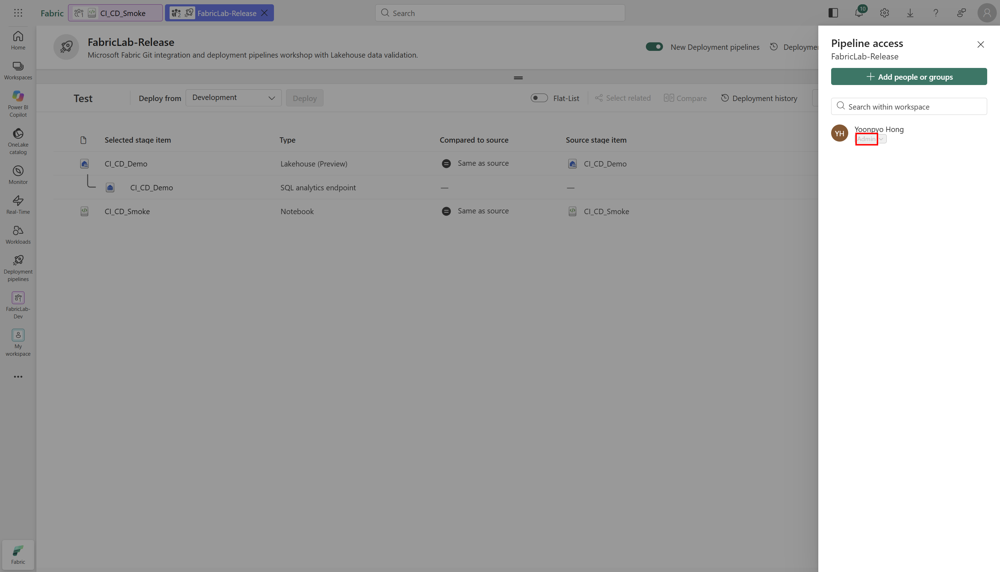
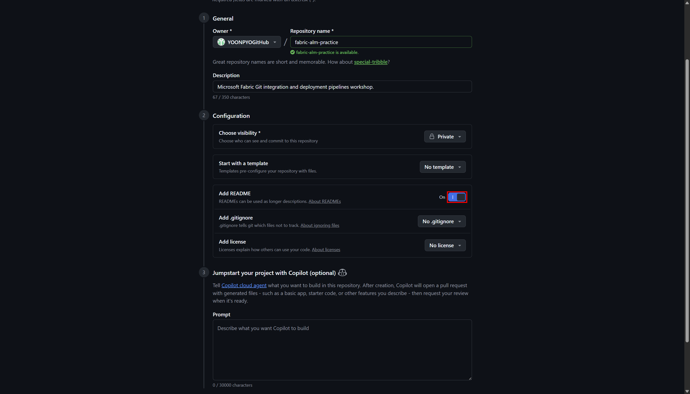

# 1. 사전 준비와 필수 설정

[처음으로](README.md) · [다음: Lakehouse + Notebook](02a-lakehouse-notebook.md)

**목표:** 기능을 사용할 수 있는 계정·Capacity·정책·권한을 먼저 준비합니다.
이미 Enabled인 설정도 확인 경로와 적용 범위를 검토하고 기록합니다.

## 1-1. 계정, 라이선스, Capacity, 역할

1. [Fabric](https://app.fabric.microsoft.com)에 로그인하고 계정 메뉴에서 tenant를 확인합니다.
2. 사용할 Capacity의 지역·SKU·Active 상태와 Workspace 할당 권한을 확인합니다.
3. 각 Workspace의 **Manage access**에서 실습 계정의 역할을 확인합니다.
4. Pipeline을 만든 뒤에는 별도로 **Manage Access**의 역할을 확인합니다.

| 작업 | 필요한 권한 / 조건 |
|---|---|
| Tenant settings 변경 | Fabric Administrator 또는 해당 설정을 위임받은 관리자 |
| Workspace 생성·Capacity 할당 | 생성 정책 허용, 해당 Capacity 사용·할당 권한 |
| Workspace Git 연결과 단계 할당 | 해당 Workspace Admin |
| Pipeline 생성·관리·단계 연결 | Pipeline Admin; Workspace Admin과 별개 |
| Notebook 배포 규칙 생성 | 규칙을 만들 대상 Notebook의 **아이템 소유자**; Workspace/Pipeline Admin만으로 대체되지 않음 |
| Git 읽기·쓰기와 PR | 해당 GitHub 저장소 권한 및 유효한 인증 |
| Notebook 실행 | Fabric Capacity와 해당 아이템·Lakehouse 접근 권한 |

Azure 구독의 Owner 역할이 Fabric Workspace/Pipeline Admin을 자동 부여하지 않습니다.
실습을 위해 Global Administrator나 조직 전체 권한을 새로 부여하지 않습니다.

**빨간 박스:** 현재 계정의 Workspace 역할입니다. `Add people or groups`로 임의의 멤버를
추가하는 단계가 아닙니다.

**기대 결과:** 각 작업의 담당자와 권한이 확인됩니다. 촬영 환경은 기존 F16을 재사용했으며
새 Capacity를 만들거나 일시 중지 상태를 임의로 해제하지 않았습니다.

## 1-2. 반드시 확인할 네 가지 Tenant settings

**현재 Learn의 기본 경로:** **OneLake catalog → Govern → Configurations → Tenant settings**.
Tenant settings에서 **Filter by keyword**로 검색합니다.

1. 좌측 **OneLake catalog**를 열고 **Govern** 탭을 선택합니다.
2. Govern의 왼쪽 메뉴에서 **Configurations**를 선택합니다.

3. **Platform → Tenant settings**를 선택하고 오른쪽 **Filter by keyword**로 설정을 찾습니다.

위 두 장은 2026-10-20 KST에 새 경로가 제공되는 것을 확인해 추가한 실제 화면입니다.
설정을 조회하기만 했으며 스위치·적용 범위는 바꾸지 않았습니다.

OneLake catalog의 Govern이 아직 제공되지 않는 지역별 rollout 환경에서는
**Settings → Admin portal → Tenant settings**를 사용합니다. 아래 각 설정의 기존 캡처는
최초 촬영 당시의 이 대체 경로입니다. 두 경로의 구분은
[공식 Tenant settings 접근 안내](https://learn.microsoft.com/en-us/fabric/admin/about-tenant-settings#how-to-get-to-the-tenant-settings)를
따릅니다. 관리자 화면에 접근할 수 없으면 담당 관리자에게 상태·적용 범위 확인을 요청합니다.

| 검색할 설정 | 확인할 사항 |
|---|---|
| **Users can create Fabric items** | Notebook·Lakehouse를 만들 실습 사용자에게 Enabled |
| **Create workspaces** | 실습 사용자에게 Workspace 생성 허용 |
| **Users can synchronize workspace items with their Git repositories** | 일반 Git 통합 허용 |
| **Users can sync workspace items with GitHub repositories** | GitHub 공급자와 실습 사용자/그룹 허용 |

### Fabric 아이템 생성

설정을 펼쳐 Enabled 상태를 확인합니다. **이미 활성화되어 있으면 변경 없이 확인만** 합니다.

### Workspace 생성

실습 사용자가 포함된 범위에 생성이 허용되어야 합니다. 아래 화면의 서비스 주체 설정과
사람이 Workspace를 만드는 설정은 서로 다릅니다.

### 일반 Git 통합

GitHub 로그인이나 PAT 발급만으로 Fabric의 Git 정책이 활성화되지는 않습니다.

### GitHub 공급자: 필요한 경우에만 그룹 한정 허용

이 설정은 최초 준비 당시 Disabled였습니다. 아래 두 장은 **같은 테넌트에서 이미 승인 후
수행한 실제 사전 구성 기록**입니다. 캡처를 위해 다시 Disabled로 바꾸지 않았습니다.

변경이 필요한 환경에서만 다음을 수행합니다.

1. 대상 tenant·GitHub 저장소·허용 범위와 메타데이터 내보내기 영향을 검토하고 승인을 받습니다.
2. Entra Security 그룹을 준비하고 실제 실습 사용자만 멤버로 포함합니다.
3. GitHub 설정을 Enabled로 바꾸고 **Specific security groups**를 선택합니다.
4. 그룹을 검색한 뒤 **검색 결과를 선택**합니다. 이름만 입력한 상태로 저장하지 않습니다.
5. 전체 조직 허용, 제외 그룹, 관리자 위임을 불필요하게 추가하지 않습니다.
6. **Apply** 후 적용 상태와 그룹 멤버를 다시 확인합니다.

촬영 환경의 그룹 이름은 `grp-fabric-alm-lab-users`이며 실습 계정 한 명만 포함했습니다.
아래는 재작성 시 다시 확인한 **현재 적용 상태**입니다.

**기대 결과:** `Enabled for a subset of the organization`과 올바른 그룹이 유지됩니다.
정책 반영에는 시간이 걸릴 수 있으므로 공식 안내의 최대 15분을 고려합니다.

GitHub에는 multi-geo 제한 스위치의 적용이 강제되지 않는다는 현재 UI·공식 문서의 안내가
있습니다. 연결 오류를 이유로 **Users can export items to Git repositories in other
geographical locations**까지 일괄 활성화하지 않습니다. 레이블이 있는 아이템의 내보내기
정책도 별도로 확인하며 임의로 완화하지 않습니다.

본 트랙은 사용자 인증을 사용합니다. 서비스 주체의 Workspace 생성 설정이나 Fabric API
설정, AI 정책을 바꾸는 단계가 아닙니다.

## 1-3. 네 개의 Workspace 생성

**경로:** **Workspaces → New workspace**. 먼저 동명 Workspace가 이미 있는지 확인합니다.

| 이름 | Description 예시 |
|---|---|
| `FabricLab-Dev` | `Microsoft Fabric CI/CD workshop - Development stage.` |
| `FabricLab-Feature` | `Microsoft Fabric CI/CD workshop - Feature development.` |
| `FabricLab-Test` | `Microsoft Fabric CI/CD workshop - Test stage.` |
| `FabricLab-Prod` | `Microsoft Fabric CI/CD workshop - Production stage.` |

1. Dev의 이름과 설명을 입력합니다.
2. **Advanced → Workspace type → Fabric**을 선택합니다.
3. **Details**에서 승인된 Capacity를 선택합니다.
4. 이름·유형·Capacity를 대조한 뒤 **Apply**를 선택합니다.

**빨간 박스:** Capacity 선택란입니다. `fb001 - Korea Central`은 촬영 환경의 이름이며,
F16 SKU와 Active 상태는 Capacity 조회로 별도 대조했습니다.

5. 같은 방식으로 Feature, Test, Prod를 생성합니다. 네 Workspace는 **모두 실제 UI로 생성**
   했고 동일한 승인 Capacity에 할당된 것을 API로도 확인했습니다.

**기대 결과:** 네 Workspace가 존재하며 실습 계정이 접근할 수 있습니다. Feature는 배포
Pipeline 단계가 아니라 Git feature branch를 검증할 Workspace입니다.

## 1-4. GitHub 저장소와 최소 범위 인증

### 새 실습의 v1 시작 상태 준비

촬영에 사용한 `YOONPYOGitHub/fabric-alm-lab`은 이미 v2 실습이 끝난 예제입니다.
기존 `main`이나 `feature/smoke-v2`를 그대로 사용해 v1 → v2 실습을 반복하지 않습니다.

1. GitHub **New repository**에서 자신의 새 실습 소스 저장소를 만듭니다.
   이 가이드는 Private을 사용하며, 이름은 다른 저장소와 구분할 수 있게 정합니다.

**빨간 박스:** 새 저장소 이름 입력란입니다. `fabric-alm-practice`는 이 추가 캡처의
입력 예시이며 완료된 촬영 저장소 `fabric-alm-lab`과 구분합니다.

2. **Add README**를 On으로 선택합니다. 화면에 따라 **Add a README file**로 표시될 수 있습니다.
   새 입력을 검토한 뒤 실제 실습에서 **Create repository**로 생성하고 기본 branch가
   `main`인지 확인합니다.
   아직 `/workshops/cicd/fabric`이나 `feature/smoke-v2`는 만들지 않습니다.
   완료된 v2 저장소를 Fork/복사해 그대로 시작하는 경로가 아닙니다.

**빨간 박스:** Add README 토글입니다. 두 추가 캡처는 생성 양식의 준비 상태이며
**촬영을 위해 Create repository를 누르거나 새 저장소를 실제로 만들지는 않았습니다.**
이미 준비한 자신의 저장소가 있다면 중복 생성하지 않습니다.

3. 실제 owner·repository URL을 기록합니다. 이후 Git 연결, PAT 범위, clone과 PR의 대상은
   모두 **이 새 저장소**입니다. 캡처의 `fabric-alm-lab`은 촬영 예시 이름입니다.
4. [Lakehouse + Notebook 장](02a-lakehouse-notebook.md)의 고정된 v1 소스에서 **코드 셀만**
   자신의 Dev Notebook에 준비하고 실제 v1 10행·합계 45를 확인합니다.
5. [Git 장](02-git-integration.md)에서 이 Dev를 새 저장소의 `main /workshops/cicd/fabric`에
   연결해 Lakehouse와 Notebook 정의를 처음 내보냅니다. Fabric이 생성한 물리/logical
   식별 정보를 예제 저장소에서 복사하거나 수동으로 바꾸지 않습니다.

이렇게 만든 자신의 v1 `main`에서 Feature branch를 생성해야 두 상수 변경이 실제 diff가 됩니다.
원본 예제의 v1 시점은 [Commit 4ea83edb](https://github.com/YOONPYOGitHub/fabric-alm-lab/tree/4ea83edb06a7d2b381ab961a1a25fb8925db6ce4)로
조회할 수 있지만, 그 Commit에는 오프라인 테스트 파일이 아직 없습니다.
테스트는 [Git 장의 별도 준비 단계](02-git-integration.md#prepare-smoke-tests)에서 추가합니다.

### 저장소 한정 인증

1. 소스 저장소와 설명용 `fabric-alm-guide`를 구분하고, 자신의 새 소스 저장소 접근 권한을 확인합니다.
2. **Settings → Developer settings → Personal access tokens → Fine-grained tokens**
   에서 필요한 경우 토큰을 발급합니다.
3. **Only select repositories**에서 **자신의 새 실습 소스 저장소 하나만** 선택합니다.
4. **Contents: Read and write**, **Metadata: Read-only**를 확인합니다.
5. 짧은 만료 기간을 사용하고 조직 승인·SSO 요구사항이 있다면 따릅니다.

위 화면은 최초 준비 기록이며 토큰 값이 아닌 범위와 권한만 보여줍니다. 촬영 환경의 토큰은
7일 만료였고, 재개 시 등록된 `YOONPYOGitHub-alm` 계정을 재사용했습니다.
현재 유효한 토큰을 캡처를 위해 재발급·교체하지 않습니다.
다만 이 계정의 토큰은 촬영 저장소 한정이므로 다른 새 저장소에 그대로 사용할 수 없습니다.
새 실습에서는 해당 새 저장소에 한정된 계정을 등록하며 기존 토큰의 범위를 임의로 넓히지 않습니다.

Fabric **Workspace settings → Git integration → GitHub → Add account**에서 Display name,
Repository URL, PAT를 입력합니다. 토큰은 해당 보안 입력란에서만 취급하고 채팅·문서·Git·로그·
화면 캡처에 남기지 않습니다. 이미 올바른 계정이 등록되어 있다면 그것을 선택합니다.

## 1-5. PR 검토를 실제로 할 수 있는지 확인

**경로:** GitHub 소스 저장소 **Settings → Branches / Rulesets**, **Collaborators**.

촬영 환경은 Private이고 owner가 Admin이지만 `main` 보호가 없었습니다. Rulesets API는
Pro 업그레이드 또는 Public 전환을 요구하는 403을 반환했습니다. 요금제 이름을 추측하거나
결제·공개 범위·협업자를 자동 변경하지 않았습니다.

따라서 이 실행에서는 **필수 리뷰가 기술적으로 강제된다고 주장하지 않습니다.**
협업자는 owner 한 명이었고 작성자의 자기 승인을 독립 리뷰어 승인으로 기록하지 않습니다.
실제 사람이 diff와 검증 근거를 검토하고 병합 의사를 표시해야 다음 단계로 갑니다.
독립 리뷰어 승인이 필요한 조직은 적절한 저장소 정책·요금제·리뷰어를 먼저 준비해야 합니다.

**체크포인트:** 네 설정, Capacity, Workspace/Pipeline 역할, source repository, 인증 범위와
검토 방식이 확인되어야 [Lakehouse 준비](02a-lakehouse-notebook.md)를 시작합니다.

---

## 다음으로 이동

| 이전 단계 | 전체 목차 | 다음 단계 |
|---|---|---|
| [← 가이드 소개](README.md) | [실습 순서](README.md#workshop-order) | [Lakehouse와 Notebook v1 →](02a-lakehouse-notebook.md) |
