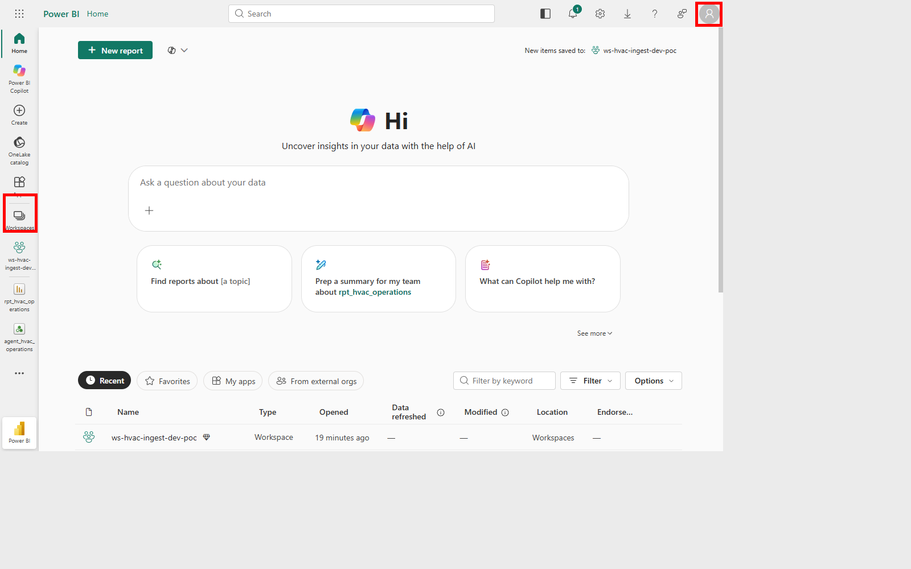
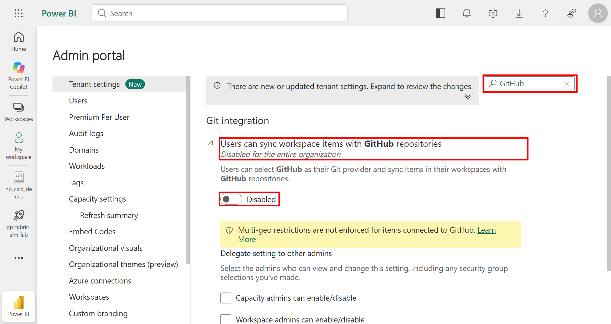
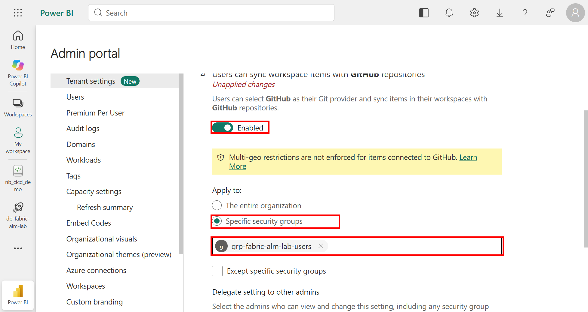
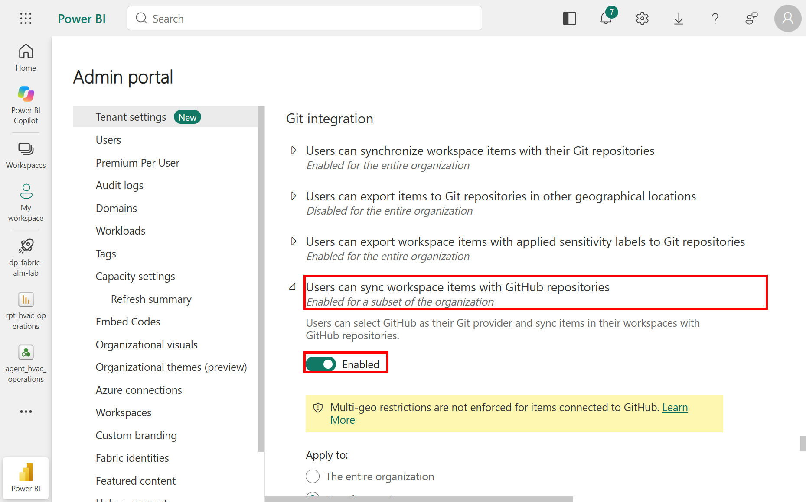
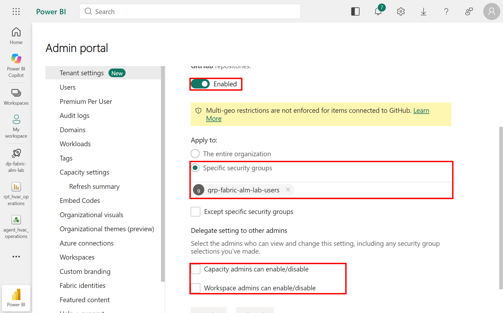
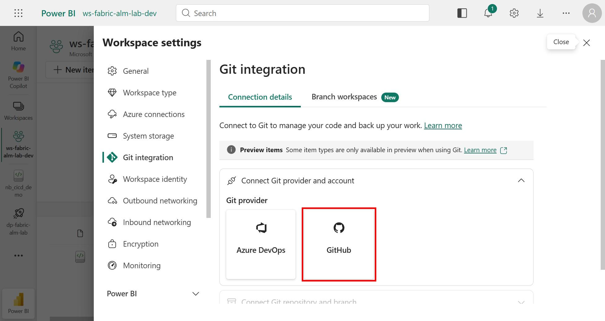
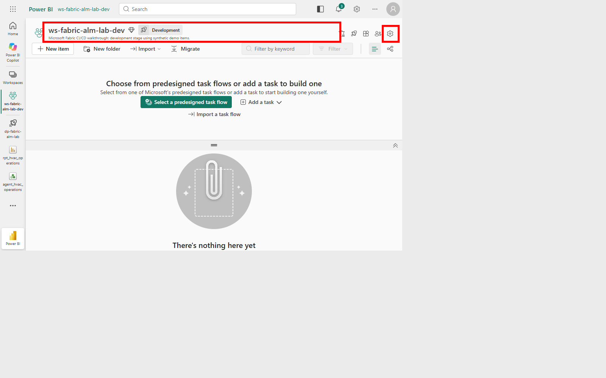
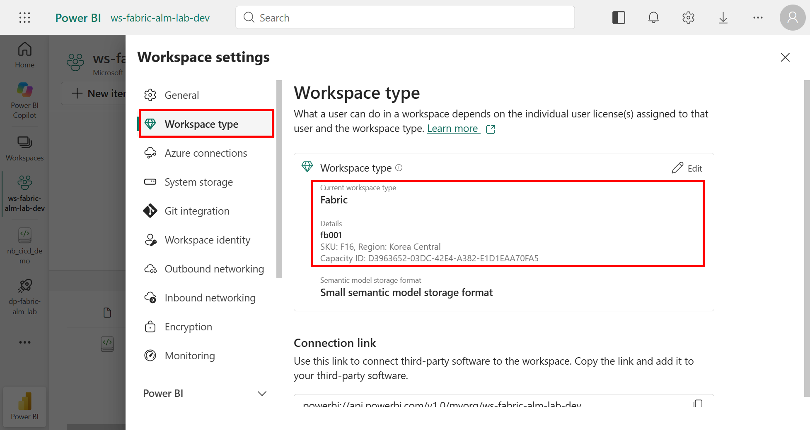
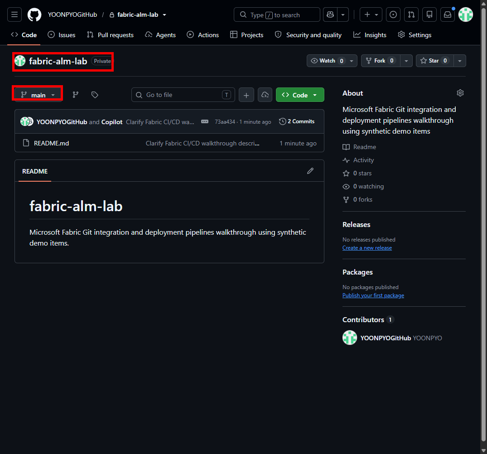
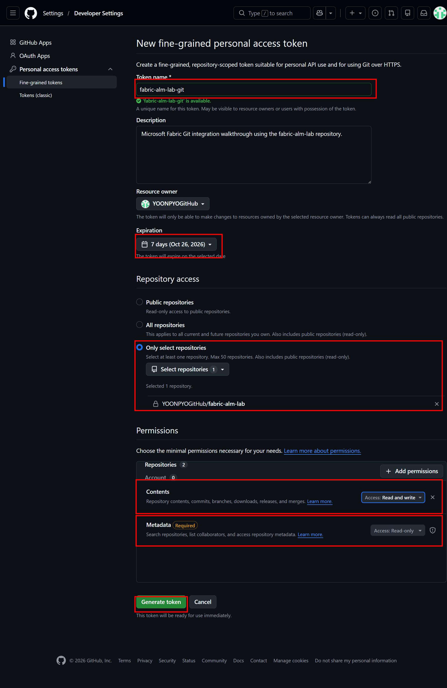

# 1. 사전 준비와 Fabric 관리자 설정

[가이드 처음으로](README.md) · [다음: Git integration](02-git-integration.md)

## 1-1. 계정과 권한 확인

**목적:** Azure 리소스 권한, Fabric 테넌트 관리, Workspace 관리, 배포 파이프라인 관리를 구분합니다.

1. [Microsoft Fabric](https://app.fabric.microsoft.com)에 로그인합니다.
2. 우측 계정 메뉴에서 사용할 계정과 테넌트를 확인합니다.
3. Workspace의 **Manage access**에서 실습 계정의 역할을 확인합니다.
4. 테넌트 설정 변경이 필요하면 Fabric 관리자에게 요청합니다.

| 작업 | 확인할 권한 / 조건 |
|---|---|
| Git 테넌트 설정 변경 | Fabric Administrator 또는 해당 설정을 위임받은 관리자 |
| Capacity 선택 | 사용할 Capacity 접근 및 Workspace 할당 권한 |
| Workspace Git 연결·해제 | Workspace Admin |
| 배포 파이프라인 관리 | Pipeline Admin; Workspace Admin과 별개 |
| Workspace 단계 할당 | 해당 Workspace Admin 및 파이프라인 관리 권한 |
| GitHub 읽기·쓰기 | 해당 저장소 접근 권한과 올바른 PAT |

Azure Subscription Owner라고 해서 Fabric Workspace Admin이 자동 부여되지는 않습니다. 이 실습을 위해 Global Administrator를 새로 부여할 필요는 없습니다. 계정 라이선스와 Capacity 요건은 [공식 시작 문서](https://learn.microsoft.com/en-us/fabric/cicd/deployment-pipelines/get-started-with-deployment-pipelines#prerequisites)를 확인합니다.

**기대 결과:** 사용할 테넌트, 계정, Capacity와 각 작업의 관리자가 확인됩니다.

## 1-2. Fabric 테넌트의 Git 설정 확인

**클릭 경로:** 우측 **Settings → Admin portal → Tenant settings**. Admin portal이 보이지 않으면 관리자에게 요청합니다.

1. **Filter by keyword**에 `GitHub`를 입력합니다.
2. **Users can sync workspace items with GitHub repositories**를 펼칩니다.
3. 현재 Enabled/Disabled 상태와 적용 범위, 관리자 위임 여부를 확인합니다.

위 캡처는 **변경 전**입니다. 승인 후 실습 그룹에 한정해 활성화했고, 변경 전후를 API로도 대조했습니다.

| 설정 | 변경 전 | 변경 후 |
|---|---|---|
| Users can synchronize workspace items with their Git repositories | Enabled | 그대로 유지 |
| Users can sync workspace items with GitHub repositories | Disabled | **Enabled: 실습 보안 그룹만 허용** |
| Users can export items to Git repositories in other geographical locations | Disabled | 그대로 유지 |

현재 공식 문서와 실제 관리자 화면은 **GitHub에 multi-geo 제한 스위치의 적용을 강제하지 않는다**고 설명합니다. GitHub 연결을 위해 cross-geo 설정까지 일괄 활성화하지 않습니다. Azure DevOps를 사용하는 경우에는 해당 지리적 위치 설정을 별도로 검토합니다.

### 실습 보안 그룹 준비

**목적:** 전체 조직에 허용하지 않고 실습 사용자에게만 기능을 제공합니다.

1. 변경할 테넌트, GitHub 저장소, 보안 그룹 범위와 메타데이터 내보내기를 검토하고 승인을 받습니다.
2. Microsoft Entra의 **Groups → New group**에서 Security 그룹을 준비합니다.
3. 이름은 `grp-fabric-alm-lab-users`, membership type은 **Assigned**로 정합니다.
4. 실습을 수행할 Fabric 사용자만 멤버로 추가합니다.
5. 그룹 ID와 실제 멤버 목록을 대조합니다. 촬영 환경은 현재 실습 계정 **한 명만** 직접 멤버입니다.

이번 그룹 생성과 멤버 추가는 Azure CLI로 수행했습니다. 포털에서도 같은 구성을 준비할 수 있습니다. 그룹을 만들 권한이 없다면 담당 관리자에게 요청하며, 이 작업을 위해 광범위한 관리자 역할을 추가하지 않습니다.

### Fabric 관리자 포털에서 그룹 한정 허용

1. 앞서 연 GitHub 테넌트 설정을 **Enabled**로 전환합니다.
2. **Apply to → Specific security groups**를 선택합니다.
3. 그룹 입력란에 `grp-fabric-alm-lab-users`를 검색하고 **검색 결과를 선택**합니다. 이름을 입력만 한 상태로 저장하지 않습니다.
4. **The entire organization**이 선택되지 않았고, 허용 그룹이 실습 그룹 하나인지 확인합니다.
5. **Except specific security groups**는 이 실습에서 선택하지 않습니다.

6. **Capacity admins can enable/disable**, **Workspace admins can enable/disable** 위임은 추가하지 않습니다.
7. **Apply**를 선택합니다.
8. 적용 후 그룹 범위가 유지되고 Apply가 비활성화되는지 확인합니다. 관리자 화면의 상태는 **Enabled for a subset of the organization**으로 바뀝니다.

9. 화면 안내에 따라 **최대 15분**의 정책 반영 시간을 고려하고 Workspace Git 화면을 새로 고칩니다.
10. GitHub 공급자가 활성화되는지 확인합니다.

**실제 결과:** GitHub 설정의 `enabled=true`와 허용 그룹 하나를 API에서 확인했고, 일반 Git·cross-geo 설정 및 관리자 위임은 변경 전과 동일했습니다. 이어서 실제 GitHub 계정 연결과 `/fabric` 최초 동기화까지 성공했습니다.

Sensitivity label이 있는 아이템은 관련 Git 내보내기 정책도 확인합니다. 연결 오류 해결을 이유로 레이블 정책을 무조건 완화하지 않습니다.

**기대 결과:** 실습 사용자에게 GitHub 공급자가 활성화됩니다. 회색으로 남아 있으면 PAT를 반복 발급하기 전에 테넌트·그룹·정책 적용 여부를 확인합니다.

## 1-3. Development / Test / Production Workspace 준비

**목적:** 단계마다 사용할 Capacity 기반 Workspace를 준비합니다.

**클릭 경로:** 좌측 **Workspaces → New workspace**.

1. 아래 이름과 설명을 입력합니다.
2. Workspace 유형을 **Fabric**으로 선택합니다.
3. 사용할 Capacity를 선택합니다. 촬영 환경은 `fb001`, F16, Korea Central입니다.
4. **Apply**로 생성합니다.
5. 나머지 두 Workspace도 같은 방식으로 준비합니다.

| 이름 | 설명 |
|---|---|
| `ws-fabric-alm-lab-dev` | `Microsoft Fabric CI/CD walkthrough: development stage using synthetic demo items.` |
| `ws-fabric-alm-lab-test` | `Microsoft Fabric CI/CD walkthrough: test stage using synthetic demo items.` |
| `ws-fabric-alm-lab-prod` | `Microsoft Fabric CI/CD walkthrough: production stage using synthetic demo items.` |

**확인 경로:** **Workspace settings → Workspace type**.

**기대 결과:** 세 Workspace에 접근할 수 있고, 사용할 Capacity가 할당되어 있습니다. Capacity가 일시 중지되어 있다면 승인된 절차로 재개해야 Notebook 실행이 가능합니다.

실제 준비에서는 Dev를 UI로 생성했고 Test/Prod는 Core REST API로 생성했습니다. 위 클릭 경로는 같은 구성을 UI에서 준비하는 방법입니다. 이미 준비된 실습 환경에서는 같은 이름의 Workspace를 다시 만들지 않습니다.

## 1-4. GitHub Private 저장소 준비

이 단계는 Fabric과 연결할 **실습 소스 저장소 `fabric-alm-lab`**을 준비합니다. 가이드 문서 저장소인 `fabric-alm-guide`와 구분합니다.

**클릭 경로:** GitHub 로그인 → **New repository**.

| 입력 | 값 |
|---|---|
| Owner | 자신의 GitHub 계정; 촬영 환경은 `YOONPYOGitHub` |
| Repository name | `fabric-alm-lab` |
| Description | `Microsoft Fabric Git integration and deployment pipelines walkthrough using synthetic demo items` |
| Visibility | **Private** |
| Initialize | README 추가, 기본 branch `main` |

**기대 결과:** 자신의 계정으로 저장소를 열 수 있습니다. 연결할 디렉터리는 `/fabric`으로 정합니다. Fabric이 생성하는 아이템 정의 파일은 Git 연결 이후 확인합니다.

2장의 로컬 편집·Push를 따라 하려면 Git을 설치하고 GitHub 인증도 준비합니다. Git Credential Manager 또는 `gh auth login` 등 승인된 방법을 사용하며, 토큰을 clone URL이나 명령행에 직접 넣지 않습니다. 로컬 Git 인증과 Fabric에 등록하는 GitHub 계정 자격 증명은 별개입니다.

## 1-5. Fine-grained PAT 최소 권한 준비

**목적:** Fabric의 GitHub 연결에 사용할 저장소 한정 자격 증명을 준비합니다. GitHub 브라우저 로그인과 Fabric Git 인증은 별개입니다.

**클릭 경로:** GitHub 우측 프로필 → **Settings → Developer settings → Personal access tokens → Fine-grained tokens → Generate new token**.

| 항목 | 입력 |
|---|---|
| Token name | `fabric-alm-lab-git` |
| Resource owner | 저장소 소유 계정 |
| Expiration | 실습에 필요한 짧은 기간; 촬영은 7일 |
| Repository access | **Only select repositories** |
| Selected repositories | **fabric-alm-lab 하나만** |
| Repository permissions | **Contents: Read and write** |
| 자동 필수 권한 | **Metadata: Read-only** |
| Account permissions | 추가하지 않음 |

1. 이름·만료일·선택 저장소·권한을 확인합니다.
2. Fabric 측 GitHub 기능 허용이 끝난 후에 토큰을 발급합니다.
3. 발급된 값은 2장의 Fabric 인증 입력란에만 안전하게 입력합니다.
4. 토큰 값이 나타난 화면은 촬영하지 않습니다.

**기대 결과:** 선택한 저장소에만 접근 가능한 만료 기한이 있는 PAT가 준비됩니다. 조직 소유 저장소라면 조직의 PAT 승인·SSO 정책도 확인합니다.

촬영 화면은 보안을 위해 **발급 전 입력 상태**입니다. 실제 실습에서는 설정 적용 후 토큰을 발급해 Fabric의 GitHub 계정 자격 증명으로 등록했습니다. 토큰 값은 출력·촬영하거나 파일에 저장하지 않았습니다. 캡처의 특정 만료일을 그대로 복사하지 말고 생성일 기준으로 정합니다. 토큰을 Markdown, Git, 실행 로그 또는 스크린샷에 저장하지 않습니다. 만료 전에는 승인된 절차로 자격 증명을 갱신하고, 실습 종료 후 불필요한 토큰은 폐기합니다.
