# 1. 사전 준비와 필수 설정

[처음으로](README.md) · [다음: Lakehouse + Notebook](02a-lakehouse-notebook.md)

**목표:** 기능을 사용할 수 있는 계정·Capacity·정책·권한을 먼저 준비합니다.
이미 Enabled인 설정도 확인 경로와 적용 범위를 검토하고 기록합니다.

이 실습은 같은 실습 계정으로 환경 구성·개발·배포를 진행합니다.
Tenant settings 변경이 필요하면 해당 권한이 있는 관리자에게 요청합니다.

## 1-1. 계정, 라이선스, Capacity 확인

1. [Fabric](https://app.fabric.microsoft.com)에 로그인하고 계정 메뉴에서 tenant를 확인합니다.
2. 사용할 Capacity의 지역·SKU·Active 상태와 Workspace 할당 권한을 확인합니다.

**기대 결과:** 사용할 tenant와 Capacity, 해당 Capacity의 할당 권한이 확인됩니다.

## 1-2. 반드시 확인할 네 가지 Tenant settings

**경로:** **OneLake catalog → Govern → Configurations → Tenant settings**.
Tenant settings에서 **Filter by keyword**로 검색합니다.

**필수 권한:** 설정을 변경하려면 Fabric Administrator 또는 해당 설정을 위임받은 관리자여야 합니다.

1. 좌측 **OneLake catalog**를 열고 **Govern** 탭을 선택합니다.
2. Govern의 왼쪽 메뉴에서 **Configurations**를 선택합니다.

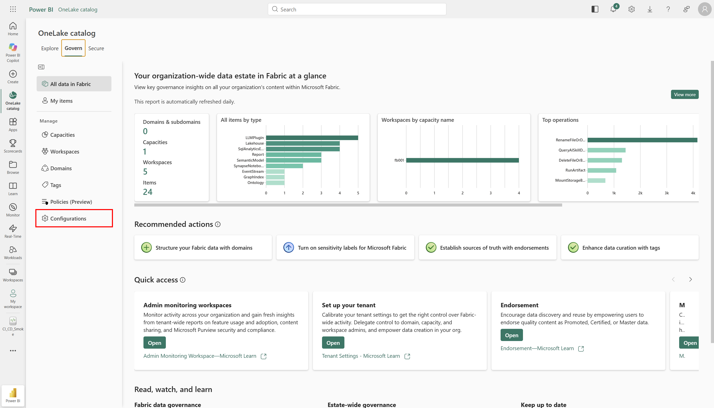

3. **Platform → Tenant settings**를 선택하고 오른쪽 **Filter by keyword**로 설정을 찾습니다.

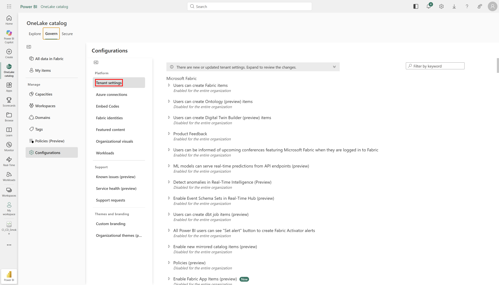

OneLake catalog의 Govern이 아직 제공되지 않는 지역별 rollout 환경에서는
**Settings → Admin portal → Tenant settings**를 사용합니다. 아래 각 설정의 기존 캡처는
이 대체 경로를 보여줍니다. 두 경로의 구분은
[공식 Tenant settings 접근 안내](https://learn.microsoft.com/en-us/fabric/admin/about-tenant-settings#how-to-get-to-the-tenant-settings)를
따릅니다. 관리자 화면에 접근할 수 없으면 담당 관리자에게 상태·적용 범위 확인을 요청합니다.

| 검색할 설정 | 확인할 사항 |
|---|---|
| **Users can create Fabric items** | Notebook·Lakehouse를 만들 실습 사용자에게 Enabled |
| **Create workspaces** | 실습 사용자에게 Workspace 생성 허용 |
| **Users can synchronize workspace items with their Git repositories** | 일반 Git 통합 허용 |
| **Users can sync workspace items with GitHub repositories** | GitHub 공급자와 실습 사용자/그룹 허용 |

### Fabric 아이템 생성

설정을 펼쳐 Enabled 상태를 확인합니다. **이미 활성화되어 있으면 변경 없이 확인만** 합니다.

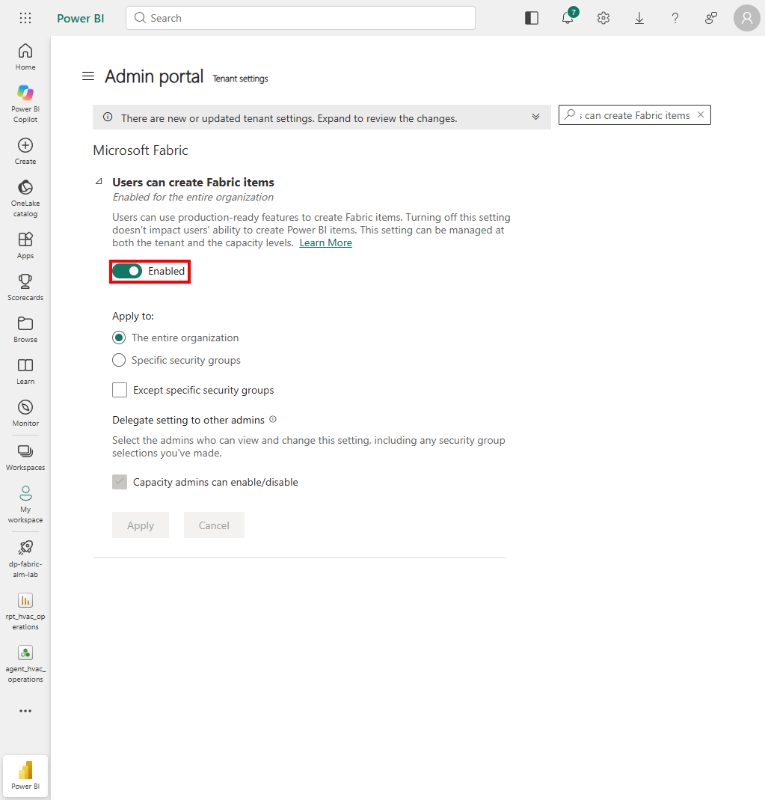

### Workspace 생성

실습 사용자가 포함된 범위에 생성이 허용되어야 합니다. 아래 화면의 서비스 주체 설정과
사람이 Workspace를 만드는 설정은 서로 다릅니다.

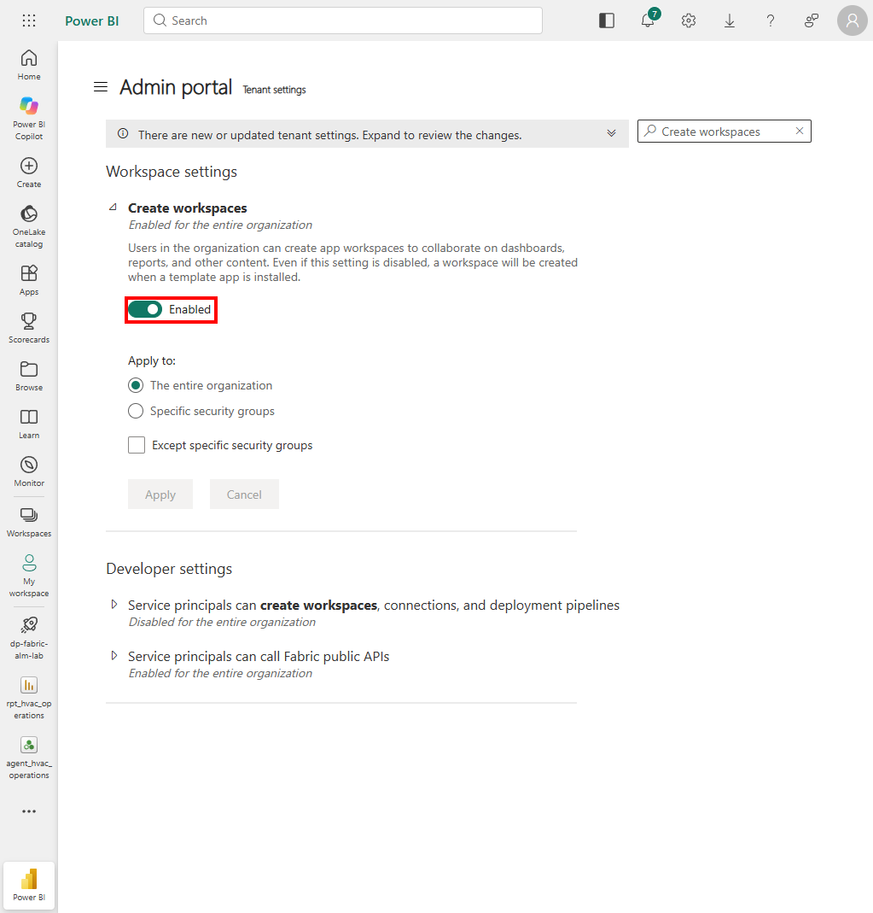

### 일반 Git 통합

GitHub 로그인이나 PAT 발급만으로 Fabric의 Git 정책이 활성화되지는 않습니다.

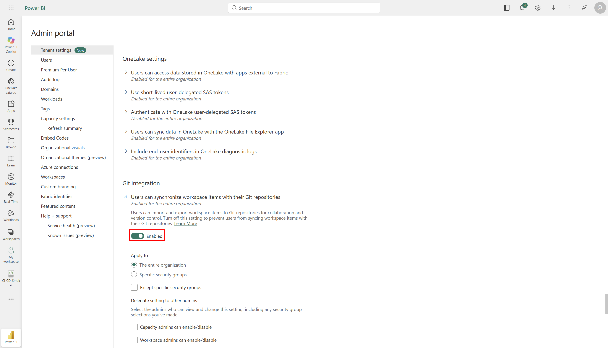

### GitHub 공급자: 필요한 경우에만 그룹 한정 허용

설정의 현재 상태와 실습 사용자에게 적용되는 범위를 확인합니다.
이미 필요한 범위에 Enabled라면 변경하지 않습니다.

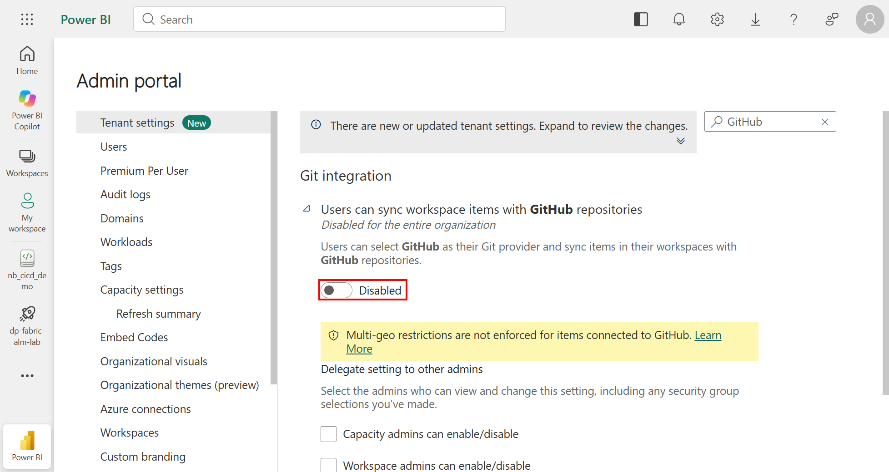

변경이 필요한 환경에서만 다음을 수행합니다.

1. 대상 tenant·GitHub 저장소·허용 범위와 메타데이터 내보내기 영향을 검토하고 승인을 받습니다.
2. Entra Security 그룹을 준비하고 실제 실습 사용자만 멤버로 포함합니다.
3. GitHub 설정을 Enabled로 바꾸고 **Specific security groups**를 선택합니다.
4. 그룹을 검색한 뒤 **검색 결과를 선택**합니다. 이름만 입력한 상태로 저장하지 않습니다.
5. 전체 조직 허용, 제외 그룹, 관리자 위임을 불필요하게 추가하지 않습니다.
6. **Apply** 후 적용 상태와 그룹 멤버를 다시 확인합니다.

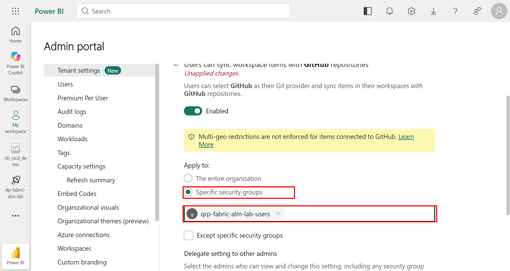

화면의 그룹 이름은 예시입니다. 자신의 승인된 보안 그룹과 실습 사용자의 멤버 포함 여부를 확인합니다.

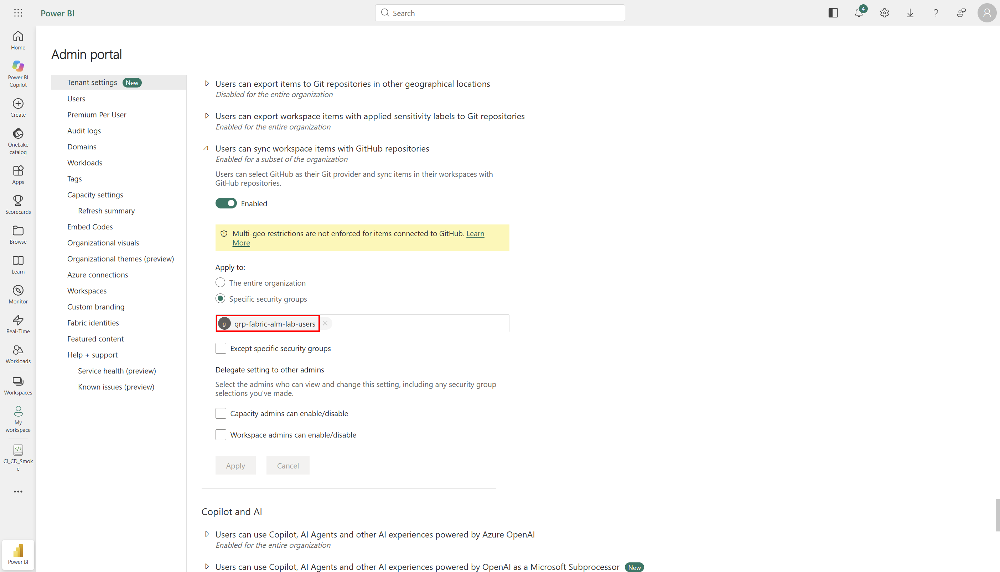

**기대 결과:** `Enabled for a subset of the organization`과 올바른 그룹이 유지됩니다.
정책 반영에는 시간이 걸릴 수 있으므로 공식 안내의 최대 15분을 고려합니다.

## 1-3. 네 개의 Workspace 생성

**경로:** **Workspaces → New workspace**. 먼저 동명 Workspace가 이미 있는지 확인합니다.

**필수 권한:** 실습 사용자에게 Workspace 생성이 허용되어 있고,
선택할 Capacity의 사용·할당 권한이 있어야 합니다.

| 이름 | Workspace 용도 | Description 예시 |
|---|---|---|
| `FabricLab-Dev` | 기본 버전 개발과 main에 병합된 변경 사항 통합 | `Microsoft Fabric CI/CD workshop - Development stage.` |
| `FabricLab-Feature` | Feature branch의 기능 변경 개발·검증 | `Microsoft Fabric CI/CD workshop - Feature development.` |
| `FabricLab-Test` | 운영 반영 전 배포와 데이터 검증 | `Microsoft Fabric CI/CD workshop - Test stage.` |
| `FabricLab-Prod` | 승인된 버전의 운영 배포와 최종 데이터 검증 | `Microsoft Fabric CI/CD workshop - Production stage.` |

1. 이름에 `FabricLab-Dev`를 입력하고, Description에는 표의 예시를 사용하거나 용도에 맞게 설명을 작성합니다.
2. **Advanced → Workspace type → Fabric**을 선택합니다.
3. **Details**에서 승인된 Capacity를 선택합니다.
4. 이름·유형·Capacity를 대조한 뒤 **Apply**를 선택합니다.

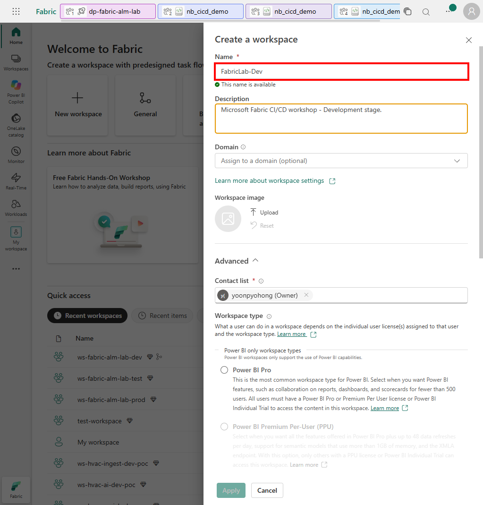

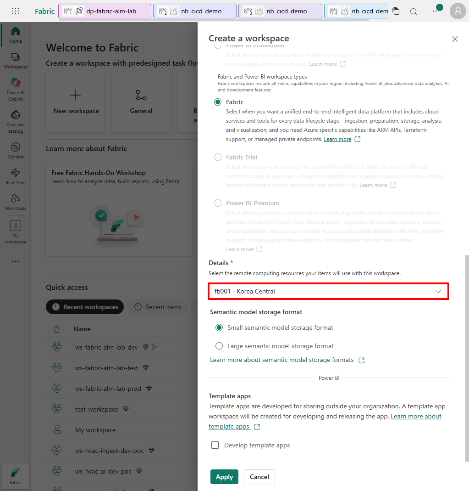

**빨간 박스:** Capacity 선택란입니다. 자신의 환경에서 사용이 승인된 Capacity를 선택합니다.
화면의 `fb001 - Korea Central`은 예시이며, 사용할 Capacity의 지역·SKU·Active 상태와
할당 권한을 확인합니다.

5. 같은 방식으로 Feature, Test, Prod를 생성하고
   각 Workspace에 올바른 Capacity가 할당되었는지 확인합니다.

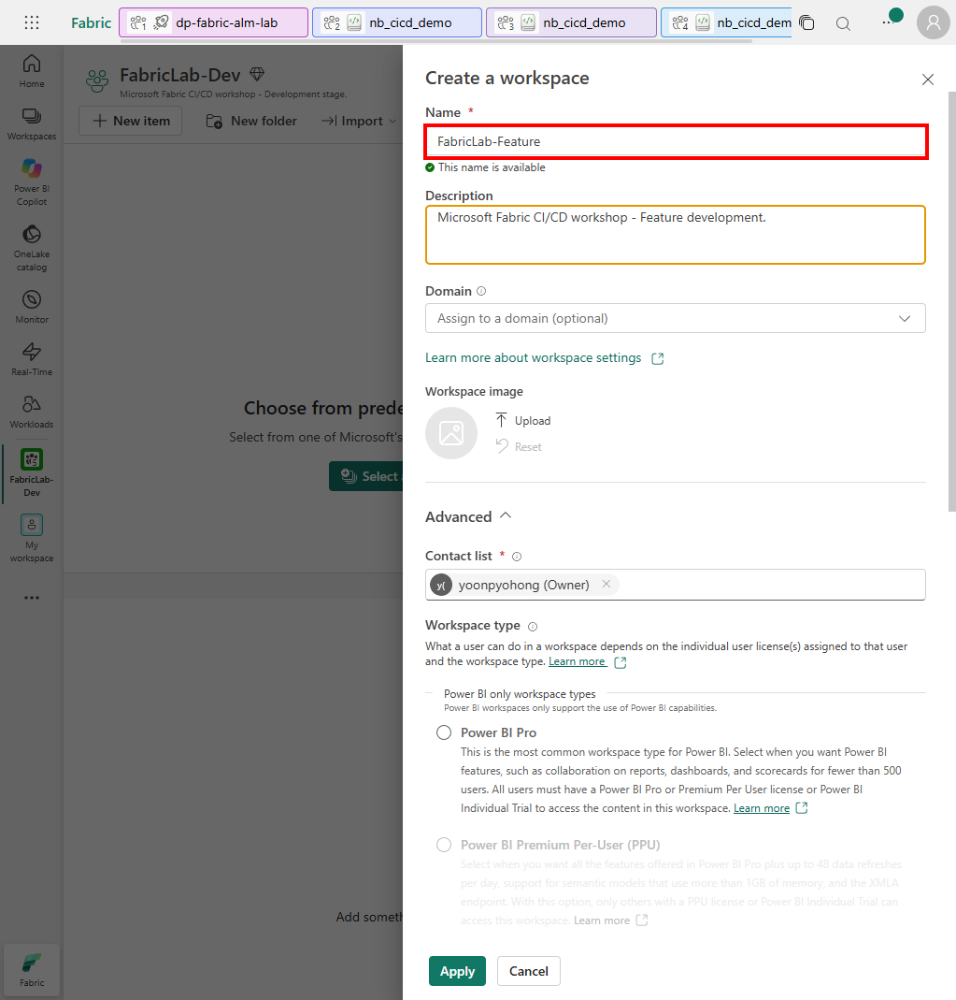

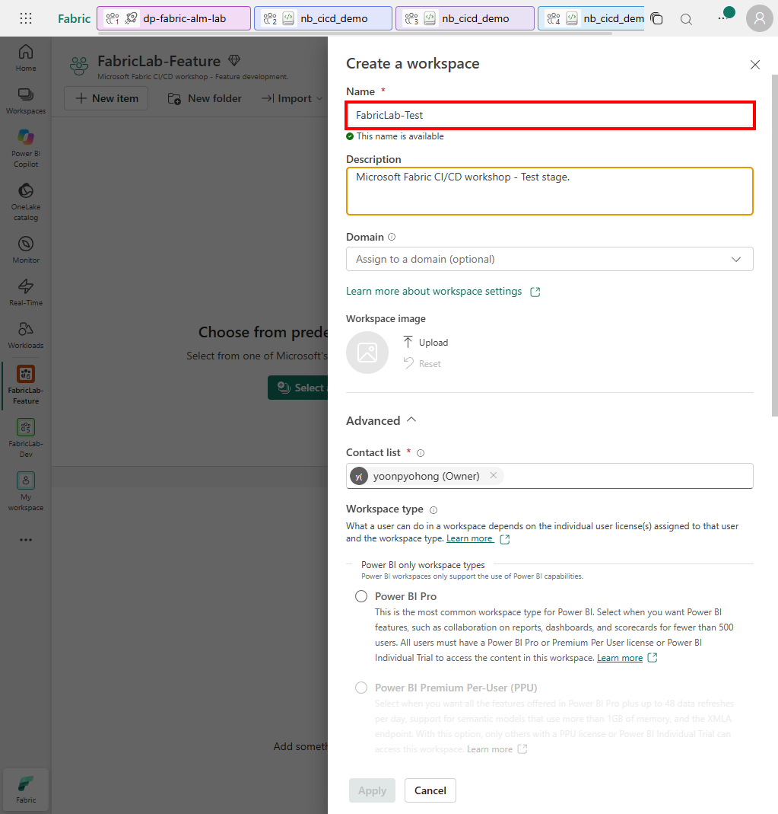

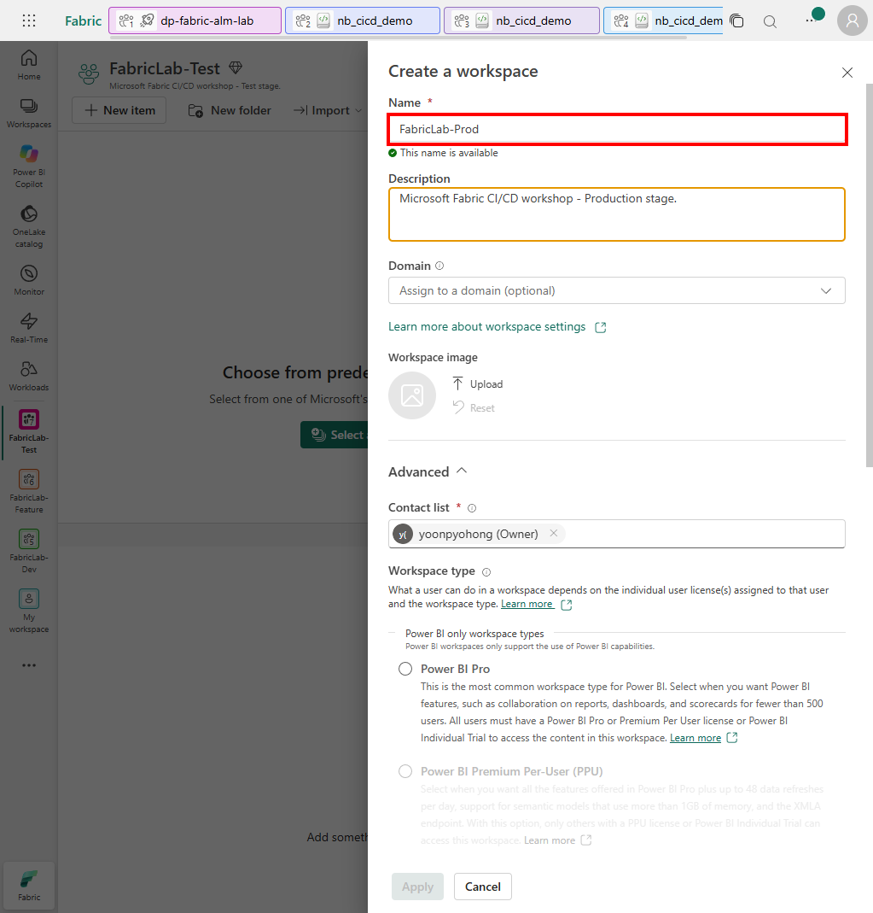

6. 생성한 네 Workspace에서 각각 **Manage access**를 열고 실습 계정이 **Admin**인지 확인합니다.

이 계정으로 Dev·Feature의 Git 연결과 Dev·Test·Prod의 Pipeline 단계 할당까지 수행하므로
네 Workspace의 Admin 역할을 확인합니다. 모든 개발자에게 Admin이 필요하다는 뜻은 아닙니다.
운영 시 담당자별 권한 구분은 [권한 구분과 운영 시 역할 분리](README.md#권한-구분과-운영-시-역할-분리)를 참고합니다.

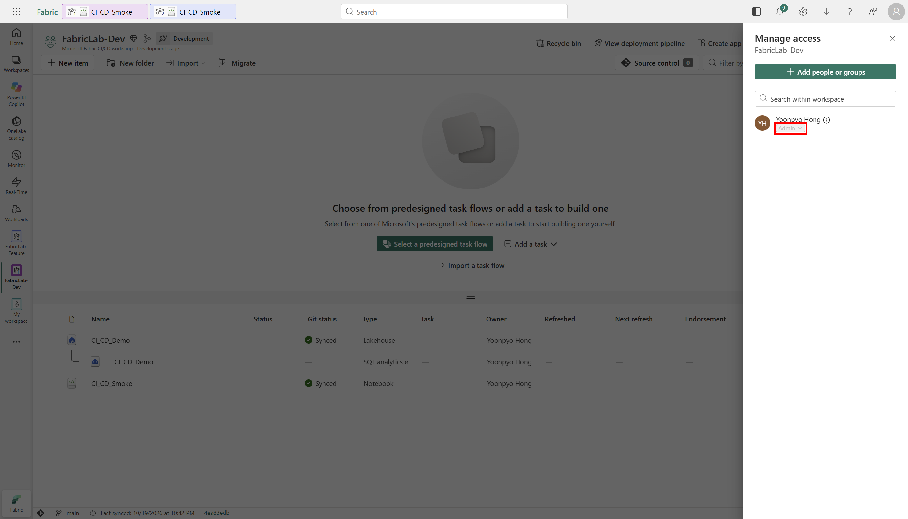

**빨간 박스:** 현재 계정의 Workspace 역할입니다. 캡처는 예시이며, 방금 생성한 각 Workspace에서
확인합니다. `Add people or groups`로 임의의 멤버를 추가하는 단계가 아닙니다.

**기대 결과:** 네 Workspace가 존재하며 실습 계정의 Workspace Admin 역할이 확인됩니다.
Feature는 배포 Pipeline 단계가 아니라 Git feature branch를 검증할 Workspace입니다.

## 1-4. GitHub 저장소와 최소 범위 인증

### 새 실습 저장소 만들기

본인 GitHub 계정에 README만 있는 새 실습용 저장소 `fabric-alm-lab`을 만듭니다.
이미 아래 조건으로 만든 자신의 새 실습 저장소가 있다면 중복 생성하지 않습니다.
다른 이름으로 만들었다면 이후에도 그 이름을 사용합니다.

1. GitHub **New repository**에서 다음과 같이 설정합니다.
   - **Repository name:** `fabric-alm-lab`
   - **Visibility:** Private
   - **Add README:** On — 화면에 따라 **Add a README file**로 표시될 수 있습니다.
2. **Create repository**를 선택합니다.
3. 생성된 저장소의 기본 브랜치가 `main`인지 확인하고 저장소 URL을 기록합니다.
   예: `https://github.com/<본인 계정>/fabric-alm-lab`

이후 Git 연결·PAT·clone·PR의 대상은 모두 **본인이 만든 이 저장소**입니다.

**기대 결과:** README가 있는 새 저장소와 `main` 브랜치가 준비됩니다.

### Fabric 연결용 GitHub 토큰(PAT) 준비

Fabric이 본인의 실습 저장소를 읽고 변경 사항을 저장할 수 있도록 인증 토큰을 준비합니다.
접근 대상은 실습 저장소 하나로 제한하며, 설명·코드를 제공하는 `fabric-alm-guide`는 선택하지 않습니다.

1. 자신의 새 실습 저장소에 접근할 수 있는지 확인합니다.
2. GitHub 개인 계정의 **Settings → Developer settings → Personal access tokens → Fine-grained tokens**
   에서 필요한 경우 토큰을 발급합니다.
3. **Only select repositories**에서 **자신의 새 실습 소스 저장소 하나만** 선택합니다.
4. **Contents: Read and write**, **Metadata: Read-only**를 확인합니다.
5. 짧은 만료 기간을 사용하고 조직 승인·SSO 요구사항이 있다면 따릅니다.

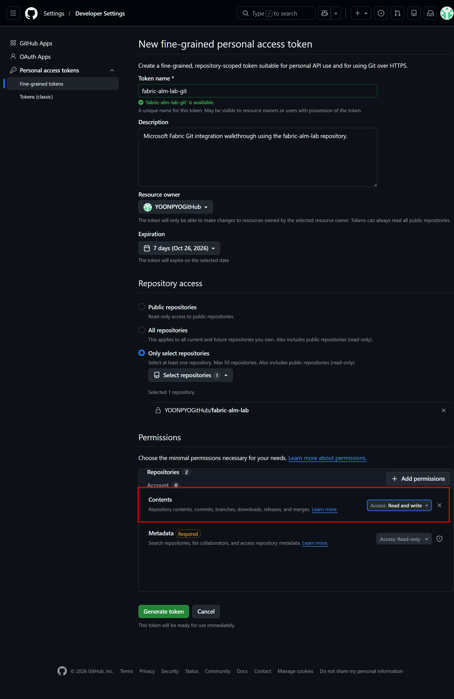

위 화면의 저장소 선택은 예시입니다. **Only select repositories**에서
자신이 만든 `fabric-alm-lab`을 선택합니다. 다른 이름으로 만들었다면 해당 저장소를 선택합니다.
**Expiration**은 토큰의 유효기간입니다. 실습 일정에 맞게 설정하며,
만료되면 해당 토큰으로 Git 동기화를 할 수 없지만 저장소나 Fabric 아이템이 삭제되지는 않습니다.

지금은 토큰 준비까지만 진행합니다. 토큰은 안전하게 보관하고 채팅·문서·Git·로그·화면 캡처에
남기지 않습니다. Fabric 등록은 [Git 연결 단계](02-git-integration.md#3-1-dev를-main의-새-git-directory에-연결)에서 진행합니다.

## 1-5. PR 검토를 실제로 할 수 있는지 확인

**경로:** GitHub 소스 저장소 **Settings → Branches / Rulesets**, **Collaborators**.

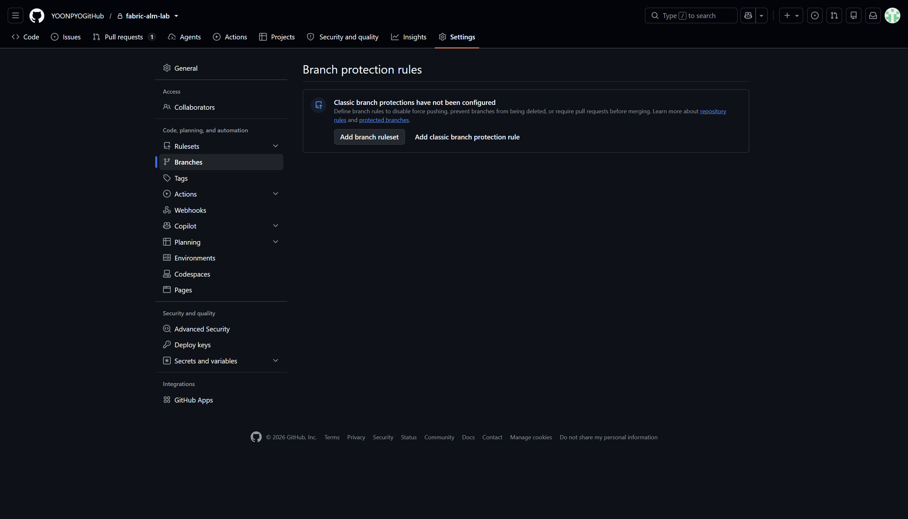

자신의 저장소에서 `main` 보호와 PR 리뷰 설정을 확인합니다.
필수 리뷰 설정의 사용 가능 여부는 GitHub 요금제와 저장소 정책에 따라 다릅니다.

보호 규칙이 없으면 **필수 리뷰가 기술적으로 강제되지 않습니다.**
작성자의 자기 검토는 독립 리뷰어 승인으로 간주하지 않습니다.
실제 사람이 diff와 검증 근거를 검토하고 병합 의사를 표시해야 다음 단계로 갑니다.
독립 리뷰어 승인이 필요한 조직은 적절한 저장소 정책·요금제·리뷰어를 먼저 준비해야 합니다.

**체크포인트:** 네 설정, Capacity, 네 Workspace의 Admin 역할, source repository, 인증 범위와
검토 방식이 확인되어야 [Lakehouse 준비](02a-lakehouse-notebook.md)를 시작합니다.

---

## 다음으로 이동

| 이전 단계 | 전체 목차 | 다음 단계 |
|---|---|---|
| [← 가이드 소개](README.md) | [실습 순서](README.md#workshop-order) | [Lakehouse와 Notebook v1 →](02a-lakehouse-notebook.md) |
