# 3. GitHub 연결, Feature branch, PR과 Dev Update

[처음으로](README.md) · [이전: Lakehouse + Notebook](02a-lakehouse-notebook.md) · [다음: 배포](03-deployment-pipelines.md)

**목표:** Workspace → Git Commit과 Git → Workspace Update를 구분하고, 실제 Feature
데이터 검증과 사람의 PR 검토를 거쳐 main에 반영합니다.

## 3-1. Dev를 main의 새 Git directory에 연결

**경로:** `FabricLab-Dev → Workspace settings → Git integration → Connection details`.

처음부터 실습하는 독자는 [자신의 새 소스 저장소](01-prerequisites.md#source-repository)를
사용합니다. 캡처의 URL은 완료된 촬영 환경 예시이며 새 실습의 연결 대상이 아닙니다.

1. GitHub를 선택합니다. 회색이면 [필수 tenant 설정](01-prerequisites.md)을 먼저 확인합니다.
2. 올바른 repository-scoped 계정을 선택하고 **Connect**를 누릅니다.
   새 계정이 필요한 경우만 Add account에서 PAT를 등록합니다.
3. Branch는 `main`, Git folder는 `/workshops/cicd/fabric`으로 지정합니다.

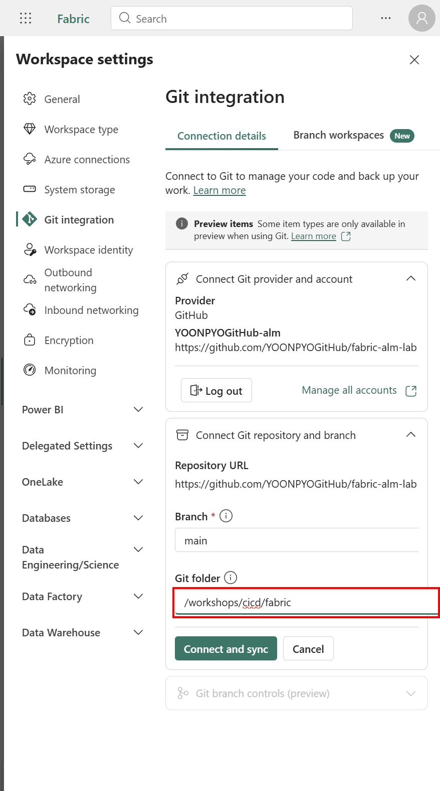

4. **Connect and sync**를 누릅니다.
5. 폴더가 없다는 확인 창에서 정확한 경로를 대조하고 **Create and sync**를 선택합니다.

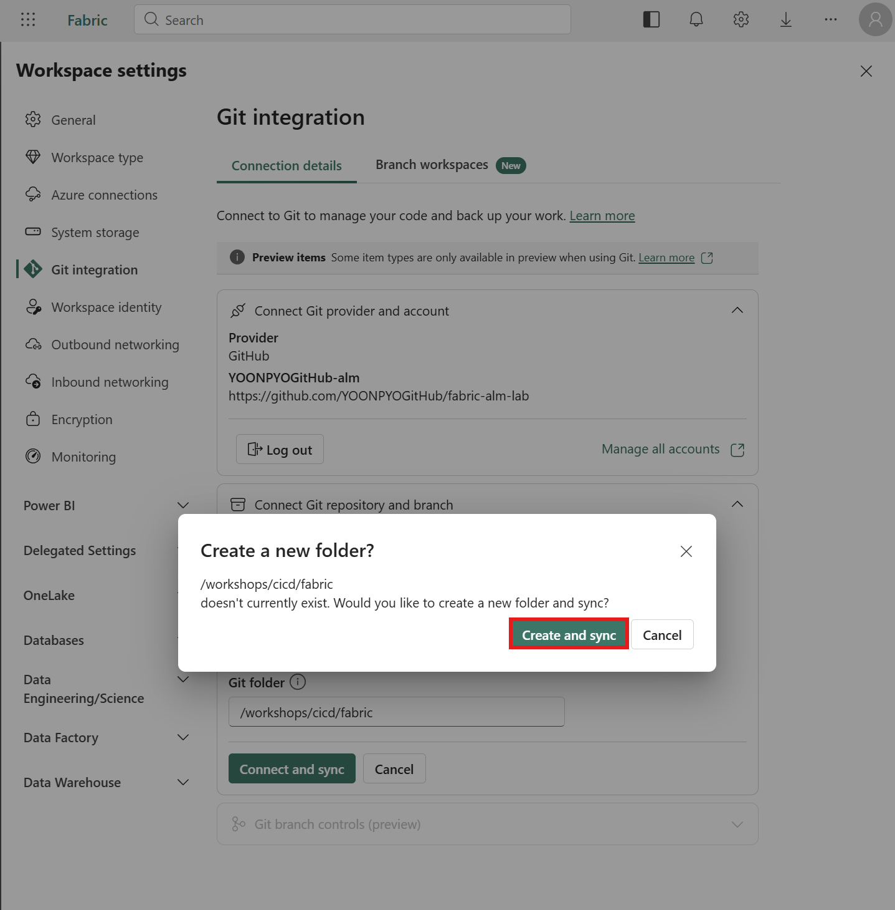

### 초기 동기화 방향을 확인

이번 Dev에는 Lakehouse와 Notebook이 있고 원격의 이 directory는 없었습니다.
실제 UI가 directory를 만든 뒤 **Workspace → Git**으로 두 정의를 커밋했습니다.
양방향 선택 창이 표시되었다고 설명하지 않습니다.

반대로 Feature처럼 Workspace가 비어 있고 Git 정의가 있으면 **Git → Workspace**가
초기 방향입니다. 양쪽에 내용이 있거나 삭제·덮어쓰기 경고가 나오면 멈춰 비교합니다.
빈 directory로 Workspace를 덮어쓰지 않습니다.

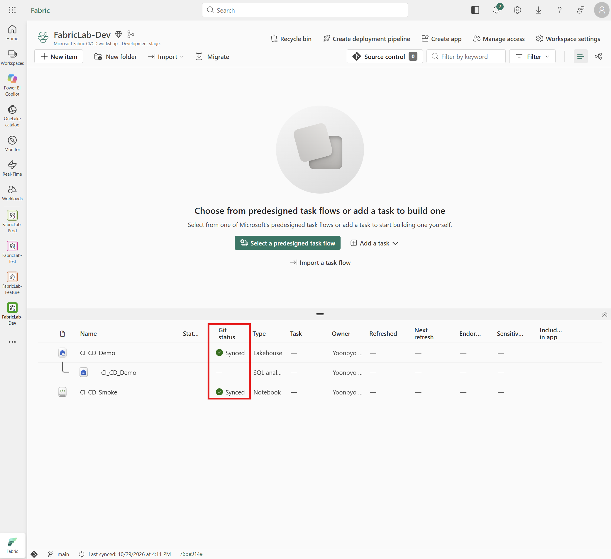

**실제 기록:** directory 생성 `f510589f`, 두 정의 최초 Commit `2398332f`.
Git에 다음 구조가 생겼습니다.

```text
workshops/cicd/fabric/
  CI_CD_Demo.Lakehouse/
    .platform
    alm.settings.json
    lakehouse.metadata.json
    shortcuts.metadata.json
  CI_CD_Smoke.Notebook/
    .platform
    notebook-content.py
```

SQL analytics endpoint는 Lakehouse가 관리하는 항목입니다. 별도 source definition이나
Delta 테이블 행을 Git에 추가하지 않습니다.

## 3-2. Git으로 분기할 때 Lakehouse 바인딩 설정

**경로:** Dev Notebook **Settings → Git settings → Git binding**.

1. **Lakehouse in new workspace**를 선택합니다.
2. 변경이 다음 Commit에 반영된다는 안내를 확인합니다.
3. Workspace로 돌아와 **Source control → Changes**를 엽니다.
4. Notebook 하나의 변경을 검토하고 Commit 메시지를 입력합니다.
5. 해당 Notebook을 선택하고 **Commit**합니다.

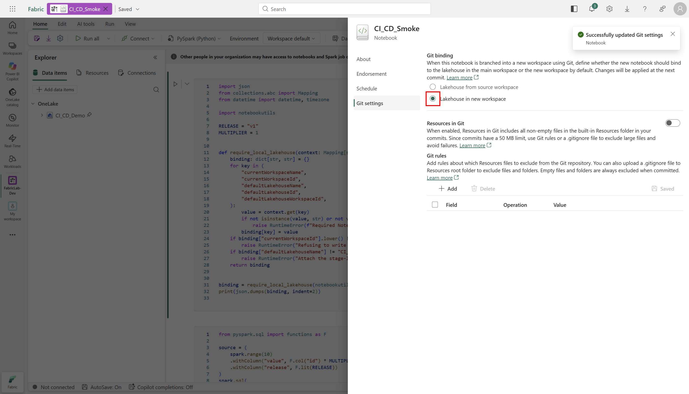

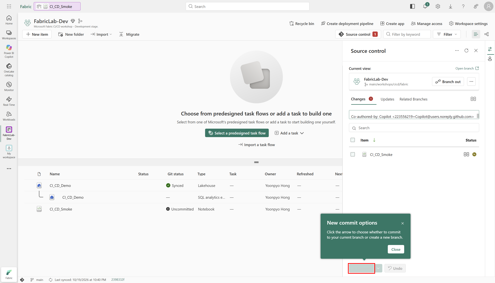

**실제 기록:** Commit `4ea83edb`. Fabric이 `notebook-settings.json`을 만들고 lakehouse
물리 ID를 logical ID로 바꾸었습니다. Workspace ID의
`00000000-0000-0000-0000-000000000000`은 이 Git 바인딩 표현의 일부이지 배포할 실제
Workspace ID가 아닙니다. 이 설정 파일이나 logical ID를 수동으로 고치지 않습니다.

Lakehouse와 Notebook을 **함께** 버전 관리하고, 동기화 후에는 실제 물리 ID가 새 환경으로
해결되었는지 다시 확인합니다. 설정이 on이라는 사실만으로 안전한 바인딩이 증명되지는 않습니다.

## 3-3. Feature branch와 Feature Workspace

**경로:** GitHub 소스 저장소 **Branches → New branch**.

1. Source가 최신 `main`인지 확인합니다.
   새 실습의 main에는 앞 절에서 내보낸 **v1·MULTIPLIER=1**이 있어야 합니다.
   이미 v2라면 아래 변경을 반복하지 말고 새 실습의 시작 상태를 확인합니다.
2. 새 이름 `feature/smoke-v2`를 입력하고 **Create new branch**를 선택합니다.

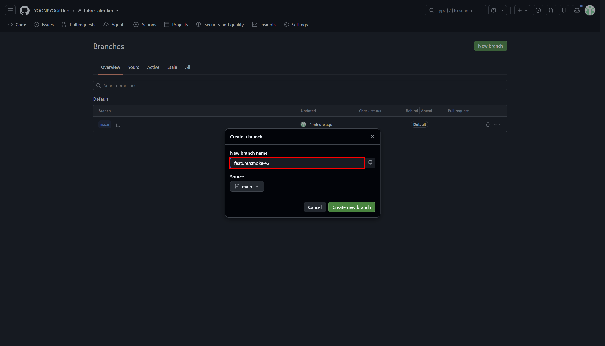

**실제 기록:** 새 branch의 시작 Commit이 `4ea83edb`와 같음을 API로 대조했습니다.
오래 열린 GitHub 화면의 오래된 Commit을 분기 기준으로 추측하지 않습니다.

3. `FabricLab-Feature → Workspace settings → Git integration`을 엽니다.
4. 같은 repository-scoped 계정을 선택합니다.

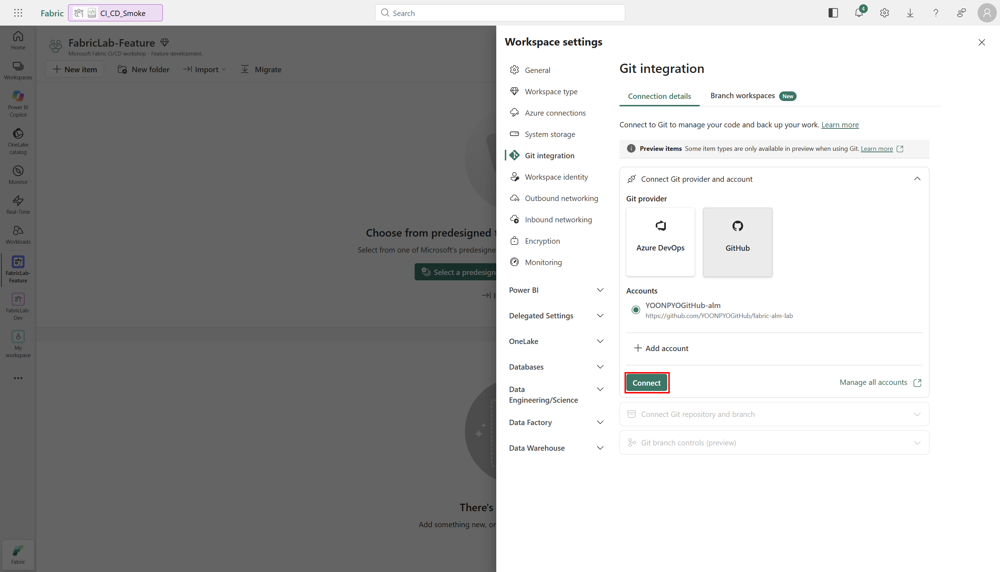

5. `feature/smoke-v2`, `/workshops/cicd/fabric`에 연결합니다.
6. 비어 있는 Workspace에 Git의 Lakehouse와 Notebook 정의를 가져옵니다.

**실제 수행 방식:** 계정 선택 준비는 UI로 했고 Feature의 연결·초기화·첫 Update는
공식 Core Git API로 수행했습니다. UI branch 목록이 새 branch를 즉시 반영하지 않아,
동일하게 승인된 기존 connection을 재사용했습니다. UI에서 이 연결을 확정했다고 기록하지 않습니다.

API를 사용할 때도 다음 순서와 검증을 지킵니다.

```text
GET  /v1/workspaces/{devWorkspaceId}/git/myGitCredentials
GET  /v1/workspaces/{featureWorkspaceId}/git/connection
POST /v1/workspaces/{featureWorkspaceId}/git/connect
POST /v1/workspaces/{featureWorkspaceId}/git/initializeConnection
POST /v1/workspaces/{featureWorkspaceId}/git/updateFromGit
GET  /v1/workspaces/{featureWorkspaceId}/git/status
```

- `connect`: 실제 owner/repository, feature branch, directory와 기존 connection ID를 전달합니다.
- `initializeConnection`: `requiredAction=UpdateFromGit`인지 확인합니다.
- Update에는 조회한 `workspaceHead`, `remoteCommitHash`를 사용합니다. 임의 SHA를 만들지 않습니다.
- 202이면 `x-ms-operation-id`로 canonical operations API에서 완료를 확인합니다.
  결과 본문이 없는 성공 작업에 `/result`를 무조건 요구하거나 작업을 중복 제출하지 않습니다.
- 최종 `ConnectedAndInitialized`, 같은 원격/Workspace SHA와 변경 목록 0을 확인합니다.

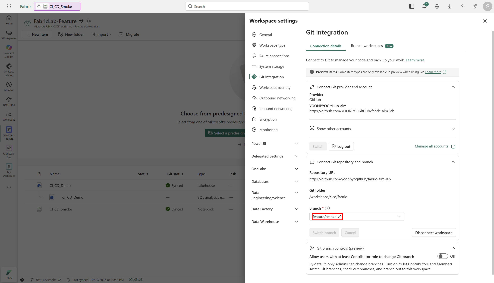

**실제 확인:** 가져온 v1 전체 코드 AST는 Dev v1과 같았고, Notebook의 물리 기본 Lakehouse는
Feature 자체 Lakehouse로 해결되었습니다. Dev의 Lakehouse를 가리키지 않았습니다.

## 3-4. Feature에서 v2 변경·검증

이번 코드 변경은 **로컬 Git 편집·Commit·Push**로 수행했습니다. Fabric 셀 출력이나
다운로드한 실행 결과를 편집한 것이 아닙니다.

### 자신의 v1 Feature branch를 clone

아래 URL의 `<YOUR_OWNER>/<YOUR_LAB_REPOSITORY>`를
[1-4에서 만든 자신의 새 저장소](01-prerequisites.md#source-repository)로 바꿉니다.
Git/Python 3.12 이상이 필요하며 Private 저장소는 GitHub 인증도 준비해야 합니다.
`fabric-alm-workshop`은 새 로컬 디렉터리 예시입니다.

```bash
git clone https://github.com/<YOUR_OWNER>/<YOUR_LAB_REPOSITORY>.git fabric-alm-workshop
cd fabric-alm-workshop
git switch feature/smoke-v2
git grep -n -E '^(RELEASE|MULTIPLIER) =' -- workshops/cicd/fabric/CI_CD_Smoke.Notebook/notebook-content.py
```

**변경 전 기대 값:** `RELEASE = "v1"`, `MULTIPLIER = 1`입니다.
두 줄이 이미 v2/2이면 여기서 멈춥니다. 촬영 예제의 현재 `main`과 `feature/smoke-v2`는
이미 v2이므로 단순 clone만으로는 새 v1 → v2 변경이나 PR을 만들 수 없습니다.

<a id="prepare-smoke-tests"></a>

### 오프라인 테스트 파일을 먼저 준비

초기 Fabric Git export는 아이템 정의만 만들며 테스트 코드를 만들어 주지 않습니다.
촬영 환경의 v1 Commit `4ea83edb`에도 `workshops/cicd/tests`는 없습니다.

1. [고정 버전의 테스트 원본](https://github.com/YOONPYOGitHub/fabric-alm-lab/blob/53f7908feff72e13754fbbbdc9f65ca2b5d93fec/workshops/cicd/tests/test_smoke_contract.py)을
   엽니다. 이 Private 예제 저장소에 접근 권한이 필요합니다.
2. GitHub의 **Download raw file**로 Python 파일을 받아, 자신의 로컬 소스 저장소에
   `workshops/cicd/tests` 디렉터리를 만들고 **`test_smoke_contract.py`**로 저장합니다.
   GitHub HTML 페이지를 `.py`로 저장하지 않습니다. 예제의 Notebook 정의·`.platform`·
   `notebook-settings.json`을 이 과정에서 복사하거나 교체하지 않습니다.


**빨간 박스:** 파일 상단 **Raw 오른쪽의 아래쪽 화살표(Download raw file)**입니다.
화면의 `53f7908` Commit과 `test_smoke_contract.py` 이름을 확인한 뒤 선택합니다.
이 캡처는 다운로드 버튼의 위치를 보여주며, HTML 페이지의 저장이나 예제 파일 편집을
지시하는 화면이 아닙니다.

3. 새 로컬 소스 저장소의 루트에서 다음을 실행해 **v1 상태로도 9개 테스트가 통과**하는지 확인합니다.

```bash
python -m unittest discover -s workshops/cicd/tests -v
```

이 테스트는 소스의 v1/1과 v2/2를 모두 검사할 수 있으며, 현재 저장소의 Lakehouse logical ID와
Notebook Git binding을 대조합니다. 추가 패키지나 클라우드 인증 없이 수행됩니다.
파일이 없거나 테스트 개수가 0이면 검증 완료로 처리하지 않습니다.

이 원본 다운로드에 필요한 예제 저장소의 읽기 권한과 Fabric에 등록한 **새 실습 저장소 한정
PAT**는 별개입니다. 원본을 받으려고 Fabric PAT의 저장소 범위를 넓히지 않습니다.

### v2 변경·검사·Push

`workshops/cicd/fabric/CI_CD_Smoke.Notebook/notebook-content.py`에서 아래 두 상수만 바꿉니다.
Fabric metadata·셀 구분·검증 로직은 보존합니다. 추가한 테스트 파일은 함께 버전 관리합니다.

```python
RELEASE = "v2"
MULTIPLIER = 2
```

1. 소스 저장소의 오프라인 검사를 수행합니다.

```bash
python -m unittest discover -s workshops/cicd/tests -v
git diff --check
```

2. 아래 두 파일만 Commit하고 feature branch로 Push합니다. main에 직접 v2를 Push하지 않습니다.

```bash
git add workshops/cicd/fabric/CI_CD_Smoke.Notebook/notebook-content.py workshops/cicd/tests/test_smoke_contract.py
git commit -m "Validate stage-local Delta smoke data for release v2"
git push origin feature/smoke-v2
```

테스트 실행으로 생긴 `__pycache__`나 토큰·로컬 설정을 Commit하지 않습니다.
3. Feature의 **Source control → Updates**에서 변경을 검토하고 **Update all**을 누릅니다.

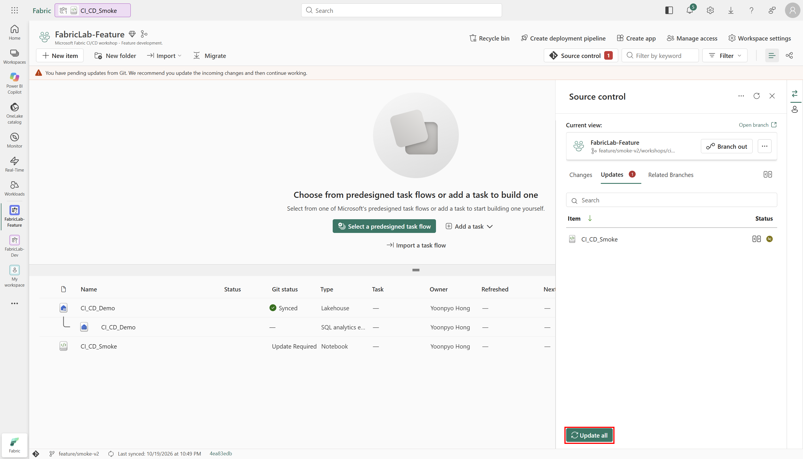

4. `Synced`, Workspace/원격 SHA 일치와 변경 목록 0을 확인합니다.
5. 내보낸 Notebook 전체 코드가 Git v2와 같고 기본 Lakehouse가 여전히 Feature인지 대조합니다.
6. Feature Notebook을 실행해 실제 Delta 데이터를 다시 읽어 검증합니다.

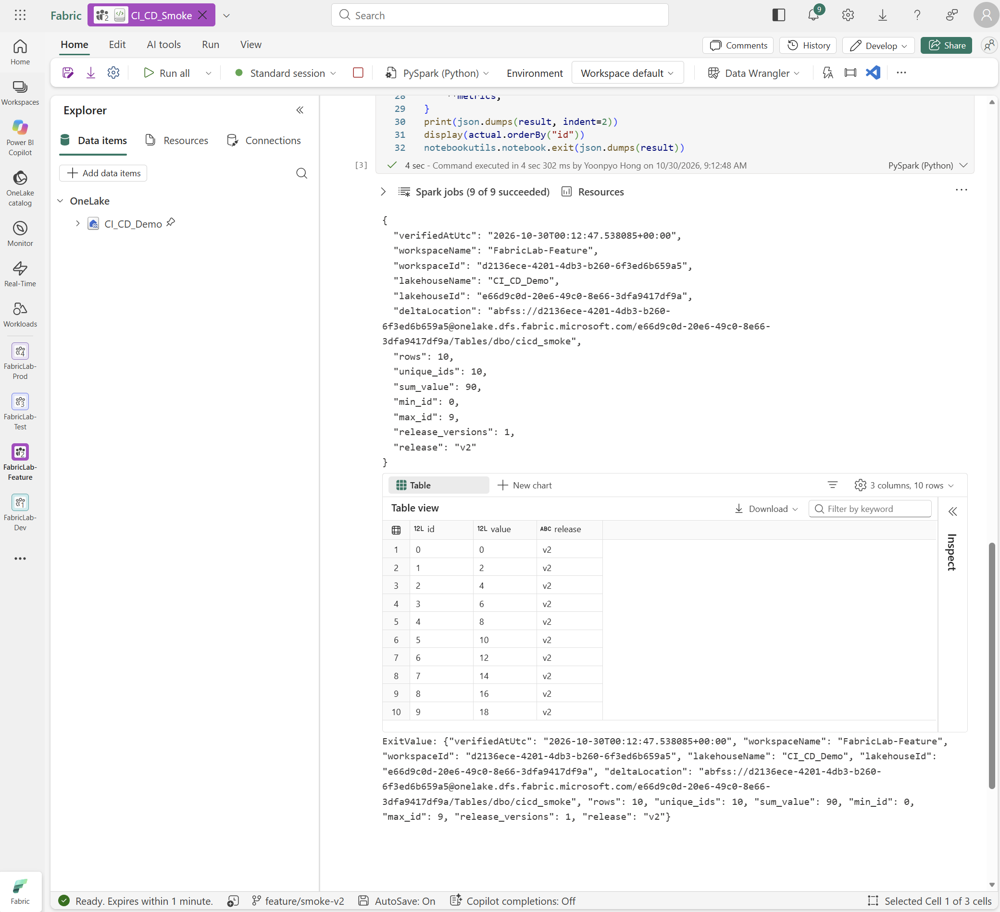

**실제 기록:** feature HEAD `09b03c28`, unittest 9개·Ruff·Pyright 통과.
UI Update 후 실제 실행 스냅샷에서 10행·유일한 ID 0–9·모든 행 값과 release·합계 90을 확인했습니다.
실행은 Job Scheduler API였으며 UI의 Run all로 실행한 것으로 기록하지 않습니다.

## 3-5. 실제 Pull request와 사용자 승인

**경로:** GitHub **Compare & pull request**, base `main`, compare `feature/smoke-v2`.

1. 제목·변경 이유·오프라인 결과·Feature 실제 데이터 결과·바인딩 근거를 적습니다.
2. base와 compare 방향, 바뀐 두 상수와 테스트·문서 변경을 확인합니다.
3. **Create pull request**를 선택합니다. 이 버튼은 merge가 아닙니다.

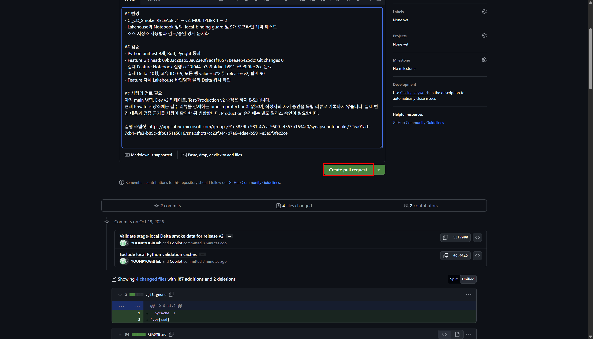

4. **Files changed**에서 코드·metadata·테스트·문서를 검토합니다.

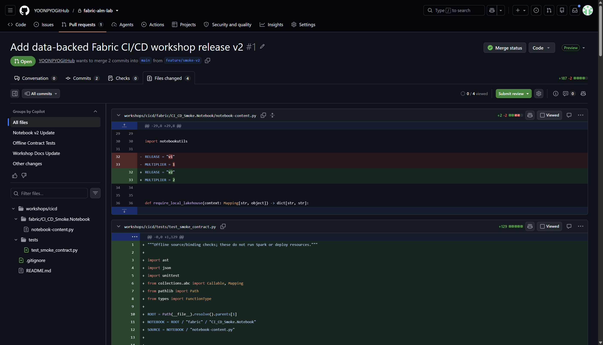

GitHub Checks는 구성하지 않았습니다. 오프라인 검사를 GitHub 필수 status check가 통과한
것으로 표현하지 않습니다.

검토자가 diff와 검증 근거를 확인하고 실제 병합 승인을 남겨야 합니다. 저장소 정책이
독립 리뷰어 승인을 요구한다면 별도의 적격 리뷰어가 필요합니다. 승인 요청에 응답이 없으면
대기하며 자동 승인·작성자의 자기 승인을 독립 리뷰로 기록하지 않습니다.

**PR 생성 후 이동:** 처음 진행한다면 v1 초기 배포를 마친 뒤 아래 승인·병합 단계로 돌아옵니다.

| 다음 단계 | v1 초기 준비를 이미 마친 경우 |
|---|---|
| [Pipeline 생성·Test v1 초기 배포로 이동 →](03-deployment-pipelines.md#baseline-preparation) | [승인·PR 병합·Dev Update로 바로 이동 ↓](#merge-and-dev-update) |

<a id="merge-and-dev-update"></a>

### 이번 실습의 승인과 실제 병합

**실행 순서 체크포인트:** PR을 만든 직후에는 main이 아직 v1입니다. 실제 순서대로
재현하려면 여기서 [Pipeline의 4-1~4-6 v1 초기 준비](03-deployment-pipelines.md#baseline-preparation)를
마친 뒤 이 승인·병합 절로 돌아옵니다. 이미 main을 v2로 업데이트했다면 v1 절은 과거 실행
기록으로 읽으며, v1을 재현하려고 임의로 코드를 되돌리지 않습니다.

Feature의 실제 10행·합계 90과 PR을 제시한 뒤 사용자에게 main 병합과 Dev/Test v2 검증
진행을 요청했고, 사용자가 대화에서 **“그래 계속 진행해”**라고 승인했습니다.
이것은 사용자의 진행 승인이지 별도의 독립 GitHub 리뷰어가 남긴 APPROVED review가
아닙니다. 그 구분과 Production 별도 승인 범위를
[실제 PR 댓글](https://github.com/YOONPYOGitHub/fabric-alm-lab/pull/1#issuecomment-6269675248)에 기록했습니다.

1. 승인 대상 HEAD `09b03c28`와 baseline main `4ea83edb`가 바뀌지 않았는지 확인했습니다.
2. **Merge pull request**를 선택했습니다.

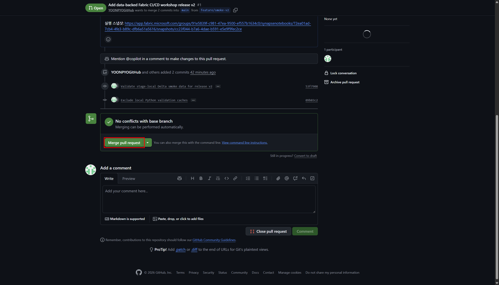

3. Commit message와 설명에 승인 범위와 독립 리뷰와의 구분을 적고 **Confirm merge**했습니다.


4. 실제 merge SHA와 두 parent, 병합 상태를 API로도 대조했습니다.

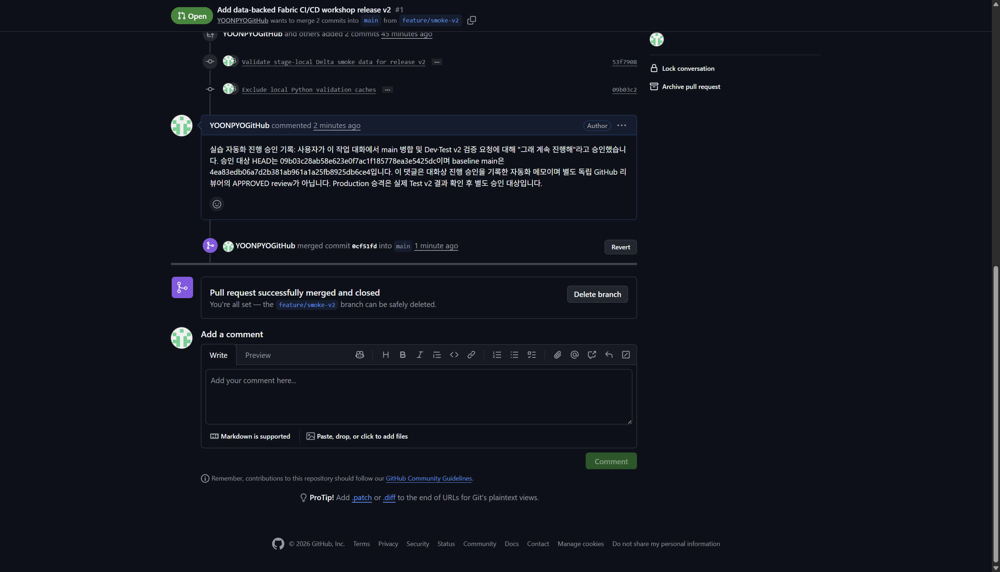

**실제 결과:** [소스 PR](https://github.com/YOONPYOGitHub/fabric-alm-lab/pull/1)은 Merged이며
merge Commit은 `0cf51fdfff638952d1b72685574fd369646694e2`입니다. 병합된 Fabric 정의는
승인한 Feature 정의와 같고 이전 source directory는 바뀌지 않았습니다.
Feature Workspace가 연결된 branch를 임의로 삭제하지 않았습니다.

## 3-6. 병합 후 Dev Update와 실제 v2 실행

1. GitHub에서 실제 merge Commit SHA를 기록합니다.
2. Dev의 Git 연결이 `main /workshops/cicd/fabric`인지 확인합니다.
3. `FabricLab-Dev → Source control → Updates`에서 변경을 검토합니다.
4. 충돌·삭제·로컬 미커밋 변경이 없는지 확인하고 **Update all**을 선택합니다.

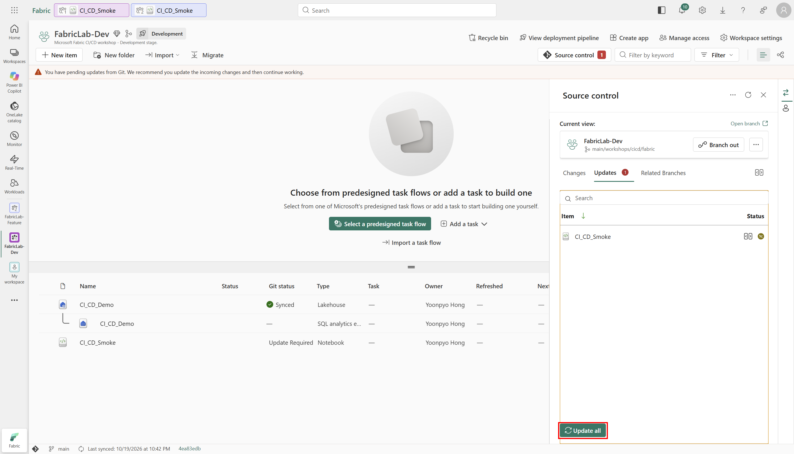

5. Dev의 Git HEAD가 실제 main과 같고 변경 목록이 비었는지 확인합니다.
6. Dev 코드가 v2이며 물리 기본 Lakehouse는 Dev인지 확인합니다.
7. Dev에서 실제 10행·합계 90을 검증한 후 [v2 Test 배포](03-deployment-pipelines.md#release-v2)를 진행합니다.

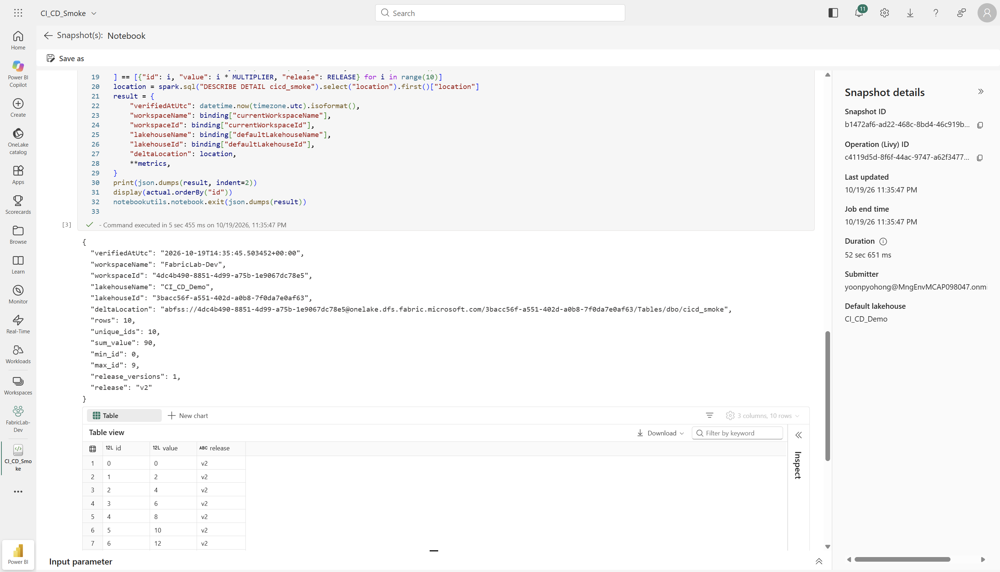

**실제 결과:** UI Update 후 Dev/원격 HEAD가 `0cf51fd`로 일치했고 변경 목록은 비었습니다.
내보낸 전체 코드 AST가 merge Commit의 정의와 같고 물리 기본 Lakehouse는 Dev인 것을
확인한 뒤 API로 실행했습니다. 실제 테이블의 모든 v2 행과 10행·합계 90을 확인했습니다.

Feature HEAD와 merge Commit SHA는 다를 수 있습니다. 버전 문자열 하나나 Saved 표시만 보지
말고 실제 코드와 branch HEAD, 환경별 물리 바인딩을 각각 대조합니다.

---

## 다음으로 이동

Dev v2 검증을 마쳤다면 초기 배포 설명을 다시 읽지 않고 **4-7의 Test v2 배포**로 이동합니다.

| 이전 단계 | 전체 목차 | 다음 단계 |
|---|---|---|
| [← Lakehouse와 Notebook v1](02a-lakehouse-notebook.md) | [실습 순서](README.md#workshop-order) | [Test v2 배포·Production 승격 →](03-deployment-pipelines.md#release-v2) |
