# 2. GitHub 연결, Commit, Update from Git

[가이드 처음으로](README.md) · [이전: 사전 준비](01-prerequisites.md) · [다음: Deployment pipelines](03-deployment-pipelines.md)

**실제 수행:** GitHub 기능 그룹 한정 허용 → 계정 등록 → 최초 동기화 → Workspace에서 v1.1 Commit → Git에서 v2 Push → Fabric Update를 수행했습니다. 각 단계의 실제 화면과 Commit을 아래에서 확인합니다.

## 2-1. Workspace에서 Git 공급자 상태 확인

**목적:** GitHub 인증보다 먼저 Fabric의 공급자 허용 상태를 확인합니다.

**클릭 경로:** `ws-fabric-alm-lab-dev` → **Workspace settings → Git integration → Connection details**.

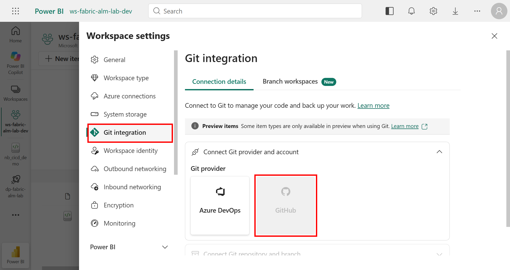

위 화면은 **변경 전**입니다. 공급자에 `Contact an admin to allow this Git provider.` 안내가 있었고, REST API의 연결 상태도 `NotConnected`였습니다. [사전 구성의 실제 그룹 한정 허용 절차](01-prerequisites.md#1-2-fabric-테넌트의-git-설정-확인)를 수행한 뒤 GitHub가 활성화되었습니다.

**기대 결과:** GitHub를 선택할 수 있어야 합니다. 선택할 수 없으면 [테넌트 설정 단계](01-prerequisites.md#1-2-fabric-테넌트의-git-설정-확인)에서 멈춰 해결합니다. GitHub 로그인 성공만으로 이 차단이 해제되지는 않습니다.

## 2-2. GitHub 계정 연결

**목적:** Fabric에 저장소 한정 GitHub 인증을 등록합니다.

1. Git provider에서 **GitHub**를 선택합니다.
2. **Add account**를 선택합니다. 이미 등록한 계정이 있다면 올바른 계정인지 확인합니다.
3. Display name에 식별 가능한 이름을 입력합니다. 촬영 환경은 `YOONPYOGitHub-alm`입니다.
4. 사전 준비에서 발급한 PAT를 **Personal access token** 입력란에 입력합니다.
5. Repository URL에 `https://github.com/YOONPYOGitHub/fabric-alm-lab`을 입력합니다.
6. **Add**로 자격 증명을 등록합니다.

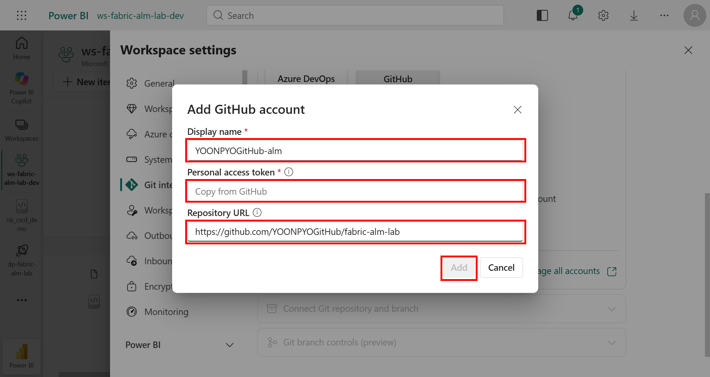

토큰 값이 있는 중간 화면은 촬영하지 않았습니다. 아래처럼 등록된 계정과 저장소 URL만 확인합니다.

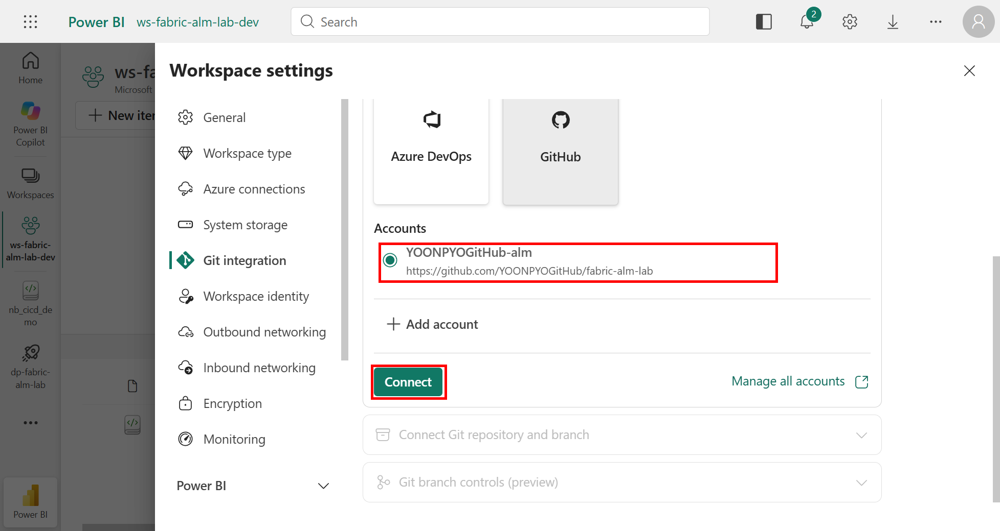

7. 해당 계정을 선택하고 **Connect**를 누릅니다.

**실제 결과:** 계정 연결이 완료되고 Repository / Branch / Folder 설정 단계가 열렸습니다.

## 2-3. Repository / Branch / Folder 연결

**클릭 경로:** Git integration → **Connect Git repository and branch**.

| 입력 | 값 |
|---|---|
| Repository URL | `https://github.com/YOONPYOGitHub/fabric-alm-lab` |
| Branch | `main` |
| Git folder | `/fabric` |

1. 다른 환경에서는 자신의 Repository URL로 바꿉니다.
2. 저장소 한정 토큰이라면 해당 저장소만 선택 가능한지 확인합니다.
3. Branch에서 `main`을 선택하고 Git folder에 `/fabric`을 입력합니다.

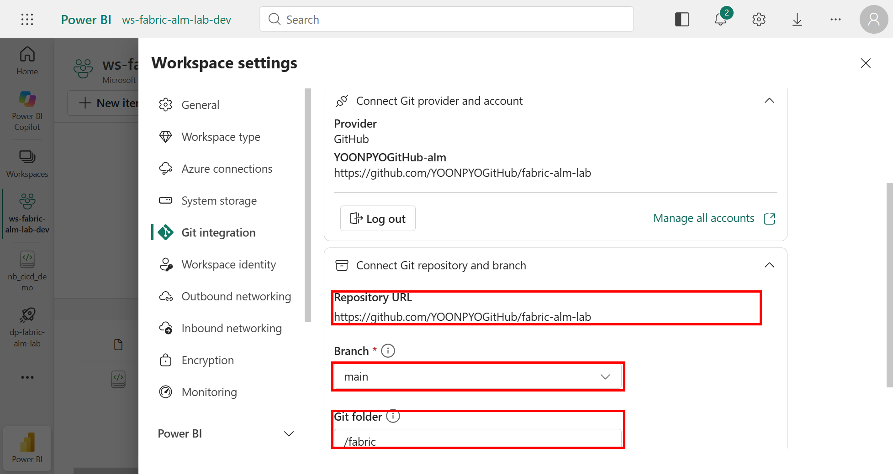

4. **Connect and sync**를 선택합니다.
5. `/fabric`이 없으면 **Create a new folder?** 창에서 경로를 대조하고 **Create and sync**를 선택합니다.

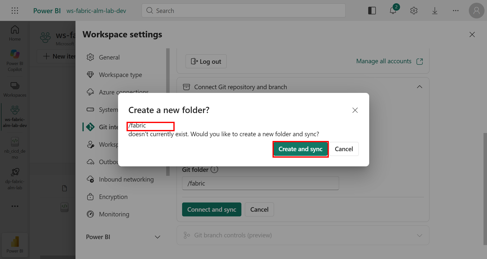

### 초기 동기화 방향

이 실습의 Dev에는 `nb_cicd_demo` v1이 있고 GitHub의 `/fabric`은 없었습니다. 실제로는 **Create and sync**가 새 폴더를 만들고 Workspace 정의를 Git으로 보내 최초 Commit을 생성했습니다. 별도의 양방향 선택 창이 표시된 것으로 기록하지 않습니다.

- 비어 있는 `/fabric`을 기준으로 Workspace를 덮어쓰지 않습니다.
- 양쪽에 아이템이 있다면 내용과 충돌을 검토하고 진행합니다.
- 삭제·덮어쓰기 경고가 있으면 멈춰 대상과 방향을 확인합니다.

**실제 결과:** `ConnectedAndInitialized`, `main /fabric` 연결과 최초 Commit `5516e8bc`를 확인했습니다.

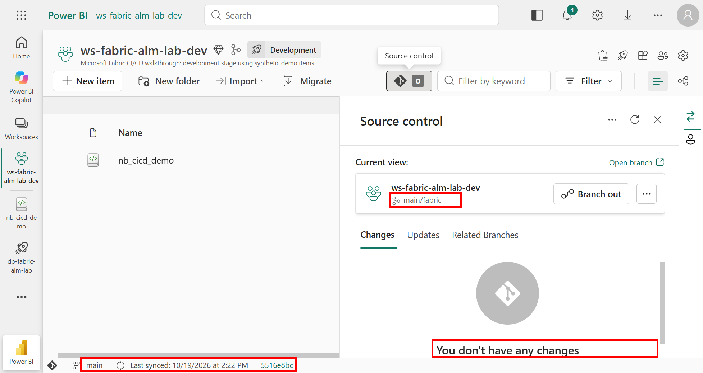

GitHub에는 다음 파일이 생성되었습니다.

```text
fabric/
  Readme.md
  nb_cicd_demo.Notebook/
    .platform
    notebook-content.py
```

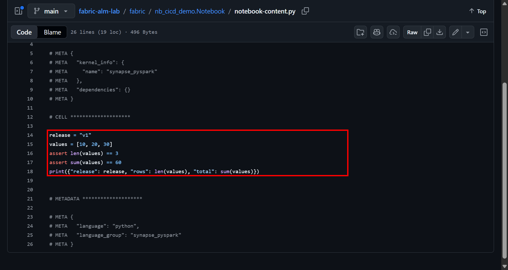

## 2-4. Workspace → Git 변경 Commit

**목적:** 최초 동기화와 별도로, Workspace에서 수정한 내용을 실제 Commit UI로 보냅니다. 먼저 [Notebook v1 작성](03-deployment-pipelines.md#3-1-notebook-v1-작성과-실행)을 마칩니다.

1. Dev의 `nb_cicd_demo`를 열어 첫 줄만 `release = "v1.1"`로 바꾸고 저장합니다. 입력값과 합계 검증 60은 그대로 둡니다.
2. Workspace로 돌아와 **Source control → Changes**를 엽니다.
3. 변경이 바로 보이지 않으면 Source control의 **Refresh**를 선택합니다.
4. `nb_cicd_demo`가 **Modified / Uncommitted**인지 확인합니다.
5. **Review and commit changes**를 열고 v1 → v1.1 한 줄 변경을 검토합니다.
6. Notebook 하나만 선택하고 Commit 메시지를 입력합니다.
7. **Commit**을 선택합니다.

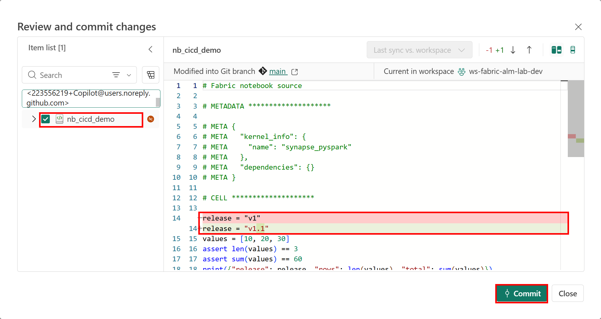

**실제 결과:** [Commit c653df75](https://github.com/YOONPYOGitHub/fabric-alm-lab/commit/c653df75d531632051be64ea43f0396d6e2002b2)가 생성되었고, Workspace와 원격 Commit이 일치하며 변경 목록이 비었습니다. v1.1은 Commit 방향을 보여주는 중간 버전이며 별도 Fabric 실행 검증 대상으로 삼지 않았습니다.

Fabric이 생성한 셀 메타데이터와 `.platform` 식별 정보를 임의로 만들거나 삭제하지 않습니다. Git에는 아이템 정의를 기록하며 토큰이나 실행 로그를 넣지 않습니다.

## 2-5. Git에서 v2 변경

**목적:** 원격 변경을 Fabric으로 가져오는 방향을 실습합니다.

이번 변경은 **로컬 Git에서 편집·Commit·Push**하고, GitHub 웹 화면에서 실제 diff를 확인했습니다. 웹 편집기로 Commit한 것으로 기록하지 않습니다.

1. 실습 저장소를 clone하고 `main`을 확인합니다.

```bash
git clone https://github.com/YOONPYOGitHub/fabric-alm-lab.git
cd fabric-alm-lab
```

2. `fabric/nb_cicd_demo.Notebook/notebook-content.py`의 코드 세 줄을 변경합니다. Fabric 셀·메타데이터 구조와 나머지 코드는 보존합니다.

```python
release = "v2"
values = [10, 20, 40]
assert len(values) == 3
assert sum(values) == 70
print({"release": release, "rows": len(values), "total": sum(values)})
```

3. 이 예제는 외부 라이브러리가 없는 순수 Python 계산이므로 로컬에서도 입력·출력을 검사할 수 있습니다. 로컬 검사가 Fabric 런타임 검증을 대신하지는 않습니다.

```bash
python fabric/nb_cicd_demo.Notebook/notebook-content.py
git diff --check
git diff --numstat
```

출력은 `release=v2`, `rows=3`, `total=70`, 변경량은 **3 additions / 3 deletions**여야 합니다.

4. 해당 파일만 Commit하고 Push합니다.

```bash
git add fabric/nb_cicd_demo.Notebook/notebook-content.py
git commit -m "Update synthetic Notebook to v2 with total 70"
git push origin main
```

5. GitHub에서 Commit과 세 줄의 diff를 확인합니다.

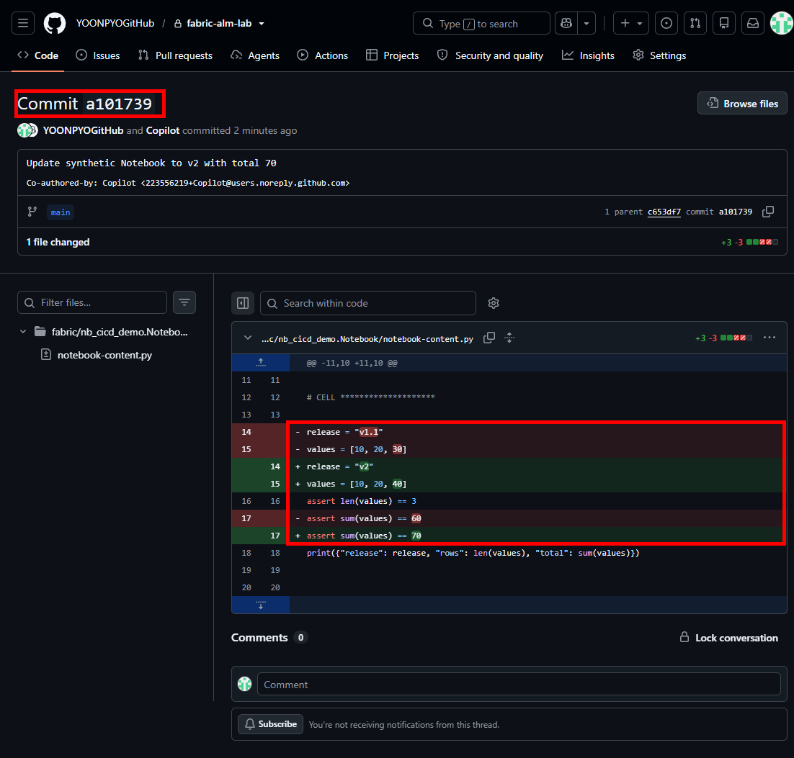

직접 `main`에 Commit하는 것은 이 실습의 단순화된 절차입니다. 보호 branch를 사용하는 환경에서는 feature branch → Pull request → 검토·병합 절차를 따릅니다. GitHub에서 파일을 편집·Commit하는 것만으로 Fabric Notebook이 실행되지는 않습니다.

**실제 결과:** [Commit a1017399](https://github.com/YOONPYOGitHub/fabric-alm-lab/commit/a1017399c1cf124e9340cdcaf3df1de83b77b23f)가 생성되었습니다. 이때 Workspace는 아직 v1.1이고 Git은 v2입니다.

## 2-6. Git → Workspace Update

**클릭 경로:** Dev Workspace → **Source control → Updates**.

1. Source control의 **Refresh** 후 **Updates**에서 원격 변경과 Commit을 확인합니다.
2. 로컬 미Commit 변경이 있다면 먼저 충돌 처리 방향을 정합니다.

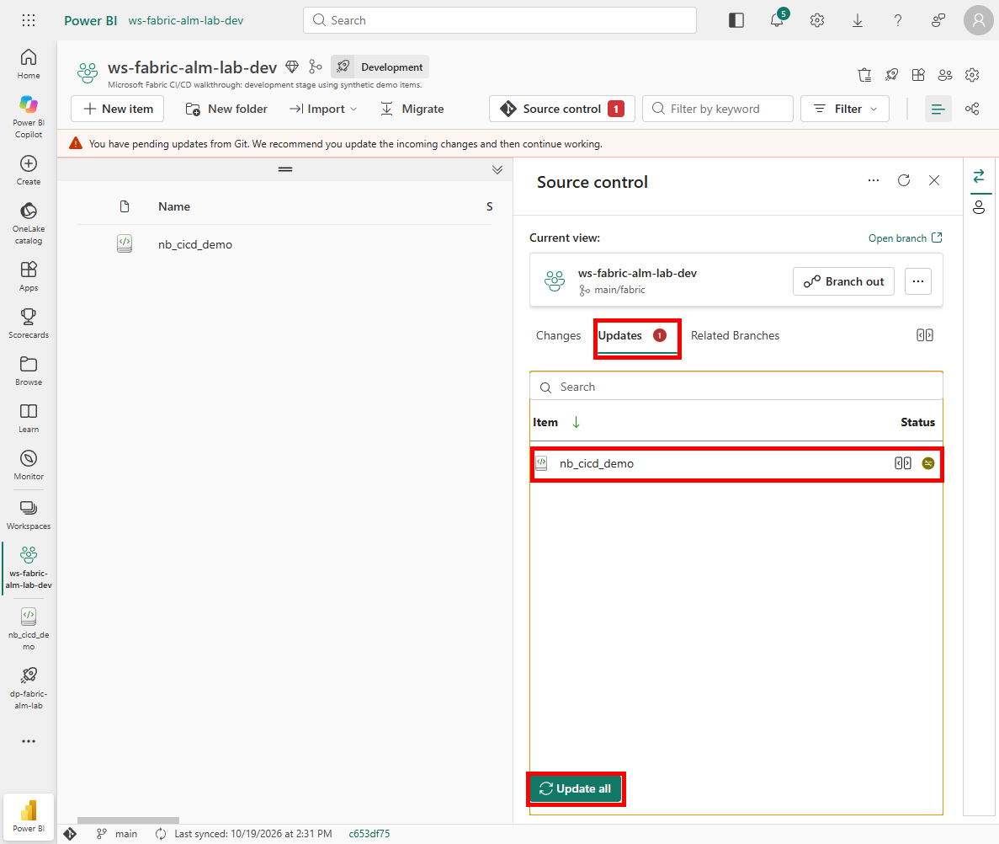

3. Notebook 행의 **Review changes**로 v1.1 → v2, 합계 60 → 70 변경을 검토합니다.

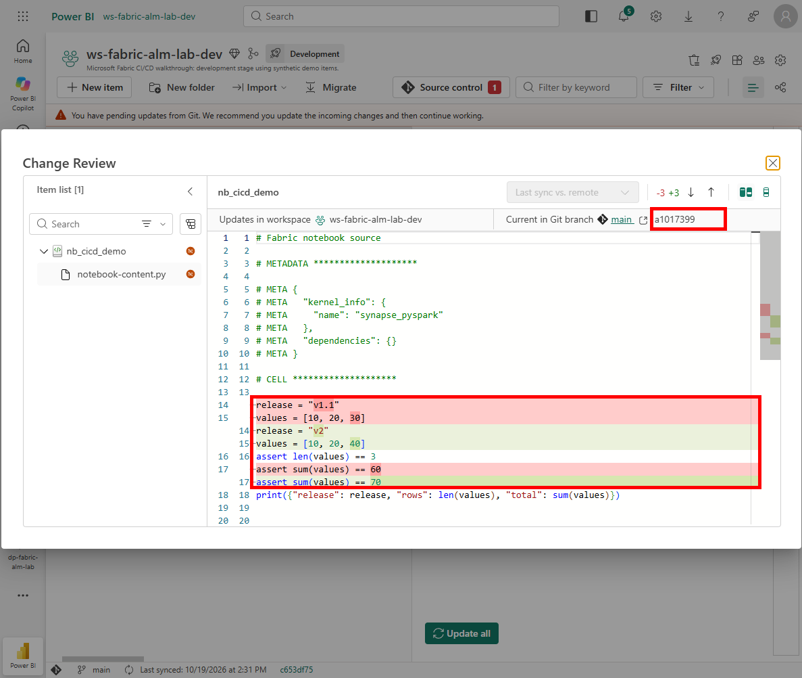

4. 검토 창을 닫고 **Update all**로 Git 변경을 Workspace에 적용합니다.
5. 업데이트 완료 후 Notebook을 새로 열어 `v2`, `[10, 20, 40]`, 합계 검증 `70`을 확인합니다. 업데이트 전에 열어 둔 편집기가 있다면 새로 고쳐 오래된 메모리 상태로 실행하지 않습니다.
6. **Run all** 실행의 기대 출력은 다음과 같습니다. 실제 Fabric 실행 검증은 [배포 장](03-deployment-pipelines.md)에 기록합니다.

```text
{'release': 'v2', 'rows': 3, 'total': 70}
```

7. Source control이 다시 **Synced**인지 확인합니다.

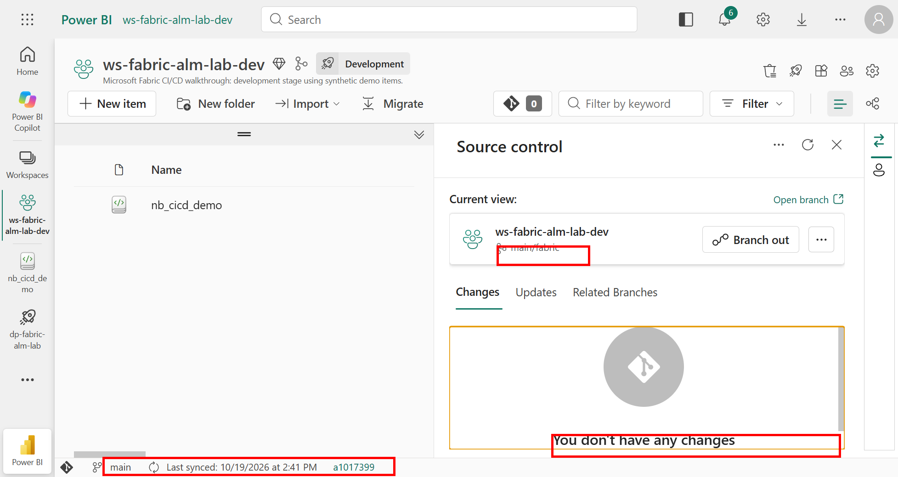

**실제 결과:** 원격 Commit과 Workspace head가 모두 `a1017399`이고 변경 목록이 비었습니다. Notebook 정의를 다시 내보내 **전체 소스가 Git의 v2와 일치**하는지 대조했습니다. 단순히 Synced 표시만 보고 검증을 끝내지 않았습니다.

## 2-7. 배포로 연결

v2의 실제 실행 검증 후 [Development → Test → Production 배포 절차](03-deployment-pipelines.md)를 진행합니다.

`Synced`는 Git 정의와 Workspace 정의의 동기화 상태입니다. Test/Prod 배포 완료나 Notebook 실행 성공을 의미하지 않습니다. 대상 정의와 실행 결과는 배포 단계에서 별도로 확인합니다.
