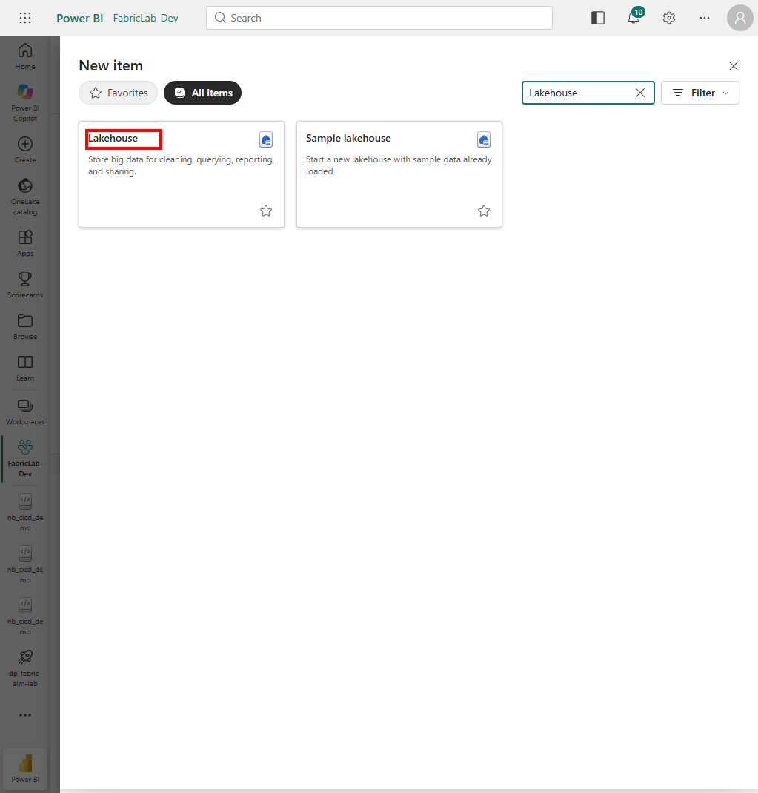
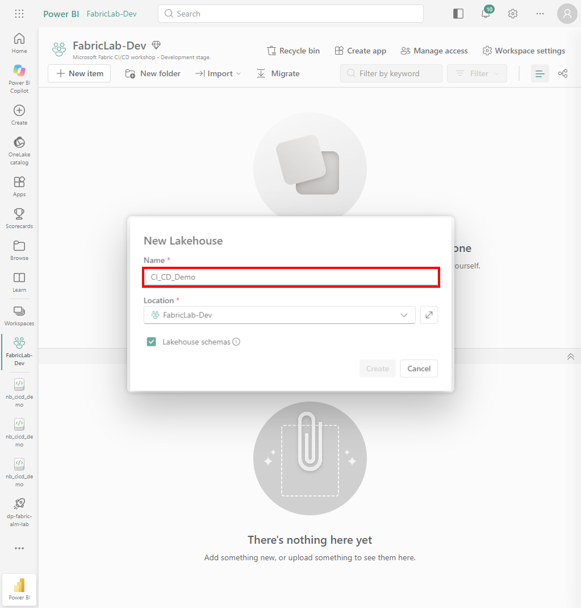
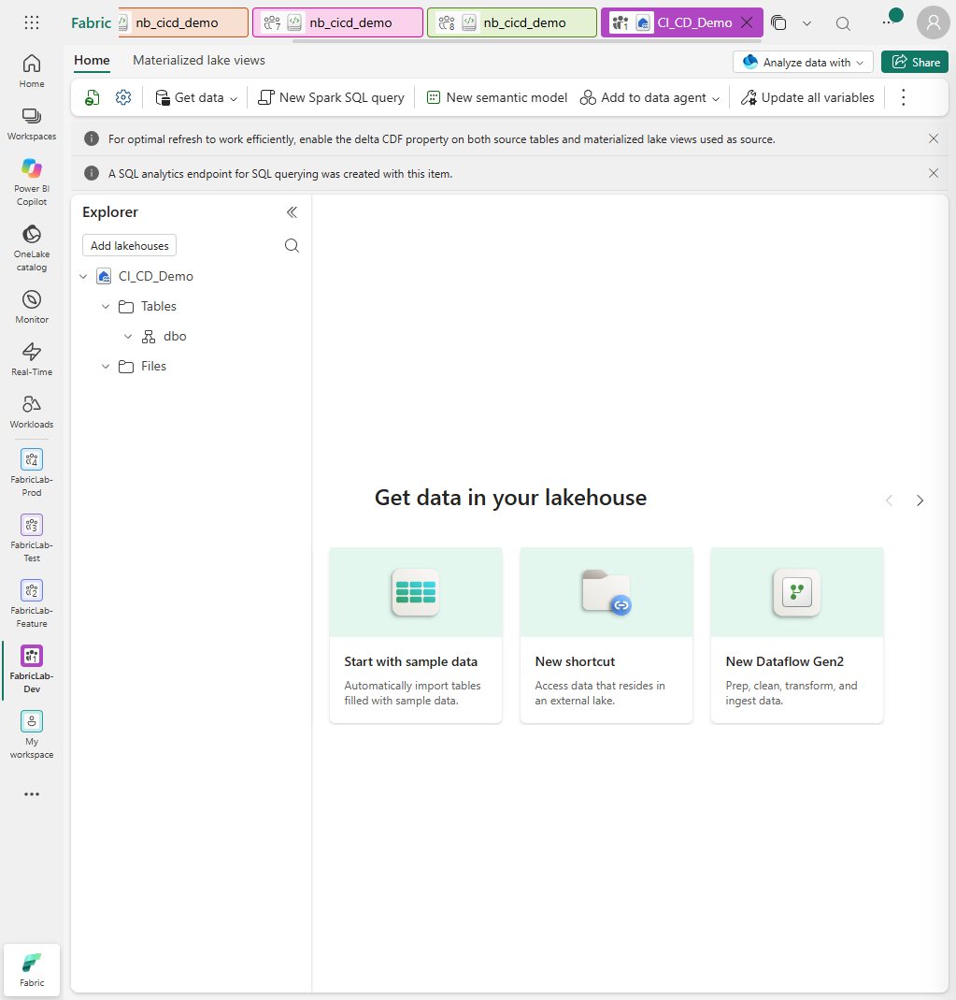
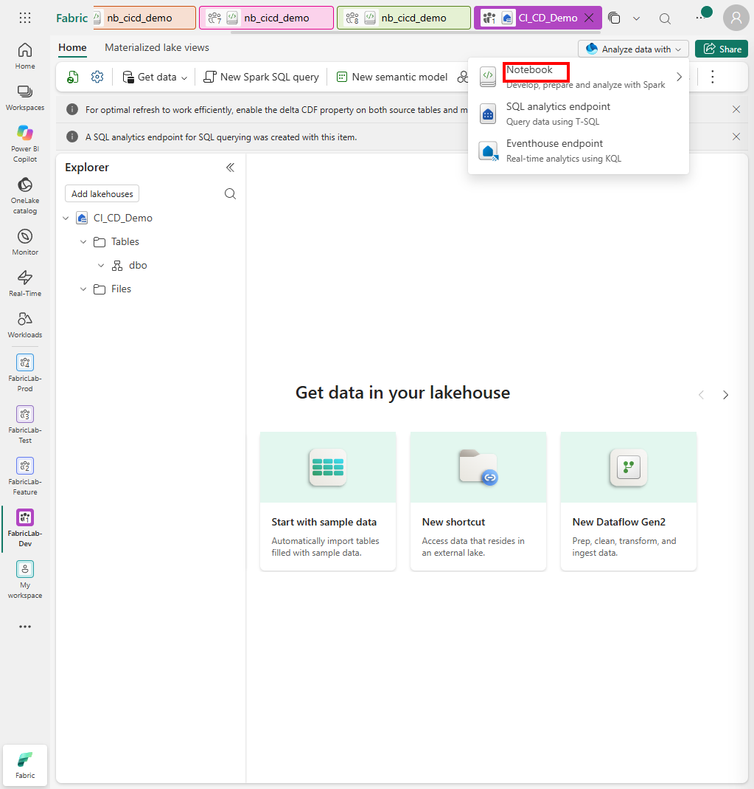
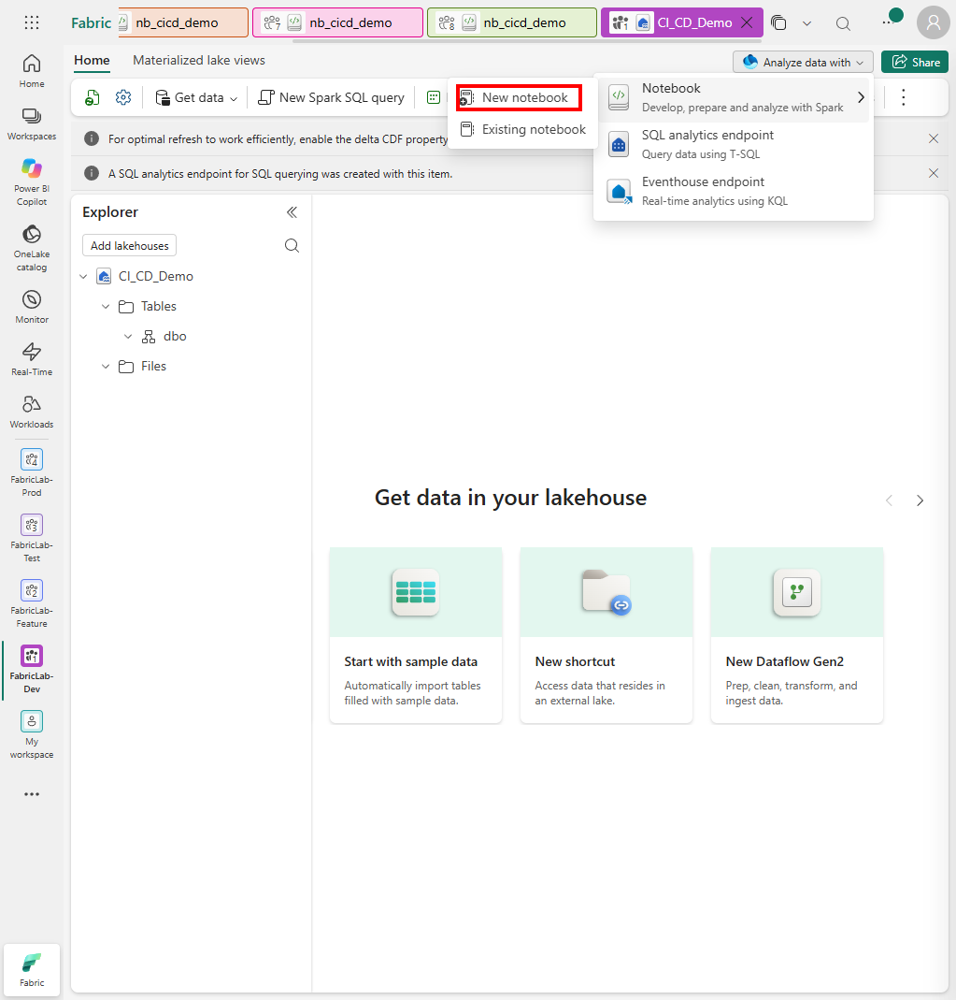
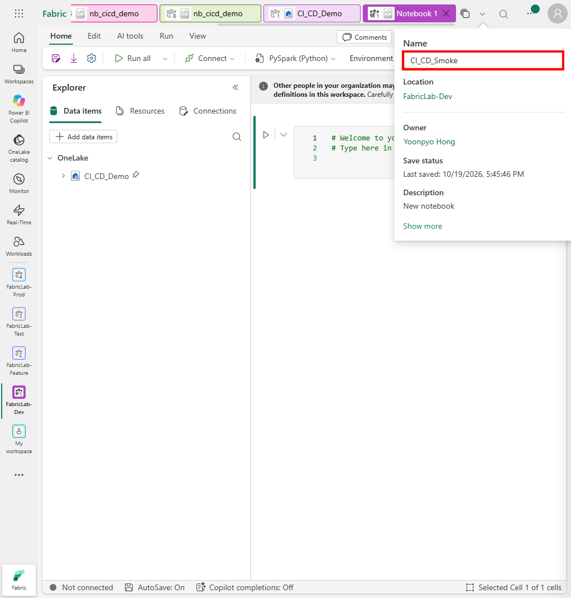
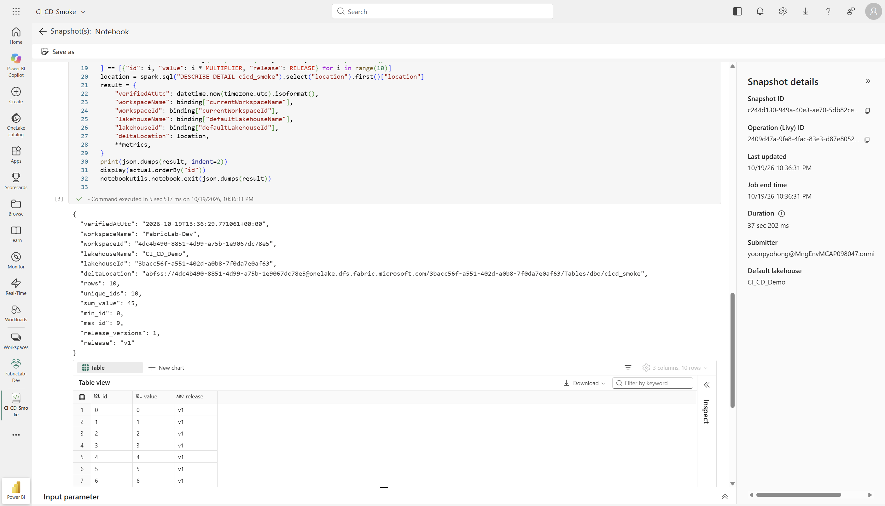

# 2. Lakehouse와 Notebook v1

[처음으로](README.md) · [이전: 사전 준비](01-prerequisites.md) · [다음: Git과 PR](02-git-integration.md)

**목표:** Python 리스트 합계가 아니라 실제 Lakehouse의 Delta 테이블을 생성·읽기·검증합니다.
이 장의 v1은 10행과 합계 45, Feature에서 바꿀 v2는 같은 10개 ID와 합계 90입니다.

## 2-1. Dev Lakehouse 생성

**경로:** `FabricLab-Dev → New item → Lakehouse`.



1. 이름에 `CI_CD_Demo`를 입력합니다.
2. Location이 `FabricLab-Dev`인지 확인합니다.
3. **Lakehouse schemas**를 켠 상태로 생성합니다.
4. 생성 후 **Explorer → Tables → dbo**가 비어 있는지 확인합니다.





**기대 결과:** Workspace에 Lakehouse와 서비스가 관리하는 SQL analytics endpoint가 나타납니다.
테이블은 아직 없습니다. 빈 화면이 늦게 갱신되면 아이템 목록을 조회해 이미 생성되었는지
확인하고, 생성 버튼을 반복 클릭하지 않습니다.

## 2-2. Lakehouse에 연결된 Notebook 생성

**경로:** Lakehouse 우측 **Analyze data with → Notebook → New notebook**.





1. 새 Notebook의 상단 이름을 눌러 `CI_CD_Smoke`로 바꾸고 Enter로 저장합니다.
2. 좌측 Data items에 `CI_CD_Demo`가 있고 기본 Lakehouse를 나타내는 핀이 있는지 확인합니다.
3. 실행 언어는 **PySpark (Python)**으로 둡니다.



**기대 결과:** Notebook과 기본 Lakehouse가 모두 Dev에 있습니다. 이름만 같은 다른
Workspace의 Lakehouse를 선택하지 않습니다.

## 2-3. 세 개의 코드 셀 준비

원본은 [v1 Notebook 소스](https://github.com/YOONPYOGitHub/fabric-alm-lab/blob/4ea83edb06a7d2b381ab961a1a25fb8925db6ce4/workshops/cicd/fabric/CI_CD_Smoke.Notebook/notebook-content.py)입니다.
`# CELL`로 구분된 세 코드 영역을 각각 셀로 사용합니다. `# META`와 `.platform`의
식별 정보를 임의로 작성하거나 다른 환경의 물리 ID로 바꾸지 않습니다.

### 셀 1: 쓰기 전 환경 확인

```python
RELEASE = "v1"
MULTIPLIER = 1
```

첫 셀은 `notebookutils.runtime.context`의 아래 값을 확인합니다.

| 값 | 확인 |
|---|---|
| `currentWorkspaceName`, `currentWorkspaceId` | 현재 실행 환경이 확인되는가 |
| `defaultLakehouseName`, `defaultLakehouseId` | 기본 Lakehouse가 실제로 연결되어 있는가 |
| `defaultLakehouseWorkspaceId` | 현재 Workspace와 같은가 |

필수 값이 비었거나 문자열이 아니면 실패하고, Workspace가 다르거나 이름이 `CI_CD_Demo`가
아니어도 실패합니다. 이 guard는 **어떤 Spark SQL이나 쓰기보다 먼저** 실행됩니다.
오류를 우회하기 위해 guard를 지우거나 cross-workspace 경로를 하드코딩하지 않습니다.

### 셀 2: 실제 Delta에 10개 ID MERGE

```python
source = (
    spark.range(10)
    .withColumn("value", F.col("id") * MULTIPLIER)
    .withColumn("release", F.lit(RELEASE))
)
```

원본의 나머지 코드는 `CREATE TABLE IF NOT EXISTS cicd_smoke ... USING DELTA` 후
ID 기준 MERGE를 수행합니다. schema-enabled 기본 Lakehouse이므로 실제 위치는
`Tables/dbo/cicd_smoke`입니다.

- v1: ID 0–9, `value=id`, `release=v1`.
- v2: ID 0–9, `value=id*2`, `release=v2`.
- `DROP`, overwrite, 행 삭제를 하지 않습니다.
- 테이블이 이미 있으면 정의·schema·내용을 확인합니다. 검증 실패를 자동 삭제로 해결하지 않습니다.

### 셀 3: 저장된 테이블을 다시 읽어 검증

`spark.table("cicd_smoke")`에서 다음을 검사합니다.

| 검사 | v1 기대 값 | v2 기대 값 |
|---|---:|---:|
| 전체 행 / 고유 ID | 10 / 10 | 10 / 10 |
| 최소 / 최대 ID | 0 / 9 | 0 / 9 |
| 합계 | 45 | 90 |
| release 종류 / 값 | 1 / v1 | 1 / v2 |
| 정렬한 모든 행 | `value=id`, v1 | `value=id*2`, v2 |

합계만 우연히 맞는 잘못된 데이터를 통과시키지 않도록 **모든 행의 ID·value·release**도
기대 목록과 대조합니다. 결과에는 검증 UTC 시각, Workspace·Lakehouse ID와
`DESCRIBE DETAIL`의 실제 Delta 위치를 출력하고 정렬한 테이블을 표시합니다.

마지막의 `notebookutils.notebook.exit(json.dumps(result))`는 API 실행에도 같은 검증 결과를
반환하기 위한 것입니다. 테스트를 성공으로 보이게 하는 고정 문자열이 아닙니다.

## 2-4. 저장된 코드 확인 후 Dev v1 실행

1. 세 셀이 저장되었고 `RELEASE="v1"`, `MULTIPLIER=1`인지 확인합니다.
2. 기본 Lakehouse가 Dev의 `CI_CD_Demo`인지 확인합니다.
3. **Run all**의 실제 실행 버튼을 선택합니다.
4. 세 셀의 완료와 실제 테이블·검증 결과를 확인합니다.
5. Workspace ID와 Lakehouse ID, 물리 Delta 경로가 Dev를 가리키는지 대조합니다.



**실제 수행 방식:** Notebook과 Lakehouse는 UI로 만들었습니다. 자동화된 여러 줄 입력에서
들여쓰기가 누적되는 문제를 저장 소스의 AST 검사로 발견해 **실행 전에** 중단했습니다.
검증한 세 셀을 공식 `updateDefinition` API의 ipynb 정의로 반영하고, 다시 내보낸 소스의
전체 AST·셀 수·기본 Lakehouse 바인딩이 일치한 뒤 Job Scheduler API로 실행했습니다.
UI의 Run all로 실행한 것으로 기록하지 않습니다. 위 화면은 그 실제 API 실행의 스냅샷입니다.

**체크포인트:** 실제 Delta의 10행·합계 45와 Dev 바인딩을 확인한 뒤
[Git 연결](02-git-integration.md)로 이동합니다.
