# 3. Deployment pipelines 생성과 단계별 배포

[가이드 처음으로](README.md) · [이전: Git integration](02-git-integration.md)

이 장은 v1 준비와 실제 **Git v2 → Dev 실행 → Test 배포·실행 → Production 배포·실행**을 설명합니다. UI와 API 수행 방식을 각 단계에서 구분합니다.

## 3-1. Notebook v1 작성과 실행

**목적:** 외부 데이터 연결 없이 계산 결과와 버전으로 배포를 확인할 작은 Notebook을 준비합니다.

**클릭 경로:** `ws-fabric-alm-lab-dev` → **New item** → 검색란에 `Notebook` → **Notebook**.

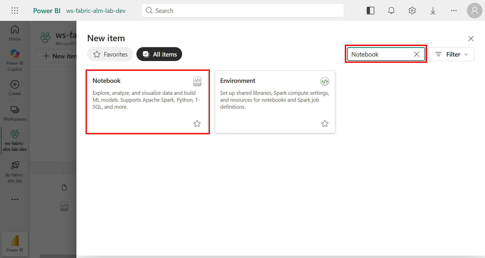

1. 이름에 `nb_cicd_demo`를 입력합니다.
2. Location이 `ws-fabric-alm-lab-dev`인지 확인합니다.
3. **Create**를 선택합니다.

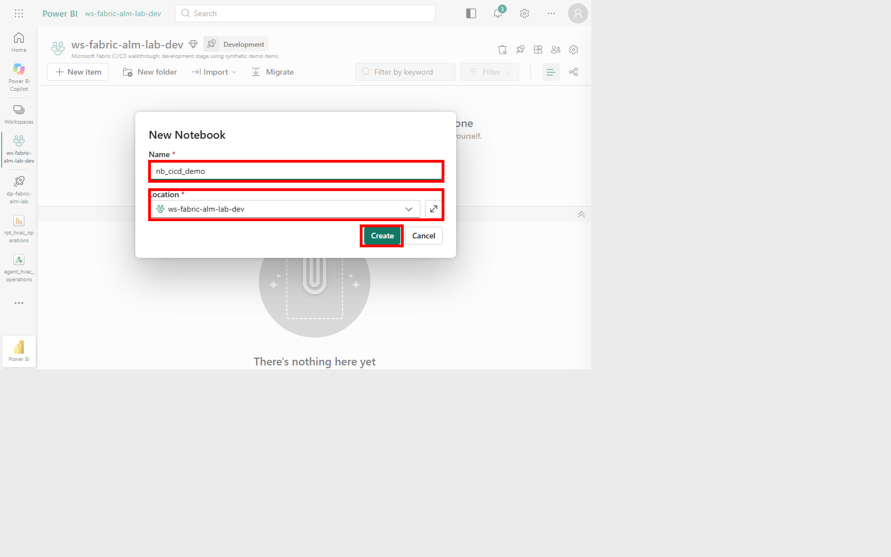

4. 시작 안내가 나타나면 **Skip for now**로 닫습니다.
5. 코드 셀에 다음을 입력하고 저장합니다.

```python
release = "v1"
values = [10, 20, 30]
assert len(values) == 3
assert sum(values) == 60
print({"release": release, "rows": len(values), "total": sum(values)})
```

6. **Run all**을 선택합니다.
7. 실행이 끝날 때까지 기다리고 셀의 성공 표시·출력을 확인합니다.

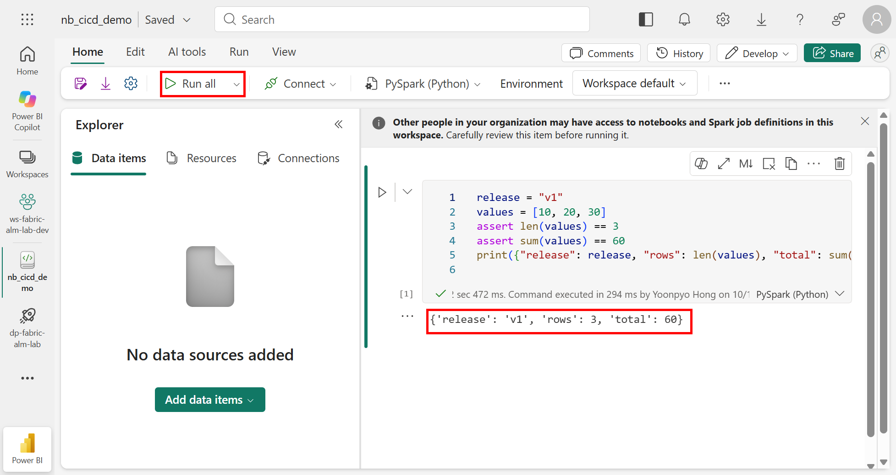

**기대 결과:**

```text
{'release': 'v1', 'rows': 3, 'total': 60}
```

초기 v1 검증에는 RunNotebook job `a62c31f3-cabf-4ba5-aff0-522d5aef922b`의 API 상태 **Completed**와 셀 출력 확인 기록이 있습니다. 아래 v2 실습은 **대화형 Run all**의 셀 완료·출력으로 별도로 검증했으며, 이 초기 job ID를 v2 실행 ID로 사용하지 않습니다.

세션 시작·큐 대기는 코드 실행보다 오래 걸릴 수 있습니다. `Running`, `Saved`, 또는 Core jobs 목록만으로 대화형 셀 실행 성공을 판단하지 않습니다.

처음부터 진행한다면 이 시점에 [Git 연결과 양방향 변경 실습](02-git-integration.md)을 수행합니다.

### Git Update 후 Dev의 v2 실행

1. 2장에서 원격 v2를 Workspace에 Update한 뒤 Notebook을 새로 엽니다.
2. `release = "v2"`, 입력 `[10, 20, 40]`, 합계 검증 `70`을 확인합니다.
3. **Run all**의 실행 버튼을 선택합니다.
4. 셀의 성공 표시와 실제 출력을 확인한 뒤 Test로 배포합니다.

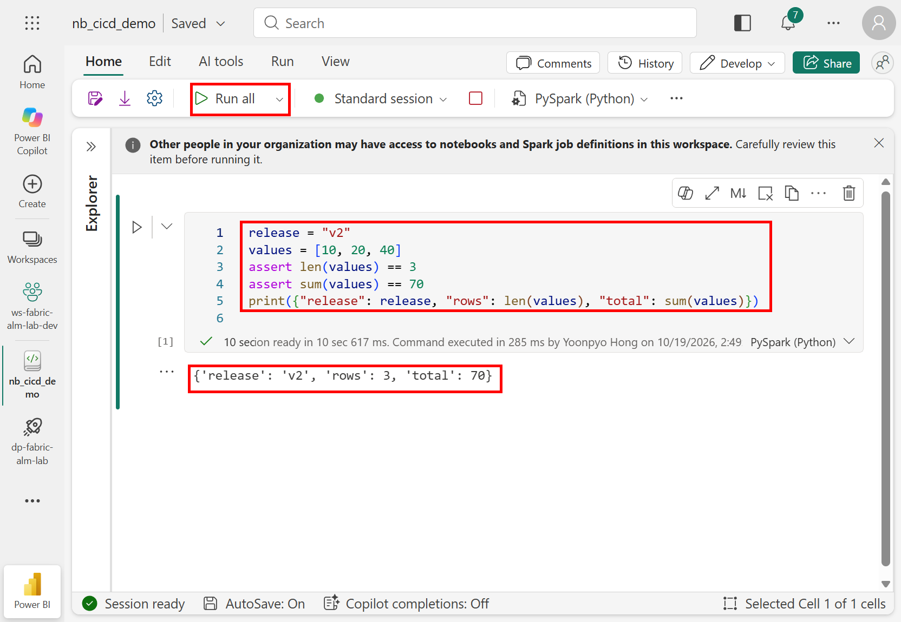

**실제 결과:** 14:49:25 KST 실행에서 `release=v2`, `rows=3`, `total=70`을 확인했습니다. 실행이 끝나기 전에 다음 단계의 검증까지 성공했다고 간주하지 않습니다.

## 3-2. 배포 파이프라인 생성

**목적:** 세 단계의 배포 구조를 만듭니다.

**클릭 경로:** 좌측 **Workspaces → Deployment pipelines** → 새 파이프라인 생성.

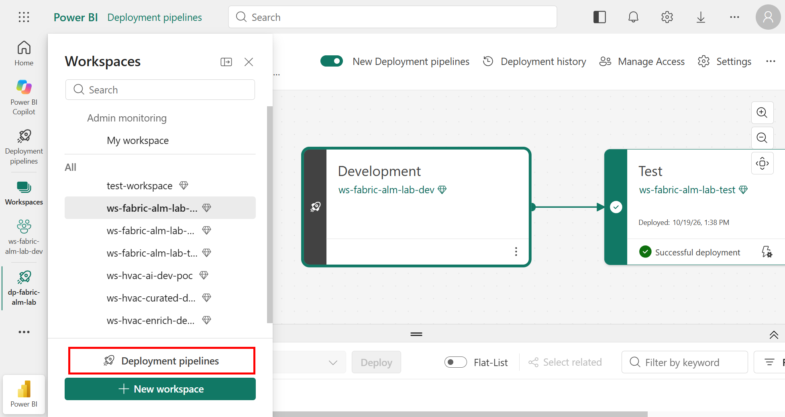

1. Pipeline name에 `dp-fabric-alm-lab`을 입력합니다.
2. Description에 다음을 입력합니다.

```text
Microsoft Fabric CI/CD walkthrough using synthetic demo items: Development, Test, Production.
```

3. 입력 검증이 끝나면 **Next**를 선택합니다.

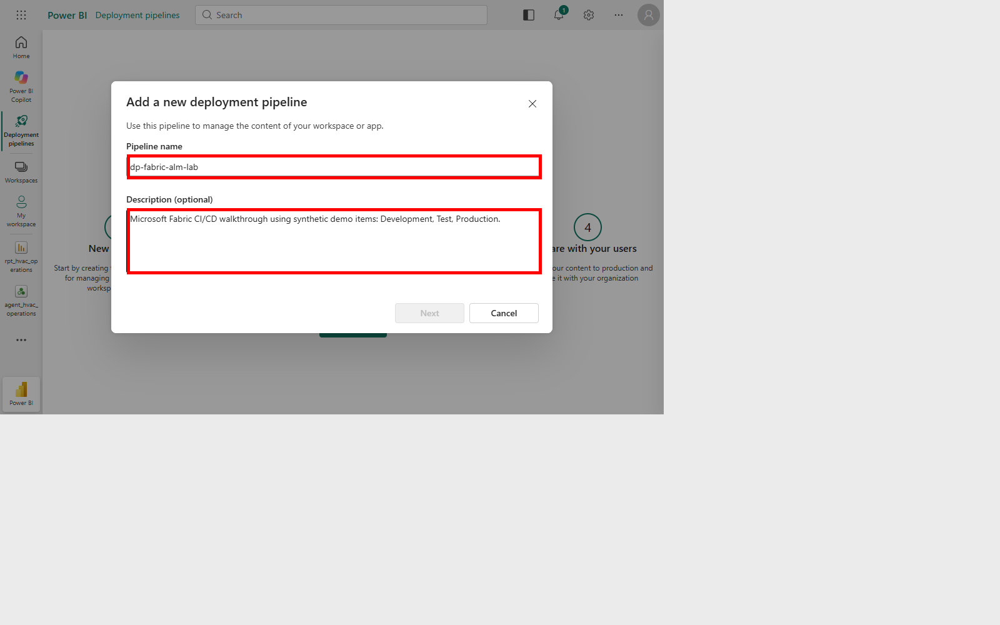

4. 기본 단계 **Development → Test → Production**을 유지합니다.
5. **Create and continue** 또는 화면의 **Create**로 생성합니다.

파이프라인은 2~10개 단계를 지원하지만 이 실습은 3개를 사용합니다. 생성 후 단계 수를 바꾸는 것을 전제로 설계하지 않습니다. 이미 준비된 환경에서는 새로 생성하지 말고 기존 `dp-fabric-alm-lab`을 엽니다.

**기대 결과:** 세 단계가 있는 파이프라인이 생성됩니다. 다음 단계에서 Workspace를 연결하면 아래와 같은 구성이 됩니다.

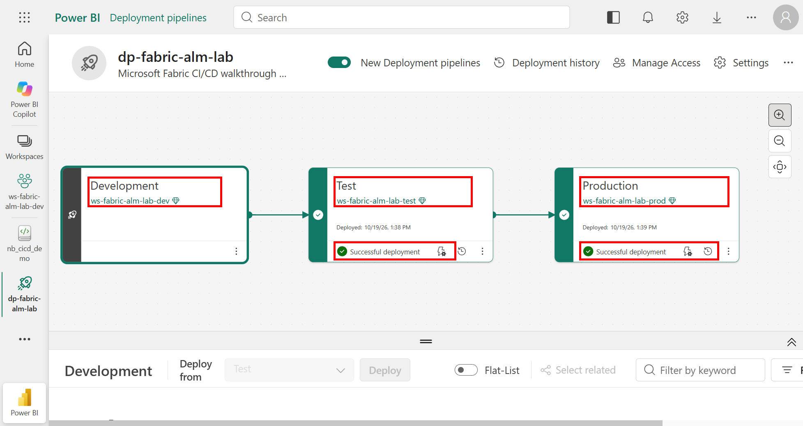

## 3-3. 단계별 Workspace 연결

**클릭 경로:** 각 단계 카드 → **Assign a workspace**.

1. Development에서 `ws-fabric-alm-lab-dev`를 선택하고 확인합니다.
2. Test에서 `ws-fabric-alm-lab-test`를 선택하고 확인합니다.
3. Production에서 `ws-fabric-alm-lab-prod`를 선택하고 확인합니다.
4. 카드마다 Workspace 이름을 대조합니다.

| 단계 | 연결할 Workspace |
|---|---|
| Development | `ws-fabric-alm-lab-dev` |
| Test | `ws-fabric-alm-lab-test` |
| Production | `ws-fabric-alm-lab-prod` |

각 단계는 Workspace 하나에 연결되며, 같은 Workspace를 다른 파이프라인 단계에 중복 연결할 수 없습니다. 선택 목록에 없으면 Workspace Admin, Capacity 및 기존 파이프라인 연결 여부를 확인합니다.

**실제 수행 방식:** Development와 Test 할당은 UI에서 수행했고 Production 할당은 Core REST API로 수행했습니다. 최종 연결은 세 카드 및 stages API에서 확인했습니다. 캡처를 위해 기존 연결을 해제하거나 Workspace를 재생성하지 않았습니다.

**기대 결과:** 세 카드가 각각 정확한 Workspace를 가리킵니다.

## 3-4. Development → Test 배포

**목적:** Git에서 Update하고 Dev에서 실행 검증한 **v2** 정의를 Test로 승격합니다.

### UI에서 따라 하기

1. **대상 단계인 Test 카드**를 선택합니다.
2. 하단 **Deploy from**이 **Development**인지 확인합니다.
3. 목록이 잘 보이지 않으면 중앙 경계선 우측의 접기 버튼으로 **파이프라인 캔버스를 접고 아이템 목록 높이를 확보**합니다.
4. `nb_cicd_demo` 행의 맨 왼쪽 체크박스를 선택합니다. 이 실습에서는 **Deploy 1**인지 확인합니다. 최초 배포라면 대상에는 아직 아이템이 없을 수 있습니다.

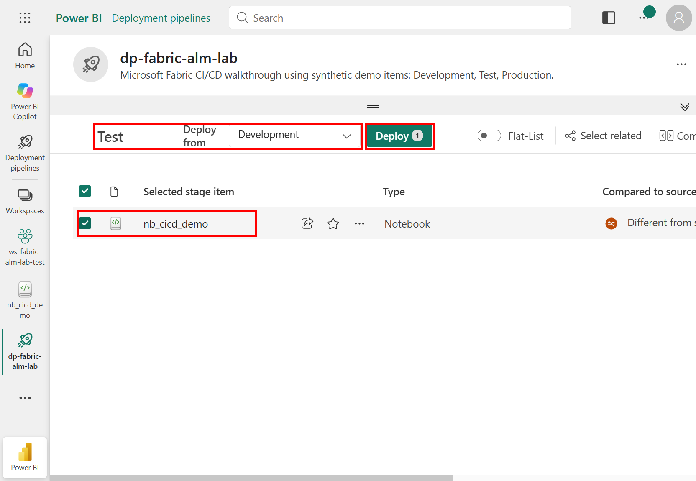

5. **Compare**를 열어 `To be modified [Test]`와 `To be deployed [Development]`를 대조합니다. v1 → v2의 세 줄 변경인지 확인합니다.

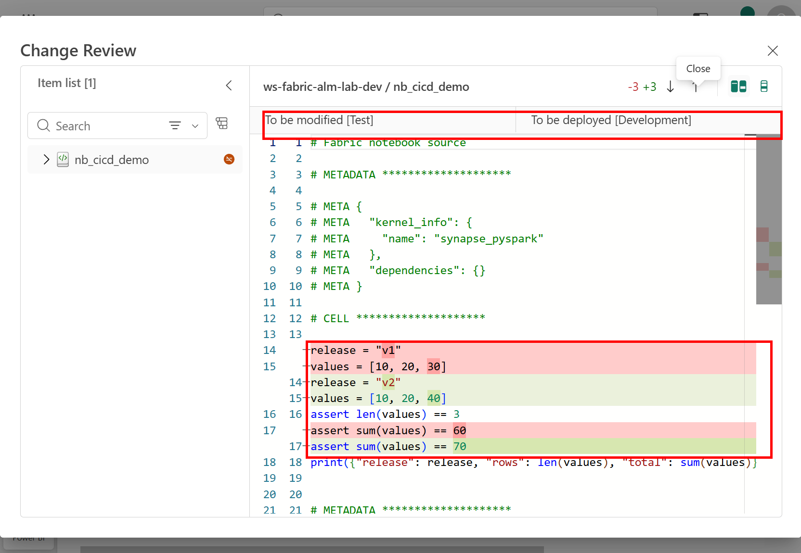

6. 필요한 의존성이 있는 경우 **Select related** 및 배포 목록을 검토합니다. 이 Notebook에는 Lakehouse 연결을 추가하지 않았습니다.
7. 비교 창을 닫고 **Deploy**를 선택합니다.
8. 확인 창에서 Development → Test, Notebook 하나를 다시 확인합니다. 이 실습은 **Continue deployment in case 1 or more items fail**을 해제합니다.
9. **Add a note**에 Git Commit `a1017399`, v2, 기대 출력 3/70 및 원본 실행 검증 여부를 기록합니다.

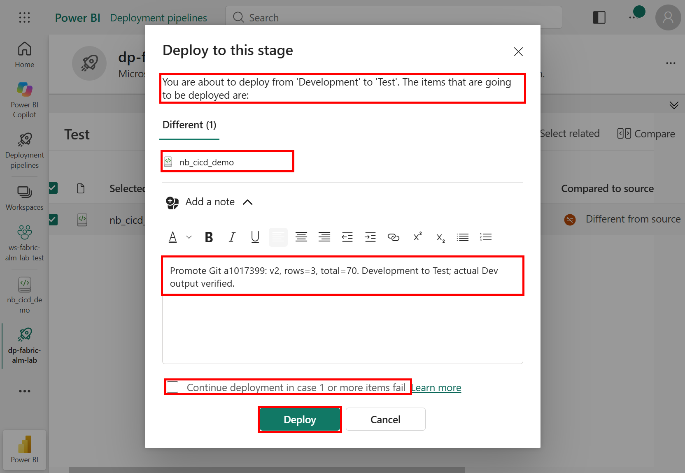

10. 최종 **Deploy**를 선택하고 완료 상태를 기다립니다.

**주의:** Development 카드를 선택하고 `Deploy from Test`로 실행하면 반대 방향입니다. 소스와 대상을 이름만 보고 추측하지 않습니다.

### 실제 실행 기록

이번 v2 배포는 **실제 UI**에서 선택, Compare, 확인 및 최종 Deploy를 수행했습니다.

| 항목 | 실제 값 |
|---|---|
| Source stage | Development |
| Target stage | Test |
| 선택한 아이템 | Dev의 `nb_cicd_demo` 하나 |
| Git Commit | `a1017399c1cf124e9340cdcaf3df1de83b77b23f` |
| Deployment ID | `d4a90d80-d842-443e-b766-74d99fc85250` |
| 결과 | **Succeeded** |

**실제 결과:** Test 정의를 내보내 전체 소스가 Git v2와 일치하는지 확인했습니다. 배포 이력의 방향·성공 상태·Git Commit을 포함한 노트도 대조했습니다.

## 3-5. Test 검증 후 Production 배포

**목적:** Test에서 확인한 정의를 Production으로 승격합니다.

1. Test Workspace의 `nb_cicd_demo`를 열고 배포된 코드·의존성을 검토합니다.
2. **Run all**로 실행하고 `release=v2`, `rows=3`, `total=70`을 확인합니다.


**실제 결과:** 15:02:44 KST Test 실행이 성공했습니다. 정의 일치만 확인하고 실행 성공까지 추정하지 않았습니다.

### UI에서 Production으로 배포하는 방법

파이프라인으로 돌아와 대상 **Production** 카드 → **Deploy from = Test** → Notebook 하나 선택 → **Deploy**로 진행합니다. 앞 단계와 같은 방식으로 방향·아이템·노트를 검토하고 완료 후 실제 대상 정의를 확인합니다.

### 이번 Production 승격의 실제 수행 방식

이번에는 브라우저 탭이 숨겨져 일부 포인터 입력이 대기하는 상태였으므로 **공식 Core REST API**로 정확히 같은 승격을 수행했습니다. Production의 UI 선택·확정 버튼을 클릭했다고 기록하지 않습니다. UI 배포 이력과 실제 Production Notebook 실행 화면은 아래에서 확인합니다.

API에서는 먼저 실제 파이프라인의 stages와 Test Workspace의 아이템을 조회하고, 승인된 대상에 대해 다음 구조로 요청합니다. 아래 ID 자리표시자는 각 환경에서 조회한 값으로 바꿔야 하며 그대로 실행하는 명령이 아닙니다.

```json
{
  "sourceStageId": "<test-stage-id>",
  "targetStageId": "<production-stage-id>",
  "items": [
    {
      "sourceItemId": "<test-notebook-id>",
      "itemType": "Notebook"
    }
  ],
  "note": "Promote validated Git v2 after Test output verification"
}
```

요청 경로는 `POST /v1/deploymentPipelines/{pipelineId}/deploy`입니다. 수락 응답이 모호하면 같은 요청을 반복하지 말고 기존 작업과 대상 상태부터 조회합니다.

| 항목 | 실제 값 |
|---|---|
| Source stage | Test |
| Target stage | Production |
| 선택한 아이템 | Test의 `nb_cicd_demo` 하나 |
| Git Commit | `a1017399c1cf124e9340cdcaf3df1de83b77b23f` |
| Deployment ID | `db59f557-d882-421e-8924-5235cda016b8` |
| 결과 | **Succeeded** |

3. Production 정의를 내보내 Git v2와 대조합니다.
4. Production Notebook을 열고 **Run all**로 실행합니다.
5. 셀 성공 표시와 `release=v2`, `rows=3`, `total=70`을 확인합니다.

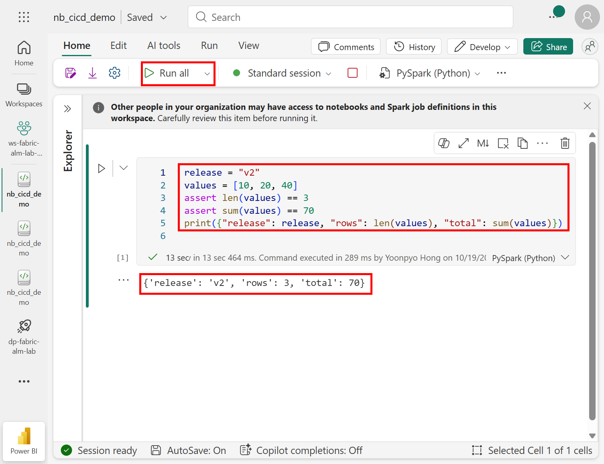

**실제 결과:** 15:15:41 KST Production 실행이 성공했습니다. 세 Workspace의 Notebook은 같은 v2 소스를 가지지만 물리 item ID는 다릅니다.

## 3-6. Deployment history와 정의 확인

**클릭 경로:** 파이프라인 상단 **Deployment history**. 창이 좁으면 상단 `…`의 **Pipeline menu → Deployment history**를 사용합니다.

1. Development → Test, Test → Production의 두 기록을 확인합니다.
2. 상태, 방향, 실행 시각, 실행자 및 아이템 목록을 확인합니다.
3. 완료 기록과 대상 Workspace의 실제 아이템을 대조합니다.

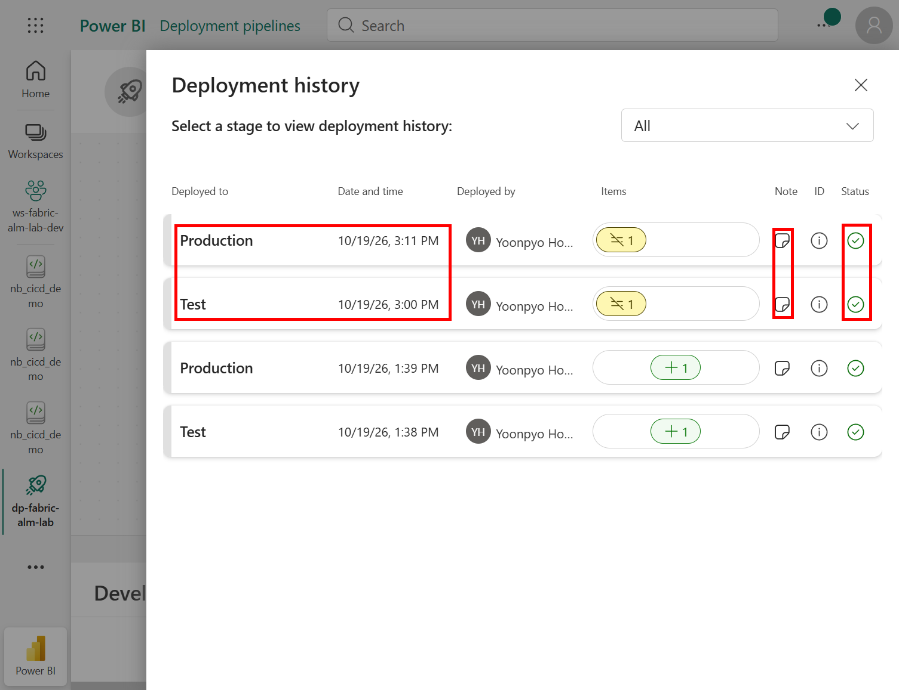

빨간 박스로 표시한 위쪽 두 행이 v2 승격입니다. 아래쪽 두 행은 초기 v1 배포 기록입니다.

비동기 REST 응답의 `202 Accepted`는 완료가 아닙니다. API 실행 시에는 응답의 작업 ID로 `/v1/operations/{operationId}`를 조회하고, 파이프라인 배포 이력과 실제 대상 정의도 대조합니다. 이번 v2 검증에서는 두 배포 이력의 **Succeeded·방향·노트**, 대상 전체 소스, 실제 실행 출력을 확인했습니다. 수락 후 요약 출력이 모호했던 Production 요청은 재전송하지 않고 기존 성공 이력을 조회해 확인했습니다.

| Workspace | Notebook item ID | 전체 소스 | 실제 실행 출력 |
|---|---|---|---|
| Development | `f5a84001-1a75-4726-9649-8289d0da1b0f` | Git v2와 일치 | v2 / 3 / 70 |
| Test | `0f3e0aa6-befd-495f-8f08-79316aedd4d6` | Git v2와 일치 | v2 / 3 / 70 |
| Production | `3ab78dc9-b759-4f7c-9a00-7b7029183d4f` | Git v2와 일치 | v2 / 3 / 70 |

2026-10-19 15:18:39 KST 최종 확인에서 세 소스의 정규화 SHA-256이 모두 같았습니다. 비교는 줄바꿈 형식과 파일 끝 공백만 정규화했으며, 셀 코드와 메타데이터 전체를 대조했습니다.

```text
BA40562970A554EC3522D9445E868375D68473D02009CD07CC3CD9A5F1AECBFC
```

Dev의 원격·Workspace Commit은 모두 `a1017399`이고 Git 변경 목록은 0개였습니다. 이 검증은 실행 후에도 소스가 의도한 Git 버전과 일치함을 확인한 것이며, 실행 성공 자체는 별도의 실제 셀 출력으로 확인했습니다.

### 초기 v1 배포 기록

초기 v1은 Core REST API로 Development → Test, Test → Production에 배포했습니다. 아래 두 기록은 v2 배포와 구분합니다.

| 방향 | v1 Deployment ID |
|---|---|
| Development → Test | `71fe3c26-ca6f-4b6d-8d3a-fc97f6d2bb24` |
| Test → Production | `b3d51c26-23c1-4d4f-a2ec-1d3a81fd6340` |

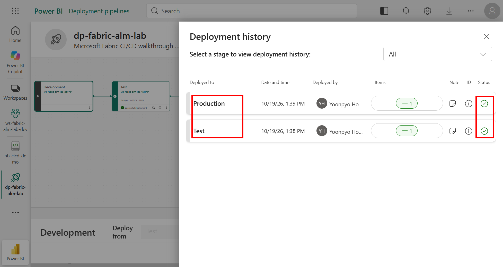

## 3-7. 실제 검증한 전체 릴리스 흐름

1. [Git에서 v2 변경 및 Update](02-git-integration.md)를 완료합니다.
2. Dev Notebook을 실행해 합계 **70**을 확인합니다.
3. Test를 선택하고 Development와 **Compare**하여 변경 내용을 검토합니다.
4. Development → Test로 배포합니다.
5. Test Notebook을 실행해 `release=v2`, `rows=3`, `total=70`을 확인합니다.
6. 검토 후 Test → Production으로 배포합니다.
7. Production의 정의, 실행 결과 및 Deployment history를 확인합니다.

**실제 결과:** 원격 Commit → Dev Update → 실행 검증 → Test 배포·실행 → Production 배포·실행이 같은 v2 변경을 가리킵니다. 변경 검토, UI 배포 확정, 실제 실행 출력 및 배포 이력을 각각 촬영했습니다. Production 승격만은 앞서 명시한 공식 API 방식입니다.

## 3-8. 배포와 실행의 경계

- Git과 배포 파이프라인은 원본 데이터 자체를 복사하는 데이터 이동 도구가 아닙니다.
- Notebook 정의 배포가 Notebook 실행이나 스케줄 활성화를 의미하지 않습니다.
- 데이터 원본, 연결 자격 증명, 권한, 환경별 Lakehouse 바인딩과 지원되는 deployment rules는 별도로 확인합니다.
- Pipeline Admin을 공유했다고 Workspace나 GitHub 저장소 권한까지 자동 부여되는 것은 아닙니다.
- **Make this stage public**은 파이프라인에 접근하지 않는 소비자의 단계 표시 방식에 관한 설정입니다. 익명 접근이나 인터넷 공개를 뜻하지 않습니다. 이 실습에서는 변경하지 않았습니다.
- 이 기록은 수동/API 배포 실습입니다. GitHub Actions에 의한 자동 테스트·자동 승격·승인 gate는 구성하지 않았습니다.
- 실습 후 불필요한 Spark 세션은 해당 Notebook의 **Stop session**으로 종료할 수 있습니다. Capacity 중지, Workspace 삭제, 토큰 폐기 및 테넌트 설정 회수는 영향과 승인을 확인한 뒤 별도로 수행합니다.

## 참고 API

- [Assign workspace to stage](https://learn.microsoft.com/en-us/rest/api/fabric/core/deployment-pipelines/assign-workspace-to-stage)
- [Deploy stage content](https://learn.microsoft.com/en-us/rest/api/fabric/core/deployment-pipelines/deploy-stage-content)

실제 API 작업은 승인된 대상에만 수행합니다. UI가 실패했다고 테넌트 정책이나 권한 검사를 우회하지 않습니다.
