# 4. Deployment pipelines와 단계별 데이터 검증

[처음으로](README.md) · [이전: Git과 PR](02-git-integration.md) · [다음: 검증·복구](04-validation-and-recovery.md)

**목표:** 정의 배포, 환경 바인딩, 데이터 실행, 사람의 승인을 분리합니다.
실제로 **Dev v1 → Test v1 초기 배포**와, 이후 사용자의 승인·PR 병합을 거친
**Dev v2 → Test v2 배포·데이터 검증**을 수행했습니다. 이어서 명시적 별도 릴리스 승인을
받고 **Test v2 → Production 배포·실제 데이터 검증**까지 완료했습니다.

## 4-1. 새 Deployment pipeline 생성

**실행 순서:** 이 v1 초기 준비는 Git 장의 PR 생성 후, main 병합 전입니다.
현재 Dev가 이미 v2라면 아래 v1 결과를 현재 기대 값으로 사용하지 않습니다.

**경로:** Dev Workspace 상단 **Create deployment pipeline** 또는 좌측 **Deployment pipelines**.

1. 이름에 `FabricLab-Release`를 입력합니다.
2. Description에 Lakehouse 데이터 검증을 포함한 실습 설명을 입력합니다.
3. 입력 검증이 끝나 **Next**가 활성화되면 선택합니다.

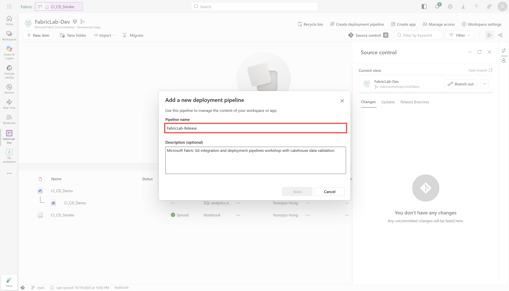

4. **Development → Test → Production**의 세 단계를 확인합니다.
5. **Create and continue**로 생성합니다.

**기대 결과:** Pipeline이 생성됩니다. 생성·관리 권한은 Workspace 역할과 별도입니다.
촬영 환경은 UI에서 Pipeline을 생성했고 현재 계정의 Pipeline Admin도 API로 확인했습니다.

## 4-2. 각 단계에 Workspace 할당

**공식 문서 기준:** Workspace에서 Pipeline을 생성한 경우 해당 Workspace는 생성 시
자동 할당되므로 먼저 카드의 연결 상태를 확인합니다. 올바르게 할당되어 있으면 그 단계의
수동 Assign을 건너뜁니다. 좌측 Deployment pipelines에서 생성했거나 카드가 비어 있으면
아래 절차로 할당합니다. [공식 Step 3 안내](https://learn.microsoft.com/en-us/fabric/cicd/deployment-pipelines/get-started-with-deployment-pipelines#step-3---assign-a-workspace)

**경로:** 단계 카드의 **Assign a workspace → 이름 선택 → Assign**.
이름을 드롭다운에서 선택하는 것만으로는 할당이 끝나지 않습니다.

| 단계 | Workspace |
|---|---|
| Development | `FabricLab-Dev` |
| Test | `FabricLab-Test` |
| Production | `FabricLab-Prod` |

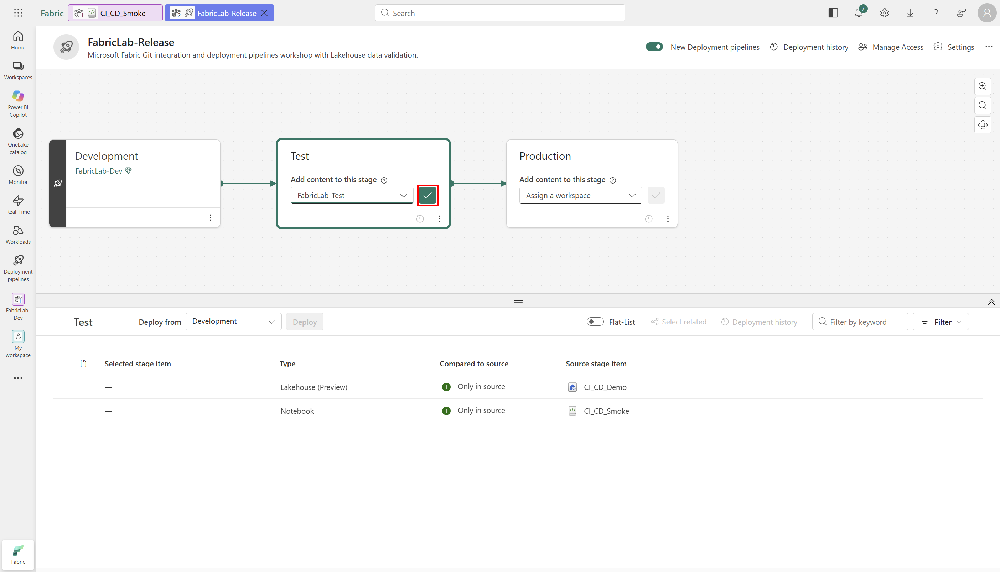

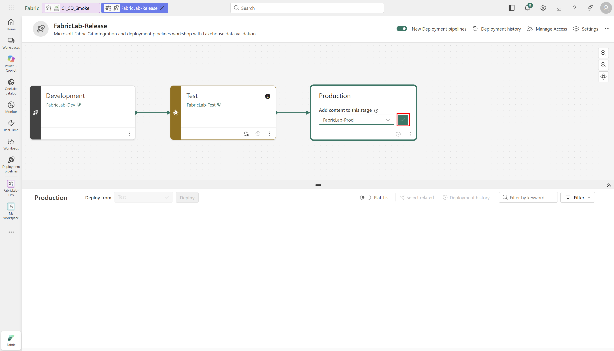

촬영 환경에서는 세 단계 할당을 모두 실제 UI로 수행했고 stages API의 실제 Workspace ID와
대조했습니다. 이 기록이 모든 환경에서 세 번의 수동 Assign을 요구한다는 뜻은 아닙니다.
Feature Workspace는 이 Pipeline에 넣지 않습니다.

**기대 결과:** 세 카드가 정확한 Workspace를 가리킵니다. Workspace를 연결했다고
아이템 정의·테이블 데이터가 자동으로 배포되는 것은 아닙니다.

## 4-3. Dev v1 → Test v1 초기 배포 — 실제 수행

1. Dev v1의 실제 Delta 결과가 10행·합계 45인지 확인합니다.
2. **대상인 Test 카드**를 선택합니다.
3. 하단 **Deploy from = Development**를 확인합니다.
4. 목록이 가려지면 캔버스 접기 버튼으로 전체 아이템 목록을 보이게 합니다.
5. `CI_CD_Demo` Lakehouse와 `CI_CD_Smoke` Notebook **두 아이템**을 선택합니다.

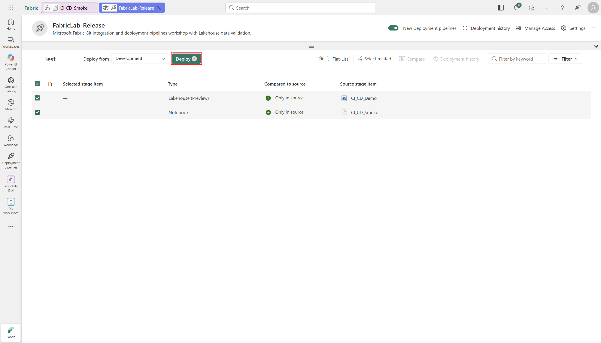

첫 배포에서 Notebook만 배포하고 Lakehouse가 생겼을 것이라고 가정하지 않습니다.
Lakehouse가 관리하는 SQL analytics endpoint를 별도 source item으로 선택하지 않습니다.

6. **Deploy**로 확인 창을 엽니다.
7. Development → Test, 두 아이템의 이름, New/Modified 범위를 확인합니다.
8. **Continue deployment in case 1 or more items fail**을 해제합니다.
9. **Add a note**에 Git SHA, v1, Dev 실제 검증 결과와 다음 Test 검증 계획을 적습니다.
10. 최종 **Deploy**를 선택하고 배포 완료를 기다립니다.

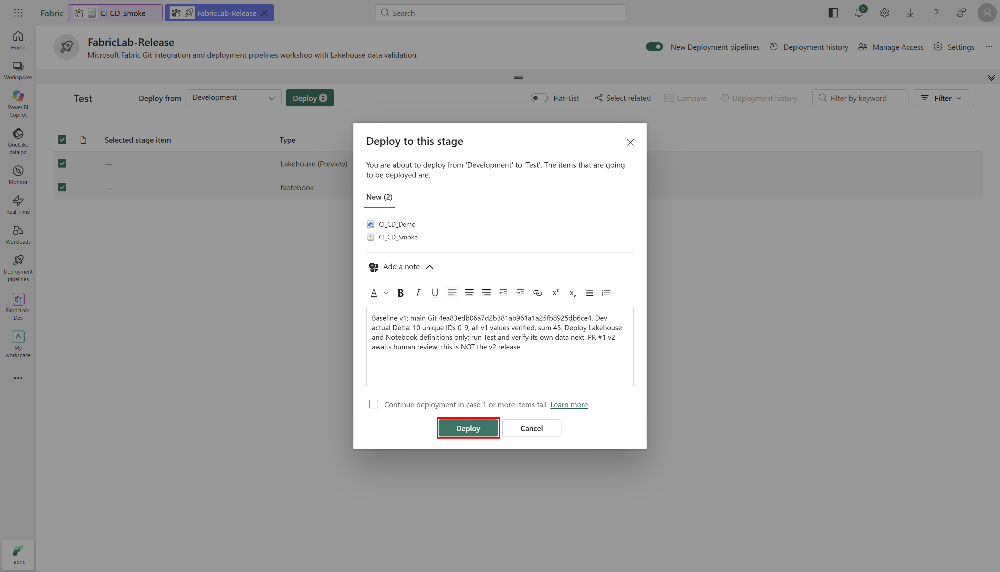

**실제 결과:** 배포 `1fa47585-6501-4c8d-b628-4f46c582b056`가 Succeeded였습니다.
source/target stage ID, 두 새 정의와 note의 `main 4ea83edb`를 API로도 대조했습니다.
이 배포를 v2 배포라고 기록하지 않았습니다.

## 4-4. 배포 직후: 정의와 바인딩, 데이터 부재 확인

1. Test Workspace에 `CI_CD_Demo`와 `CI_CD_Smoke`가 생성됐는지 확인합니다.
2. Notebook을 실행하지 말고 먼저 저장된 정의를 확인합니다.
3. 전체 코드가 v1과 같고 기본 Lakehouse의 ID와 Workspace ID가 **Test 자체**인지 대조합니다.
4. Test Lakehouse **Tables → dbo**를 펼칩니다.

**실제 확인:** 코드 AST는 Dev v1과 같았고, 물리 기본 Lakehouse는 Test로 자동 바인딩됐습니다.
배포 직후 `dbo.cicd_smoke`의 OneLake 경로는 404 **PathNotFound**였으며 아직 실행하지
않았음을 함께 확인했습니다. 임의 오류를 빈 테이블로 처리한 결과가 아닙니다.

이것이 **정의 배포는 Lakehouse 데이터를 복사하지 않는다**는 점을 확인하는 체크포인트입니다.

## 4-5. Test에서 Notebook 실행·실제 데이터 검증

1. Test의 기본 Lakehouse를 다시 확인합니다.
2. 배포된 v1 Notebook을 실행합니다.
3. 현재 Workspace가 Test인지, 실제 Delta 경로가 Test Lakehouse인지 확인합니다.
4. 10행·고유 ID 0–9·모든 값과 release=v1·합계 45를 확인합니다.

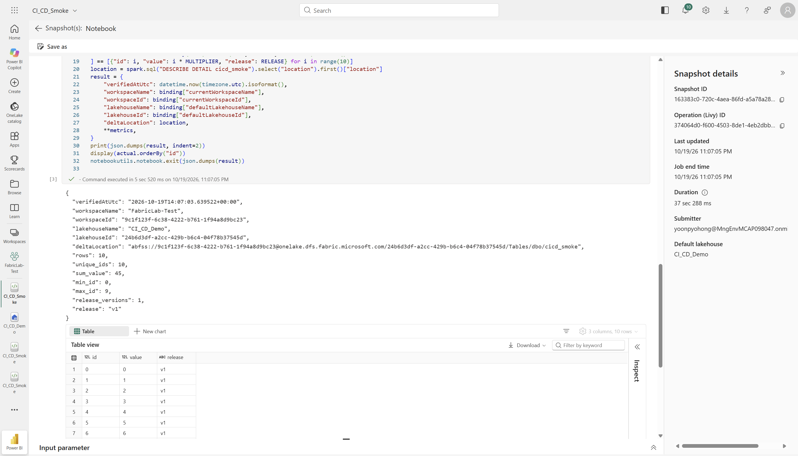

**실제 수행:** Job Scheduler API로 실행하고 실제 실행 스냅샷과 결과를 확인했습니다.
실행 후에만 OneLake 테이블 경로가 200으로 존재했습니다. 생성된 Delta commit이나
Completed라는 상태만으로 데이터 정합성을 주장하지 않았습니다.

> schema-enabled Lakehouse에는 현재 Tables List API가 지원되지 않아
> `UnsupportedOperationForSchemasEnabledLakehouse`를 반환했습니다. 이 응답을 빈 목록으로
> 무시하지 않았으며, 실제 UI·OneLake 경로·Spark의 테이블 읽기를 사용했습니다.

## 4-6. 환경별 기본 Lakehouse 규칙

Git의 Feature 분기는 [Git binding 설정](02-git-integration.md), 단계 간 배포는
Pipeline의 의존성 auto-binding으로 확인했습니다. 두 기능을 같은 설정이라고 혼동하지 않습니다.

특정 대상 Lakehouse를 고정해야 한다면 **대상 Test 또는 Production 단계**에서 Notebook
배포 규칙을 설정합니다. Development에 대상 환경 규칙을 만들지 않습니다.

**필수 권한:** 규칙을 만들 **대상 Notebook의 아이템 소유자**여야 합니다.
Workspace Admin이나 Pipeline Admin 역할만 확인하고 이 조건을 생략하지 않습니다.
Notebook의 About/Details에서 소유자를 확인하고, 소유자가 아닌 경우 실제 소유자에게
규칙 구성을 요청합니다. 소유권이나 권한을 승인 없이 자동으로 바꾸지 않습니다.
[Notebook 공식 사전 조건](https://learn.microsoft.com/en-us/fabric/data-engineering/notebook-source-control-deployment#before-you-start)과
[Deployment rules 제한사항](https://learn.microsoft.com/en-us/fabric/cicd/deployment-pipelines/create-rules#considerations-and-limitations)을
따릅니다.

**소유자 확인 경로:** 대상 Test Workspace에서 `CI_CD_Smoke`의 **More options → Settings →
About → Details → Owned by**를 확인합니다. 아래는 기존 Test Notebook을 조회한 화면입니다.

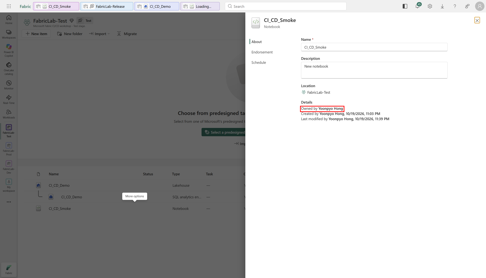

**빨간 박스:** `Owned by`의 실제 아이템 소유자입니다. **Location이 FabricLab-Test**인지도
함께 확인합니다. 이 캡처를 위해 소유권을 인수하거나 Workspace/Pipeline 역할을 변경하지
않았습니다. 관리 권한 화면 대신 대상 아이템 자체의 소유자를 확인하는 단계입니다.

1. 첫 정의 배포로 대상 Lakehouse와 Notebook의 pairing을 확인합니다.
2. 대상 단계 **Deployment rules → CI_CD_Smoke → Default lakehouse → Add rule**을 엽니다.
3. **From**에서 source 단계의 실제 `CI_CD_Demo`를 선택합니다.
4. **To → Other**를 선택하고 대상의 실제 Lakehouse ID·이름·Workspace ID를 입력합니다.
5. 대상이 같은 단계의 Lakehouse인지 대조한 뒤 Save합니다.

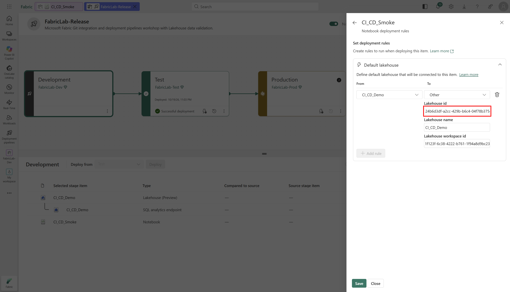

규칙은 auto-binding보다 우선합니다. Source와 같은 Lakehouse를 유지하는 옵션을 고르면
다른 환경을 참조할 수 있습니다. 이 실습의 쓰기 전 guard는 그런 실행을 거부합니다.
규칙을 저장한 것과 그 규칙이 적용된 **다음 배포·실행 검증**은 구분합니다.
이번에는 Test 규칙을 저장·페이지 reload로 재확인한 뒤, 아래 실제 v2 배포에서 코드·물리
바인딩·실제 데이터를 검증했습니다. [실행 기록](05-execution-record.md)에서 근거를 확인합니다.

**v1 초기 준비를 마쳤다면 Git 가이드로 돌아가 승인·병합을 진행합니다.**
아직 Dev가 v1인 상태에서 아래 v2 배포를 시작하지 않습니다.

| 다음 단계 | 승인·병합과 Dev v2 검증을 이미 마친 경우 |
|---|---|
| [사용자 승인·PR 병합·Dev Update로 이동 →](02-git-integration.md#merge-and-dev-update) | [Test v2 배포로 바로 이동 ↓](#release-v2) |

## 4-7. 사용자 승인·PR 병합 후 Dev v2 → Test v2 — 실제 수행

실제 사용자 승인·PR 병합과 [Dev v2 Update/실행](02-git-integration.md)을 마친 뒤 진행했습니다.

1. Dev가 승인된 main과 같고 실제 v2 결과가 10행·합계 90인지 확인합니다.
2. Test 대상, Development 원본을 확인합니다. Lakehouse는 이미 pairing되어 있고 변경되지
   않았으므로 이번에는 바뀐 Notebook 하나를 선택합니다. v1 초기 배포를 생략해 Test가
   아직 비어 있는 환경이라면 첫 배포에 Lakehouse와 Notebook 두 정의가 모두 필요합니다.

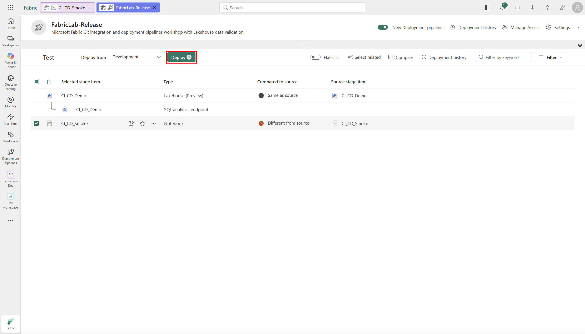

3. **Compare**를 열어 **To be modified [Test]**와 **To be deployed [Development]**를
   대조합니다. 실제 코드 diff는 `RELEASE`와 `MULTIPLIER`의 -2/+2였습니다.
   Compare의 배포 예상 정의와 실제 실행 환경의 물리 metadata는 구분하고, 배포 후에도
   실제 정의를 내보내 확인합니다.

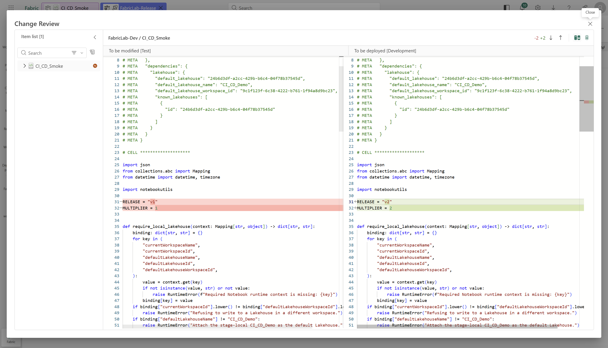

4. Test의 저장된 기본 Lakehouse 규칙이 Test 자체를 가리키는지 확인합니다.
5. **Deploy**를 눌러 Different (1), Notebook 이름과 방향을 확인합니다.
6. 오류 시 계속 옵션을 해제하고 실제 merge SHA `0cf51fd`와 Dev 검증 근거를 note에 남긴 뒤
   최종 **Deploy**를 선택합니다.

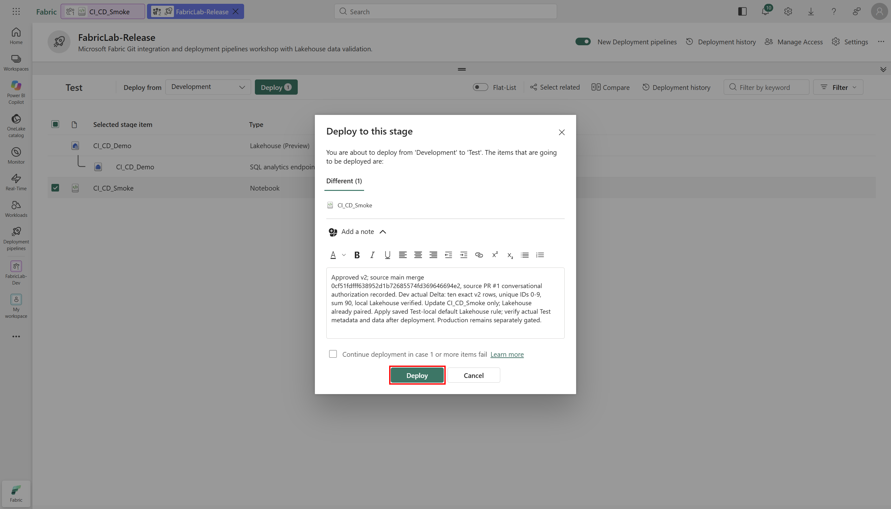

7. 실제 배포 `2f8a633c-853d-4b5b-bf59-fa618241c291`가 Succeeded임을 확인합니다.
   새 아이템 0, 변경 1, 실제 방향·note도 API로 대조했습니다.
8. Test의 전체 코드 AST가 merge Commit의 v2와 같은지, 물리 기본 Lakehouse가 Test인지
   확인한 후 Notebook을 실행합니다.

9. 실제 10행·고유 ID 0–9·모든 v2 행 값·합계 90을 확인합니다.
   v1에서 사용하던 같은 Test 테이블이 업데이트되었고 20행으로 중복 적재되지 않았습니다.
10. Pipeline의 **Deployment history**에서 v1 초기 배포와 v2 업데이트를 구분합니다.

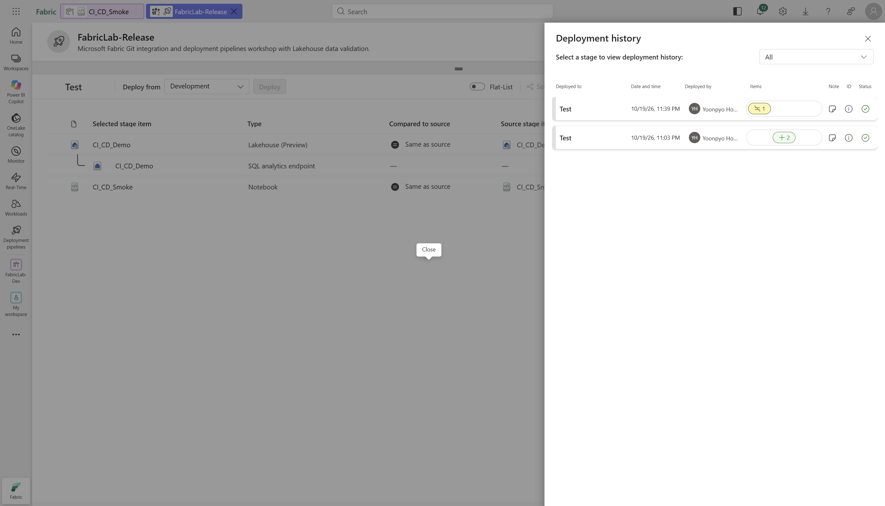

기존 Test v1 합계 45를 v2 검증으로 재사용하지 않습니다. Git Commit이나 Definition 배포만으로
기존 Test 데이터가 v2로 바뀌지 않습니다.

[다음: 별도 승인 후 Production 승격 →](#production-release)

## 4-8. Test 검증 후 별도 승인 → Production — 실제 수행

### 대상·변경·비용을 제시하고 승인받기

Test의 v2 결과를 확인한 뒤 Production 대상, 두 아이템 정의와 합성 데이터 생성,
기존 F16의 CU·스토리지 비용을 제시했습니다. 사용자가 다음 범위를 명시적으로 승인한 뒤
진행했습니다.

> FabricLab-Prod로 Test v2를 배포하고, Notebook 실행과 실제 데이터 10행·합계 90 검증까지
> 승인해. 기존 F16의 CU·스토리지 비용도 동의해.

이것은 이번 실행의 실제 승인 기록입니다. 특정 문구를 그대로 입력해야 하는 암호가 아니며,
다른 환경에서는 프로젝트 운영 정책에 따라 대상·버전·변경·비용·실행 범위가 명확한 승인
기록을 남깁니다. **Fabric 네이티브 승인 Workflow나 독립 GitHub review를 구성한 것은 아닙니다.**

1. 사람이 PR/merge SHA, Test v2 실제 결과, 대상·변경·비용을 검토하고 릴리스를 승인합니다.
2. **대상 Production**, **Deploy from = Test**를 확인합니다.
3. 첫 배포라면 Lakehouse와 Notebook을 함께 선택합니다.

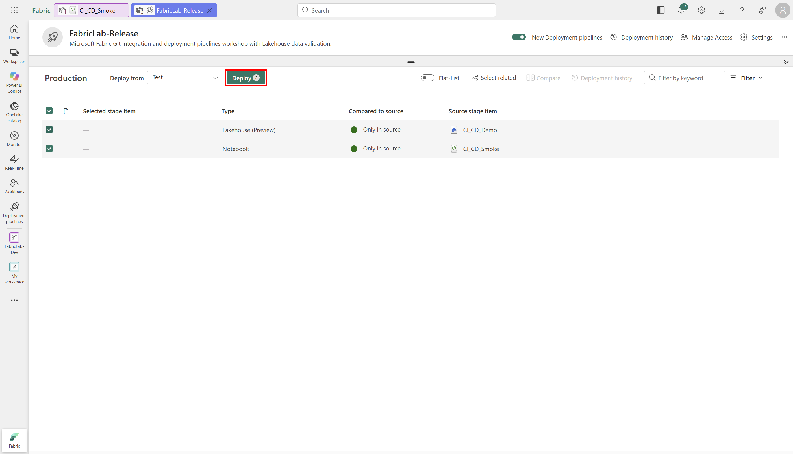

4. 방향·아이템·실제 승인된 SHA·검증 note를 확인하고 배포합니다.
   오류 시 계속 옵션은 해제합니다. 이번 note에는 승인 UTC 시각, Test 검증 job,
   main `0cf51fd`, CU·스토리지 비용 동의와 코드·바인딩 확인 후 실행 조건을 기록했습니다.

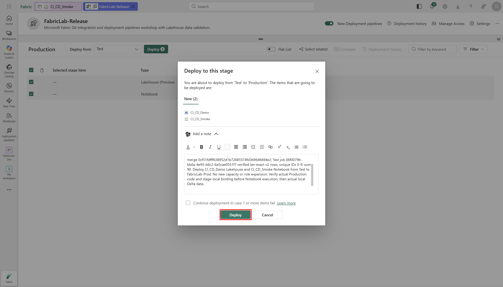

**실제 결과:** 배포 `85eb6998-4f08-44e3-864e-38b8e25a4748`가 Succeeded였습니다.
Test → Production 방향, 새 정의 2개와 note를 API로도 대조했습니다.

### 실행 전에 Production 자체 바인딩과 빈 데이터 확인

5. Production에 생긴 실제 Lakehouse ID와 Notebook의 물리 바인딩을 확인합니다.
   전체 코드 AST가 승인된 main v2와 같고 세 코드 셀이 보존됐는지 대조합니다.
   이번에는 auto-binding이 Production 자체 Lakehouse로 올바르게 해결되어 별도의
   Production override 규칙을 추가하지 않았습니다. Test 규칙을 Production 규칙으로 간주하지 않습니다.
6. Notebook 실행 전 **Tables → dbo**를 펼칩니다.

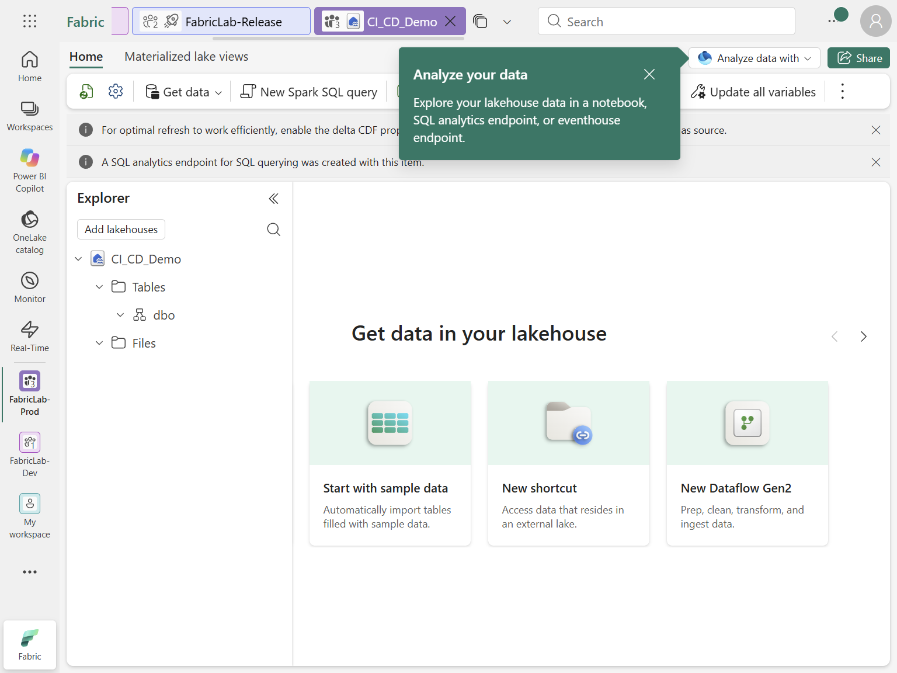

**실제 확인:** Production의 `Tables/dbo/cicd_smoke` 경로는 404 **PathNotFound**였습니다.
기본 Lakehouse와 Workspace ID가 Production 자체인 것을 내보낸 정의로 확인하기 전에는
Notebook을 실행하지 않았습니다.

### 실제 Production 실행과 데이터 검증

7. 쓰기 전 guard를 통과한 뒤 Production Notebook을 실행합니다.
8. **실제 Production 데이터**의 10행·유일한 ID·모든 v2 값·합계 90과 물리 위치를 확인합니다.

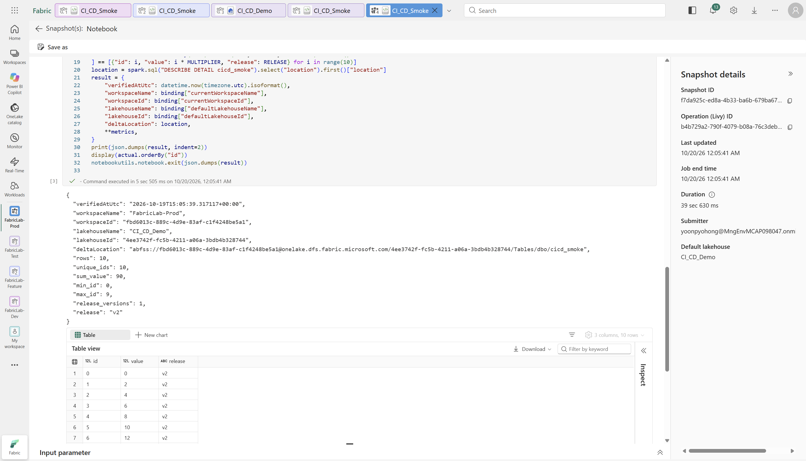

**실제 수행:** 명시적 승인 범위 안에서 Job Scheduler API로 실행하고 실제 스냅샷을 촬영했습니다.
Job `f7da925c-ed8a-4b33-ba6b-679ba678fdef`는 Completed였고, 실제 모든 행과 합계·바인딩을
검증한 JSON을 API에서도 대조했습니다. 실행 후에만 해당 OneLake 경로가 200으로 존재했습니다.

9. 배포 이력과 데이터 검증 결과를 함께 기록합니다.

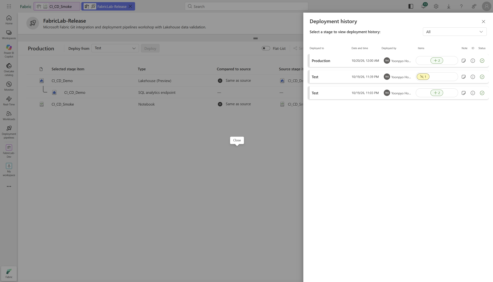

최종 검증에서는 Dev·Feature·Test·Production 네 Notebook을 다시 내보내 공통 v2 코드 AST,
각각의 물리 기본 Lakehouse ID와 Workspace ID도 대조했습니다. Dev/Feature의 성공이나
Test 결과로 Production 검증을 대신하지 않았습니다.

---

## 다음으로 이동

| 이전 단계 | 전체 목차 | 다음 단계 |
|---|---|---|
| [← 승인·PR 병합·Dev Update](02-git-integration.md#merge-and-dev-update) | [실습 순서](README.md#workshop-order) | [검증·복구·비용 정리 →](04-validation-and-recovery.md) |
