# 3. GitHub 연결, Feature branch, PR과 Dev Update

[처음으로](README.md) · [이전: Lakehouse + Notebook](02-lakehouse-notebook.md) · [다음: 배포](04-deployment-pipelines.md)

**목표:** Workspace → Git Commit과 Git → Workspace Update를 구분하고, 실제 Feature
데이터 검증과 사람의 PR 검토를 거쳐 main에 반영합니다.

## 3-1. Dev를 main의 새 Git directory에 연결

**경로:** `FabricLab-Dev → Workspace settings → Git integration → Connection details`.

**필수 권한:** 실습 계정은 Dev Workspace Admin이어야 하며, GitHub 실습 저장소의
읽기·쓰기와 PR 작업에 필요한 권한 및 유효한 인증이 있어야 합니다.

Workspace 역할과 GitHub 저장소 권한은 별개입니다. Workspace Admin이어도 GitHub 접근 권한이나
유효한 인증이 없으면 연결·Commit·Update를 할 수 없습니다.

처음부터 실습하는 독자는 [자신의 새 소스 저장소](01-prerequisites.md#source-repository)를
사용합니다. 이 가이드의 실습 저장소 이름은 `fabric-alm-lab`이며 owner는 본인 계정입니다.
캡처의 계정 대신 본인의 저장소 URL을 입력합니다.

1. GitHub를 선택합니다. 회색이면 [필수 tenant 설정](01-prerequisites.md)을 먼저 확인합니다.
2. 올바른 repository-scoped 계정을 선택하고 **Connect**를 누릅니다.
   새 계정이 필요한 경우 **Add account**에서 Display name, 본인 저장소의 Repository URL,
   사전 준비에서 만든 PAT를 입력합니다. PAT는 보안 입력란에만 입력하며 화면에 노출하지 않습니다.
3. Branch는 `main`, Git folder는 `/workshops/cicd/fabric`으로 지정합니다.

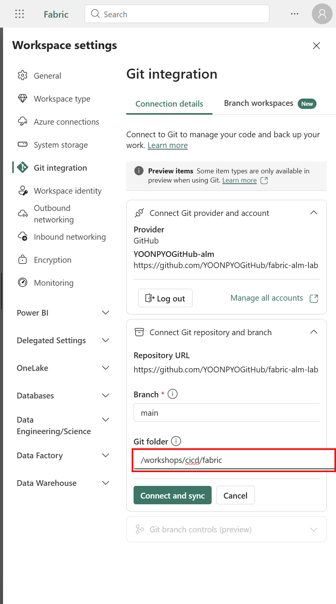

4. **Connect and sync**를 누릅니다.
5. 폴더가 없다는 확인 창에서 정확한 경로를 대조하고 **Create and sync**를 선택합니다.

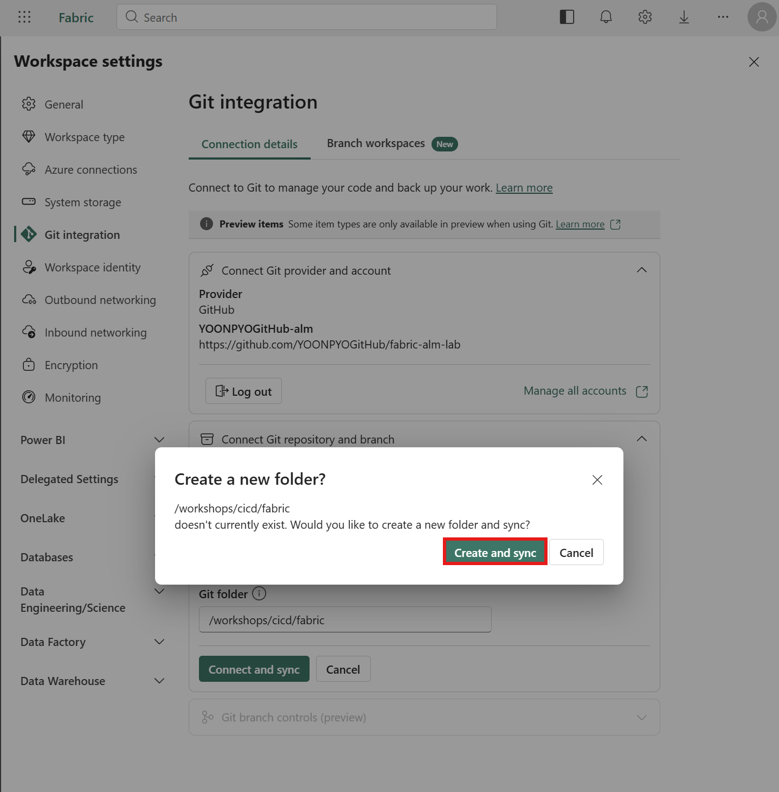

### 초기 동기화 방향과 완료 상태 확인

앞 단계에서 Dev에 만든 Lakehouse와 Notebook의 정의를 GitHub 저장소에 처음 저장합니다.
**Create and sync**를 선택하면 GitHub에 `/workshops/cicd/fabric` 폴더가 생성되고
두 아이템의 정의가 저장됩니다. 동기화 방향은 **Dev Workspace → GitHub**입니다.

GitHub의 대상 폴더에 이미 아이템 정의가 있거나 삭제·덮어쓰기 경고가 나오면
진행을 멈추고 Workspace와 GitHub의 내용을 비교합니다.

동기화가 끝나면 Dev Workspace의 아이템 목록에서 `CI_CD_Demo` Lakehouse와
`CI_CD_Smoke` Notebook의 **Git status**가 모두 **Synced**인지 확인합니다.

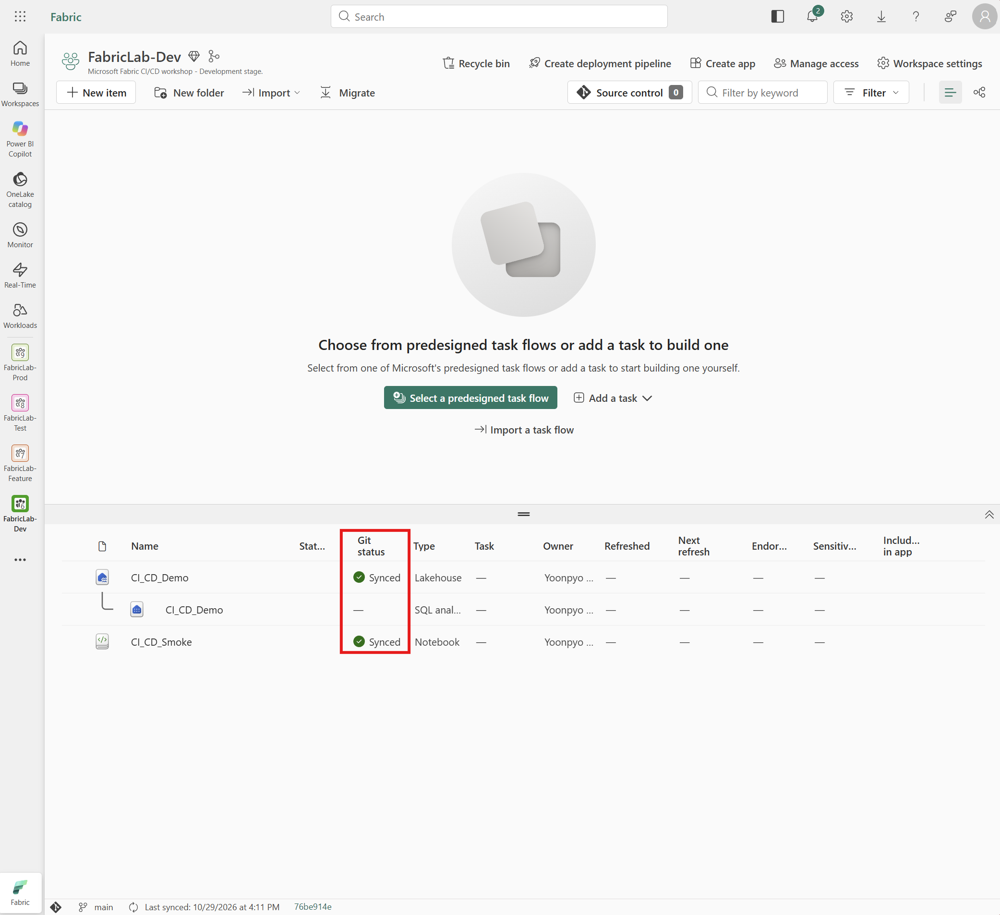

SQL analytics endpoint 행의 `—`는 별도 Git 동기화 대상이 아니므로 정상입니다.
**Synced**는 정의의 동기화 상태이며, Notebook 실행이나 실제 데이터 검증 성공을 뜻하지는 않습니다.

**기대 결과:** 두 아이템의 정의가 GitHub의 `main` 브랜치와 `/workshops/cicd/fabric` 폴더에 저장됩니다.

GitHub 저장소의 **Code** 탭에서 `main` 브랜치를 선택하고 다음 폴더와 파일이 생성되었는지 확인합니다.

```text
workshops/cicd/fabric/
  CI_CD_Demo.Lakehouse/
    .platform
    alm.settings.json
    lakehouse.metadata.json
    shortcuts.metadata.json
  CI_CD_Smoke.Notebook/
    .platform
    notebook-content.py
```

SQL analytics endpoint는 Lakehouse가 관리하는 항목입니다. 별도 source definition이나
Delta 테이블 행을 Git에 추가하지 않습니다.

## 3-2. Git으로 분기할 때 Lakehouse 바인딩 설정

**경로:** Dev Notebook **Settings → Git settings → Git binding**.

1. **Lakehouse in new workspace**를 선택합니다.
2. 변경이 다음 Commit에 반영된다는 안내를 확인합니다.

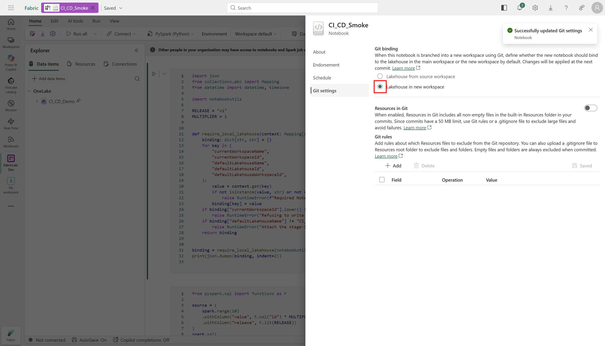

3. Workspace로 돌아와 **Source control → Changes**를 엽니다.
4. Notebook 하나의 변경을 검토하고 Commit 메시지를 입력합니다.
5. 해당 Notebook을 선택하고 **Commit**합니다.

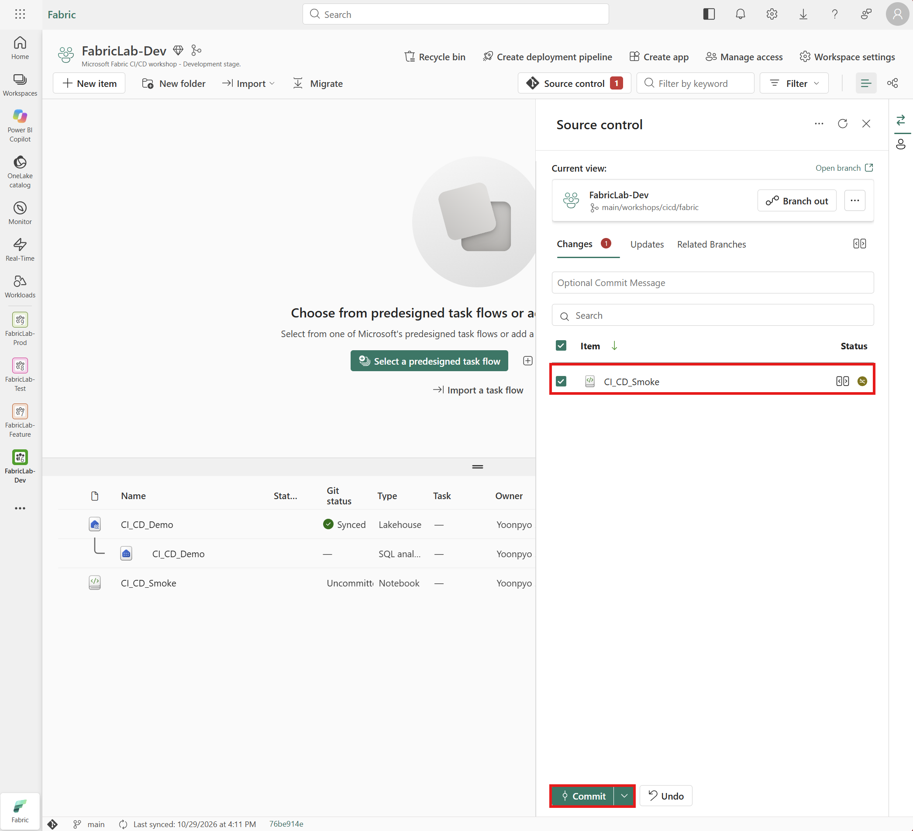

**실제 기록:** Commit `4ea83edb`. Fabric이 `notebook-settings.json`을 만들고 lakehouse
물리 ID를 logical ID로 바꾸었습니다. Workspace ID의
`00000000-0000-0000-0000-000000000000`은 이 Git 바인딩 표현의 일부이지 배포할 실제
Workspace ID가 아닙니다. 이 설정 파일이나 logical ID를 수동으로 고치지 않습니다.

Lakehouse와 Notebook을 **함께** 버전 관리하고, 동기화 후에는 실제 물리 ID가 새 환경으로
해결되었는지 다시 확인합니다. 설정이 on이라는 사실만으로 안전한 바인딩이 증명되지는 않습니다.

## 3-3. Feature branch와 Feature Workspace

**경로:** GitHub 소스 저장소 **Branches → New branch**.

1. Source가 최신 `main`인지 확인합니다.
   새 실습의 main에는 앞 절에서 내보낸 **v1·MULTIPLIER=1**이 있어야 합니다.
   이미 v2라면 아래 변경을 반복하지 말고 새 실습의 시작 상태를 확인합니다.
2. 새 이름 `feature/smoke-v2`를 입력하고 **Create new branch**를 선택합니다.

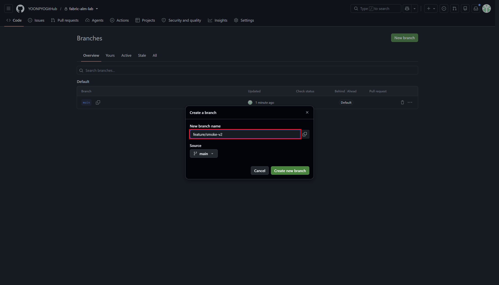

**실제 기록:** 새 branch의 시작 Commit이 `4ea83edb`와 같음을 API로 대조했습니다.
오래 열린 GitHub 화면의 오래된 Commit을 분기 기준으로 추측하지 않습니다.

3. `FabricLab-Feature → Workspace settings → Git integration`을 엽니다.
4. 같은 repository-scoped 계정을 선택합니다.

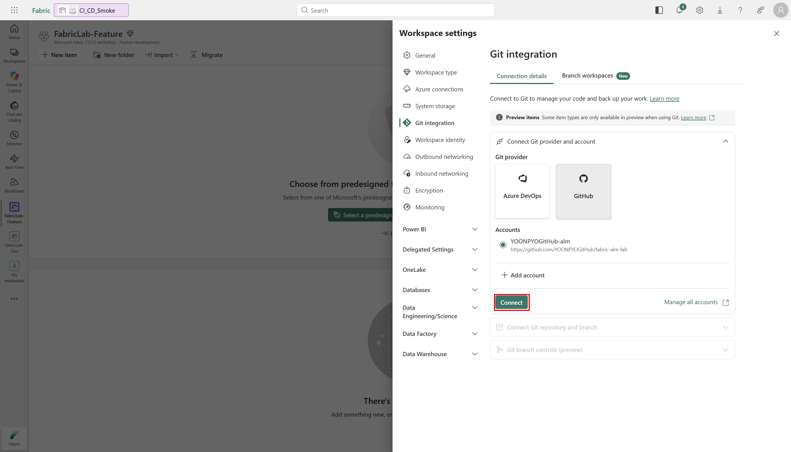

5. `feature/smoke-v2`, `/workshops/cicd/fabric`에 연결합니다.
6. 비어 있는 Feature Workspace에 Git의 Lakehouse와 Notebook 정의를 가져옵니다.
   이 단계의 동기화 방향은 **GitHub → Feature Workspace**입니다.

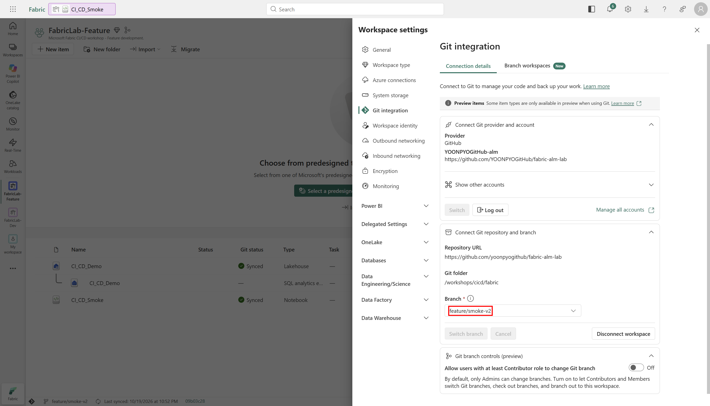

**기대 결과:** Feature Workspace에 `CI_CD_Demo` Lakehouse와 `CI_CD_Smoke` Notebook이 생성되고,
Git 연결이 `feature/smoke-v2`와 `/workshops/cicd/fabric`을 가리킵니다.
두 아이템의 Git status가 **Synced**인지 확인합니다.

가져온 Notebook 코드가 Dev와 같은 `RELEASE = "v1"`, `MULTIPLIER = 1`인지 확인합니다.
기본 Lakehouse는 Dev가 아닌 **Feature의 `CI_CD_Demo`**여야 하며 실제 연결 대상 ID도 대조합니다.

기존 실행에서 사용한 API 연결 방식은 [별첨의 Feature Git 연결 기록](06-execution-record.md#feature-git-api)을 참고합니다.

## 3-4. Feature에서 v2 변경·검증

로컬 PC의 터미널에서 Feature branch의 Notebook 코드를 v2로 변경하고 GitHub에 Push합니다.
이후 Fabric의 Feature Workspace에서 변경 사항을 가져와 실행·검증합니다.

### 로컬에서 Feature branch 준비

Git과 본인 실습 저장소의 GitHub 인증을 준비하고, `python3 --version`으로 Python 3.12 이상인지 확인합니다.
아래 명령은 Notebook 코드 셀이 아닌 **Linux/WSL의 로컬 터미널**에서 실행합니다.
`<YOUR_OWNER>`는 본인 계정으로, `fabric-alm-lab`은 자신의 저장소 이름으로 바꿉니다.
`fabric-alm-workshop`은 clone할 로컬 폴더 이름입니다.

처음 clone하는 경우에만 아래 블록을 실행합니다. 이미 같은 실습 저장소를 clone했다면
기존 폴더에서 `git branch --show-current`로 `feature/smoke-v2`인지 확인하고,
다른 branch라면 `git switch feature/smoke-v2`로 전환합니다. clone은 다시 실행하지 않습니다.

```bash
git clone https://github.com/<YOUR_OWNER>/fabric-alm-lab.git fabric-alm-workshop &&
cd fabric-alm-workshop &&
git switch feature/smoke-v2 &&
git grep -n -E '^(RELEASE|MULTIPLIER) =' -- workshops/cicd/fabric/CI_CD_Smoke.Notebook/notebook-content.py
```

**기대 결과:** `feature/smoke-v2`로 전환되고, 소스에 `RELEASE = "v1"`, `MULTIPLIER = 1`이 표시됩니다.
두 줄이 이미 v2/2이면 여기서 멈추고, 본인이 준비한 v1에서 분기했는지 확인합니다.

<a id="prepare-smoke-tests"></a>

### 오프라인 테스트 준비

Fabric이 내보낸 아이템 정의에는 테스트 코드가 없으므로 가이드의 테스트 파일을 추가합니다.
이후 로컬 명령은 모두 **방금 clone한 본인 실습 저장소의 루트**에서 실행합니다.

1. [실습용 테스트 파일](examples/test_smoke_contract.py)을 **Download raw file**로 받아
   `workshops/cicd/tests/test_smoke_contract.py`로 저장합니다. 디렉터리가 없으면 만듭니다.
   가이드를 로컬로 받았다면 `examples/test_smoke_contract.py`를 해당 위치로 복사해도 됩니다.
2. v1 상태에서 테스트를 실행합니다.

    ```bash
    python3 -m unittest discover -s workshops/cicd/tests -v
    ```

**기대 결과:** v1 상태에서 **9개 테스트가 모두 통과**합니다.
파일 누락·오류가 있거나 테스트가 0개이면 다음 단계로 진행하지 않습니다.

파일 배치와 검사 범위는 [예제 사용 안내](examples/README.md#실습용-오프라인-테스트)를 참고합니다.

### v2 변경·검사·Push

`workshops/cicd/fabric/CI_CD_Smoke.Notebook/notebook-content.py`에서 아래 두 상수만 바꿉니다.
Fabric metadata·셀 구분·검증 로직과 `.platform`·`notebook-settings.json`은 수정하지 않습니다.

줄 번호 예시는 **32번째 줄의 `RELEASE`, 33번째 줄의 `MULTIPLIER`**입니다.
내보낸 metadata에 따라 줄 번호가 달라질 수 있으므로 변수 이름도 함께 확인합니다.

```python
RELEASE = "v2"
MULTIPLIER = 2
```

1. v2 상태에서 **9개 테스트가 모두 통과**하고, 변경 내용에 공백 오류나 충돌 표시가 없는지 확인합니다.

    ```bash
    python3 -m unittest discover -s workshops/cicd/tests -v &&
    git diff --check
    ```

    테스트 실패·0개 실행 또는 diff 검사 오류가 있으면 다음 단계로 진행하지 않습니다.

2. Commit 전에 Git 작성자 이름·이메일을 확인합니다. GitHub 로그인·PAT와는 별개의 설정입니다.

    ```bash
    git var GIT_AUTHOR_IDENT
    ```

    이름·이메일 오류가 나면 아래 예시 값을 본인의 정보로 바꿔 **현재 저장소에만** 설정합니다.
    이미 올바르게 설정되어 있다면 변경하지 않습니다.
    이메일은 GitHub 개인 **Settings → Emails**의 등록 이메일 또는 제공되는 `noreply` 주소를 사용합니다.

    ```bash
    git config --local user.name "<YOUR_NAME>" &&
    git config --local user.email "<YOUR_GITHUB_EMAIL>" &&
    git var GIT_AUTHOR_IDENT
    ```

3. 작성자 확인까지 성공하면 Notebook 소스와 추가한 테스트 파일만 staging하고,
   staged 변경을 검사한 뒤 Commit·Push합니다. main에 직접 v2를 Push하지 않습니다.

    ```bash
    git add workshops/cicd/fabric/CI_CD_Smoke.Notebook/notebook-content.py workshops/cicd/tests/test_smoke_contract.py &&
    git diff --cached --check &&
    git commit -m "Validate stage-local Delta smoke data for release v2" &&
    git push origin feature/smoke-v2
    ```

테스트 실행으로 생긴 `__pycache__`나 토큰·로컬 설정을 Commit하지 않습니다.
`&&`로 연결한 명령은 앞 명령이 실패하면 중단됩니다. Commit이 실패했다면 Push 완료로 간주하지 않습니다.

### Fabric에서 변경 반영·실행

**경로:** `FabricLab-Feature → Source control → Updates`.

1. Git에서 가져올 Notebook 변경을 검토하고 **Update all**을 누릅니다.

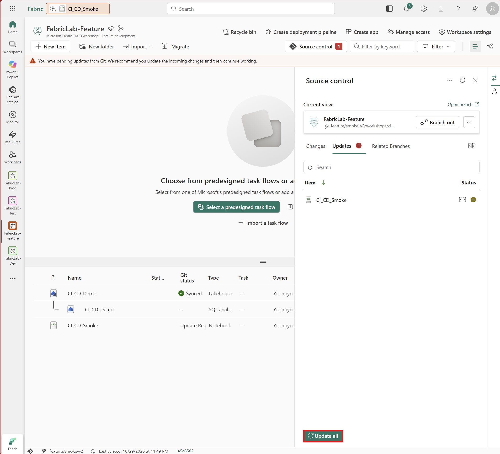

2. `Synced`, Workspace와 GitHub branch의 SHA 일치, 변경 목록 0을 확인합니다.
3. 저장된 Notebook 전체 코드가 Git의 v2 소스와 같고, 실제 기본 Lakehouse ID가
   **Feature의 `CI_CD_Demo`**를 가리키는지 대조합니다.
4. Feature Notebook을 열어 **Run all**로 실행하고, 셀 아래의 실제 테이블 검증 결과를 확인합니다.

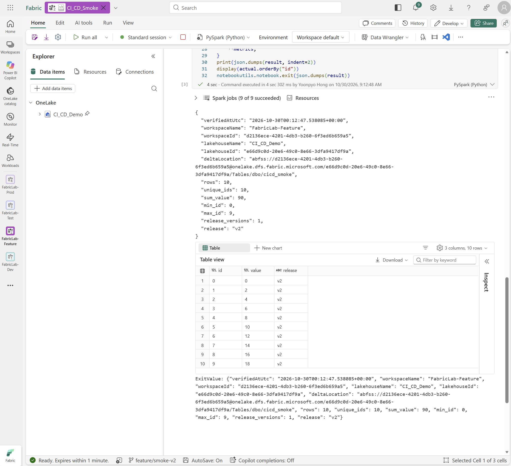

**기대 결과:** Feature 자체 Lakehouse의 실제 Delta 테이블이 10행·고유 ID 0–9이며,
모든 행이 `value=id*2`, `release=v2`이고 합계가 **90**입니다.
출력의 Workspace ID·Lakehouse ID·Delta 위치도 Feature 환경을 가리켜야 합니다.

기존 실행의 소스 검사·API 실행 기록은 [별첨의 Feature v2 검증 기록](06-execution-record.md#feature-v2-verification)을 참고합니다.

## 3-5. 실제 Pull request와 사용자 승인

Feature branch에 저장한 v2 변경을 main에 반영하기 위한 PR을 만듭니다.
Commit·Push나 Fabric의 Update만으로 다른 branch인 main까지 변경되지는 않습니다.

1. 본인 GitHub 실습 저장소의 **Code** 탭에서 branch를 **feature/smoke-v2**로 선택합니다.
2. **Contribute → Open pull request**를 선택합니다.
   **Compare & pull request** 배너가 표시되면 해당 버튼으로 들어가도 됩니다.
3. 비교 화면 상단에서 **base: main**, **compare: feature/smoke-v2**인지 확인합니다.
   base는 변경을 받을 branch, compare는 변경을 가져올 branch입니다.
4. 제목과 설명을 작성합니다.
   - 제목 예시: `Update smoke notebook from v1 to v2`
   - 변경 내용: `RELEASE`를 `"v1"`에서 `"v2"`로, `MULTIPLIER`를 `1`에서 `2`로 변경
   - 검증 근거: 오프라인 테스트 9개 통과, Feature에서 실제 10행·합계 90 확인,
     기본 Lakehouse와 출력의 환경 ID·Delta 위치가 Feature 자체를 가리킴
5. 아래 변경 목록에서 두 상수와 추가한 테스트 파일을 확인합니다.
   metadata·바인딩에 의도하지 않은 변경이 없는지 확인하고, 문서를 수정했다면 함께 검토합니다.
6. **Create pull request**를 선택합니다.
   **Open pull request**는 생성 화면으로 들어가는 버튼이고, **Create pull request**가 실제 PR 생성입니다.

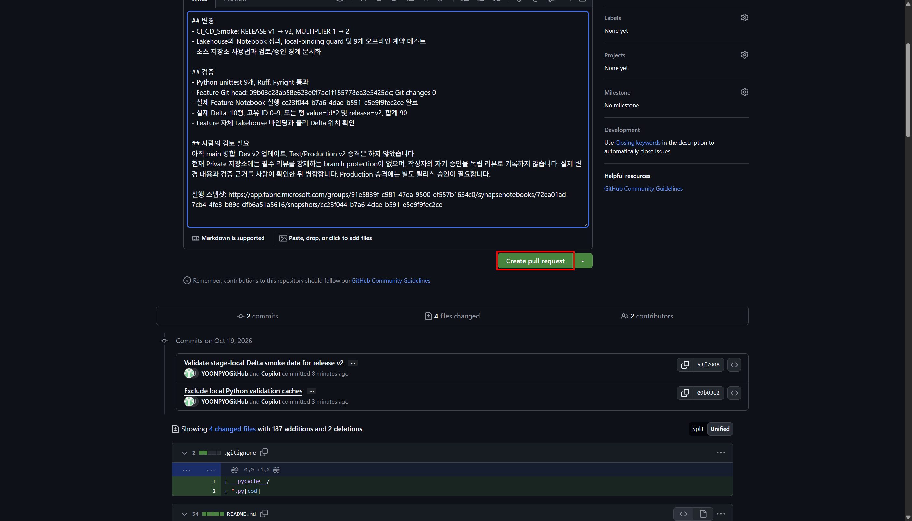

7. 생성된 PR의 **Files changed**에서 코드·metadata·테스트와 본인이 변경한 문서를 검토합니다.

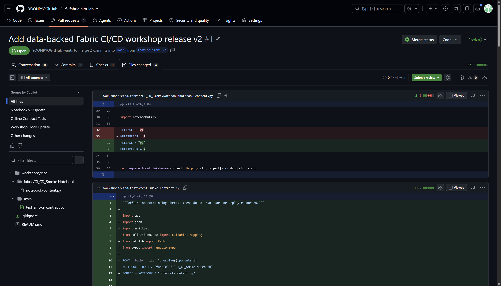

**기대 결과:** PR은 **Open** 상태이며, 병합 전이므로 main은 v1, Feature branch는 v2로 유지됩니다.
처음 진행한다면 **Merge pull request는 아직 누르지 않습니다.**

GitHub Checks는 구성하지 않았습니다. 오프라인 검사를 GitHub 필수 status check가 통과한
것으로 표현하지 않습니다.

검토자가 diff와 검증 근거를 확인하고 실제 병합 승인을 남겨야 합니다. 저장소 정책이
독립 리뷰어 승인을 요구한다면 별도의 적격 리뷰어가 필요합니다. 승인 요청에 응답이 없으면
대기하며 자동 승인·작성자의 자기 승인을 독립 리뷰로 기록하지 않습니다.

**PR 생성 후 이동:** 처음 진행한다면 v1 초기 배포를 마친 뒤 아래 승인·병합 단계로 돌아옵니다.

| 다음 단계 | v1 초기 준비를 이미 마친 경우 |
|---|---|
| [Pipeline 생성·Test v1 초기 배포로 이동 →](04-deployment-pipelines.md#baseline-preparation) | [승인·PR 병합·Dev Update로 바로 이동 ↓](#merge-and-dev-update) |

<a id="merge-and-dev-update"></a>

### 이번 실습의 승인과 실제 병합

**실행 순서 체크포인트:** PR을 만든 직후에는 main이 아직 v1입니다. 실제 순서대로
재현하려면 여기서 [Pipeline의 4-1~4-6 v1 초기 준비](04-deployment-pipelines.md#baseline-preparation)를
마친 뒤 이 승인·병합 절로 돌아옵니다. 이미 main을 v2로 업데이트했다면 v1 절은 과거 실행
기록으로 읽으며, v1을 재현하려고 임의로 코드를 되돌리지 않습니다.

Feature의 실제 10행·합계 90과 PR을 제시한 뒤 사용자에게 main 병합과 Dev/Test v2 검증
진행을 요청했고, 사용자가 대화에서 **“그래 계속 진행해”**라고 승인했습니다.
이것은 사용자의 진행 승인이지 별도의 독립 GitHub 리뷰어가 남긴 APPROVED review가
아닙니다. 그 구분과 Production 별도 승인 범위를
[과거 PR 승인 기록](06-execution-record.md#git-기록)에 남겼습니다.

1. 승인 대상 HEAD `09b03c28`와 baseline main `4ea83edb`가 바뀌지 않았는지 확인했습니다.
2. **Merge pull request**를 선택했습니다.

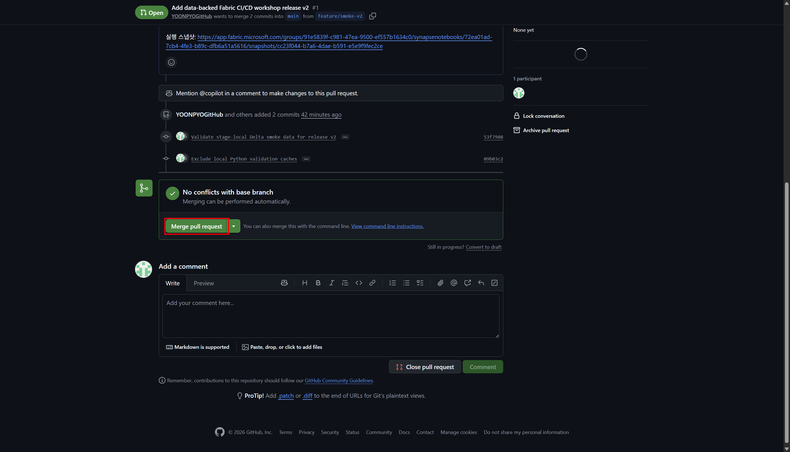

3. Commit message와 설명에 승인 범위와 독립 리뷰와의 구분을 적고 **Confirm merge**했습니다.

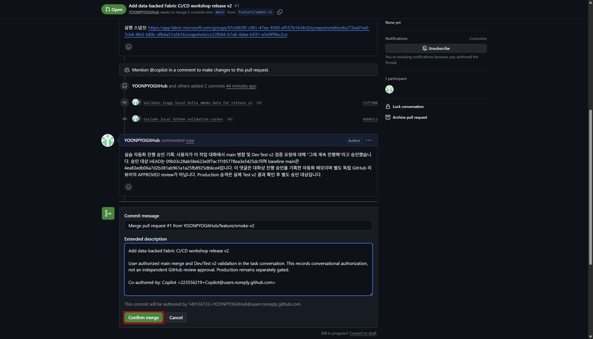

4. 실제 merge SHA와 두 parent, 병합 상태를 API로도 대조했습니다.

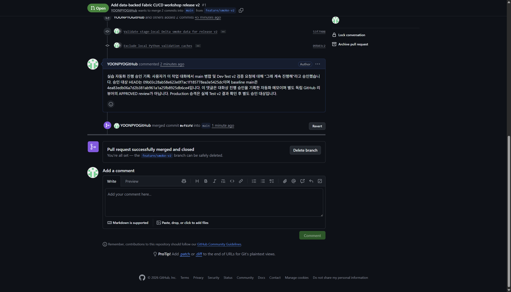

**실제 결과:** [과거 실행의 소스 PR](06-execution-record.md#git-기록)은 Merged이며
merge Commit은 `0cf51fdfff638952d1b72685574fd369646694e2`입니다. 병합된 Fabric 정의는
승인한 Feature 정의와 같고 이전 source directory는 바뀌지 않았습니다.
Feature Workspace가 연결된 branch를 임의로 삭제하지 않았습니다.

## 3-6. 병합 후 Dev Update와 실제 v2 실행

1. GitHub에서 실제 merge Commit SHA를 기록합니다.
2. Dev의 Git 연결이 `main /workshops/cicd/fabric`인지 확인합니다.
3. `FabricLab-Dev → Source control → Updates`에서 변경을 검토합니다.
4. 충돌·삭제·로컬 미커밋 변경이 없는지 확인하고 **Update all**을 선택합니다.

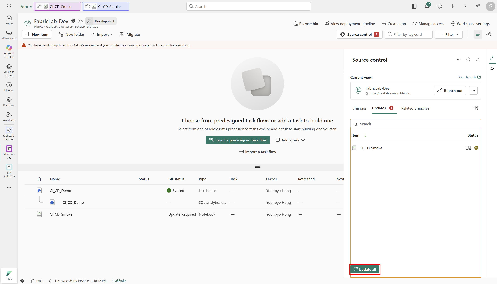

5. Dev의 Git HEAD가 실제 main과 같고 변경 목록이 비었는지 확인합니다.
6. Dev 코드가 v2이며 물리 기본 Lakehouse는 Dev인지 확인합니다.
7. Dev에서 실제 10행·합계 90을 검증한 후 [v2 Test 배포](04-deployment-pipelines.md#release-v2)를 진행합니다.

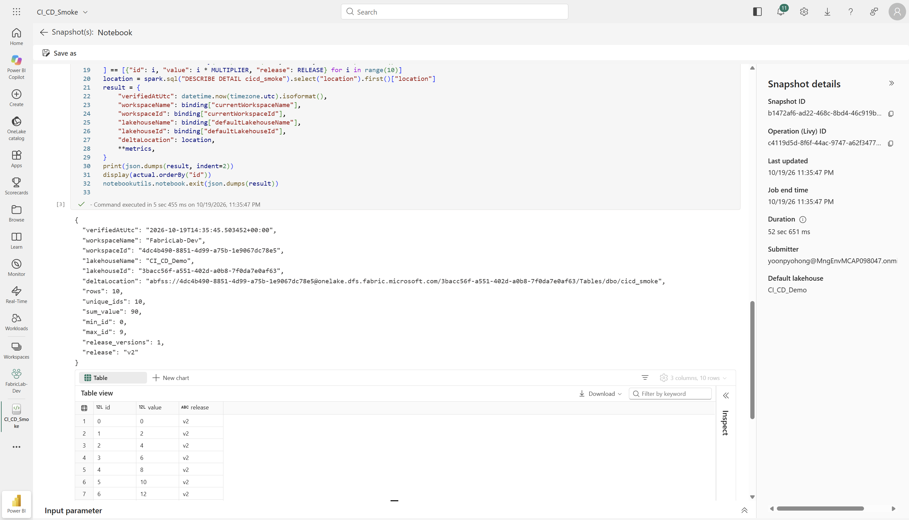

**실제 결과:** UI Update 후 Dev/원격 HEAD가 `0cf51fd`로 일치했고 변경 목록은 비었습니다.
내보낸 전체 코드 AST가 merge Commit의 정의와 같고 물리 기본 Lakehouse는 Dev인 것을
확인한 뒤 API로 실행했습니다. 실제 테이블의 모든 v2 행과 10행·합계 90을 확인했습니다.

Feature HEAD와 merge Commit SHA는 다를 수 있습니다. 버전 문자열 하나나 Saved 표시만 보지
말고 실제 코드와 branch HEAD, 환경별 물리 바인딩을 각각 대조합니다.

---

## 다음으로 이동

Dev v2 검증을 마쳤다면 초기 배포 설명을 다시 읽지 않고 **4-7의 Test v2 배포**로 이동합니다.

| 이전 단계 | 전체 목차 | 다음 단계 |
|---|---|---|
| [← Lakehouse와 Notebook v1](02-lakehouse-notebook.md) | [실습 순서](README.md#workshop-order) | [Test v2 배포·Production 승격 →](04-deployment-pipelines.md#release-v2) |
