# 4. Pipeline 구성과 Test v1 초기 배포

[처음으로](README.md) · [이전: Git 연결과 PR 생성](03-git-integration.md) · [다음: PR 병합과 Dev v2](05-pr-merge-dev-update.md)

**목표:** Pipeline을 구성하고 Dev v1을 Test에 처음 배포해, Test 자체 데이터의 10행·합계 45를 확인합니다.

**시작 조건:** PR은 Open이고 main과 Dev는 v1입니다. Feature의 v2 변경은 아직 병합하지 않습니다.
먼저 Test에 v1을 준비해야 6장에서 v1 → v2 업데이트를 비교할 수 있습니다.
이미 main이나 Dev가 v2라면 진행을 멈추고 시작 상태를 확인하며, 캡처 재현을 위해 임의로 코드를 되돌리지 않습니다.

## 4-1. 새 Deployment pipeline 생성

**경로:** Dev Workspace 상단 **Create deployment pipeline**.

1. 이름에 `FabricLab-Release`를 입력합니다.
2. Description에 Lakehouse 데이터 검증을 포함한 실습 설명을 입력합니다.
3. 입력 검증이 끝나 **Next**가 활성화되면 선택합니다.

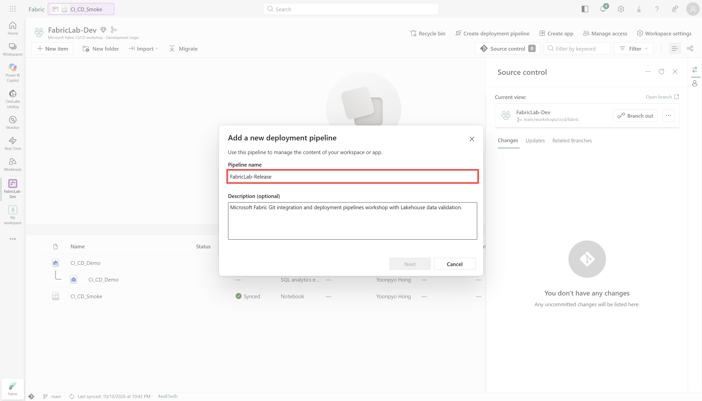

4. **Development → Test → Production**의 세 단계를 확인합니다.
5. **Create and continue**로 생성합니다.

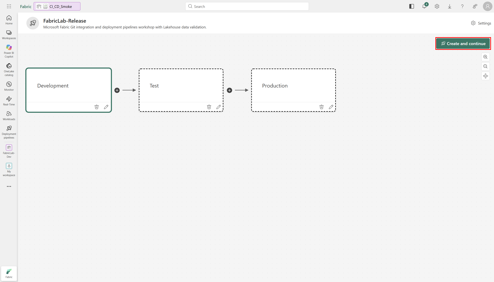

6. 생성이 완료되면 Pipeline 화면에서 **Manage Access**를 엽니다.
7. 오른쪽 **Pipeline access** 패널에서 본인 실습 계정의 역할이 **Admin**인지 확인합니다.

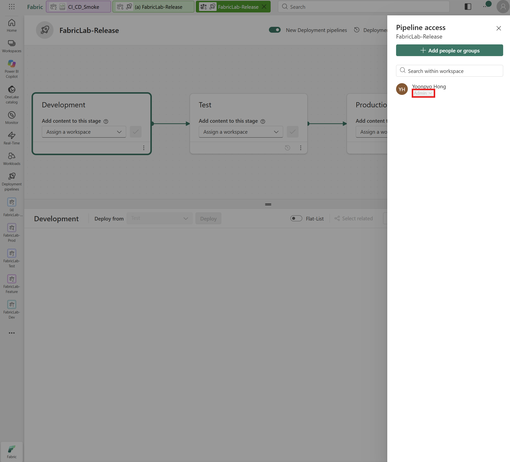

Pipeline Admin은 Workspace Admin과 별개의 권한입니다.
자세한 범위는 [권한 구분과 운영 시 역할 분리](README.md#권한-구분과-운영-시-역할-분리)를 참고합니다.

**기대 결과:** Pipeline이 생성되고 실습 계정의 Pipeline Admin 역할이 확인됩니다.

## 4-2. 각 단계에 Workspace 할당

**공식 문서 기준:** Workspace에서 Pipeline을 생성한 경우 해당 Workspace는 생성 시
자동 할당되므로 먼저 카드의 연결 상태를 확인합니다. 올바르게 할당되어 있으면 그 단계의
수동 Assign을 건너뜁니다. 좌측 Deployment pipelines에서 생성했거나 카드가 비어 있으면
아래 절차로 할당합니다. [공식 Step 3 안내](https://learn.microsoft.com/en-us/fabric/cicd/deployment-pipelines/get-started-with-deployment-pipelines#step-3---assign-a-workspace)

**경로:** 단계 카드의 **Assign a workspace → 이름 선택 → Assign**.
이름을 드롭다운에서 선택하는 것만으로는 할당이 끝나지 않습니다.

**필수 권한:** Pipeline Admin과 연결할 각 Workspace의 Admin 권한이 모두 필요합니다.

| 단계 | Workspace |
|---|---|
| Development | `FabricLab-Dev` |
| Test | `FabricLab-Test` |
| Production | `FabricLab-Prod` |

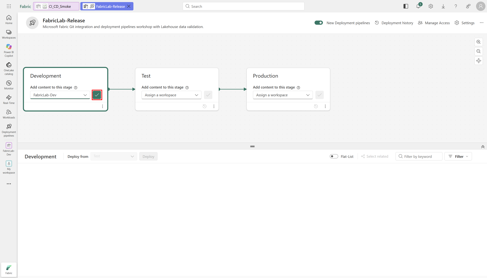

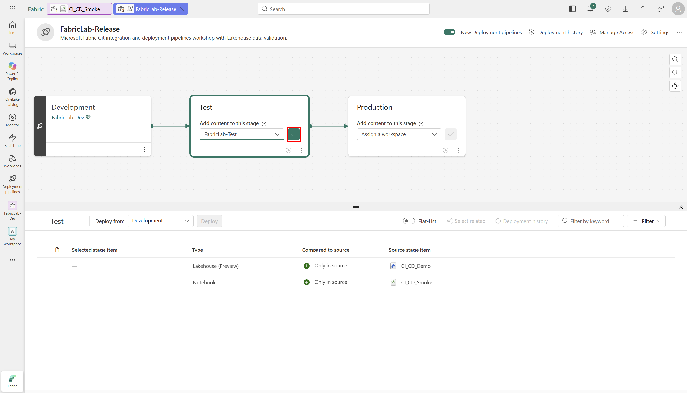

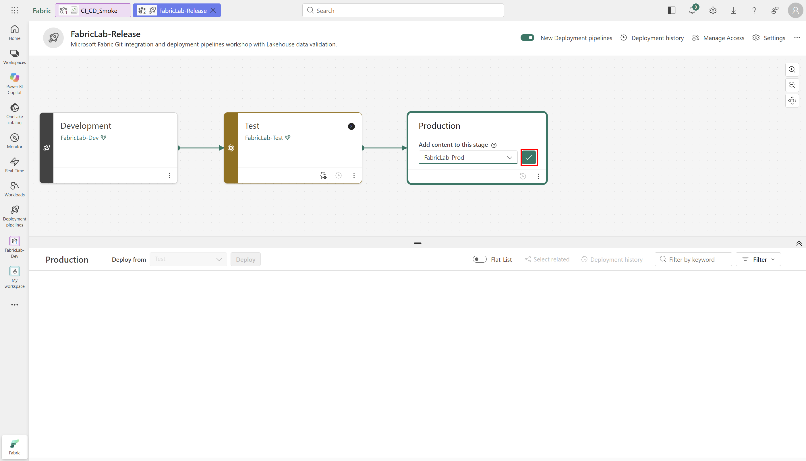

Feature Workspace는 이 Pipeline에 넣지 않습니다.

**기대 결과:** 세 카드가 정확한 Workspace를 가리킵니다. Workspace를 연결했다고
아이템 정의·테이블 데이터가 자동으로 배포되는 것은 아닙니다.

## 4-3. Dev v1 → Test v1 초기 배포

1. Dev v1의 실제 Delta 결과가 10행·합계 45인지 확인합니다.
2. **대상인 Test 카드**를 선택합니다.
3. 하단 **Deploy from = Development**를 확인합니다.
4. 목록이 가려지면 캔버스 접기 버튼으로 전체 아이템 목록을 보이게 합니다.
5. `CI_CD_Demo` Lakehouse와 `CI_CD_Smoke` Notebook **두 아이템**을 선택합니다.

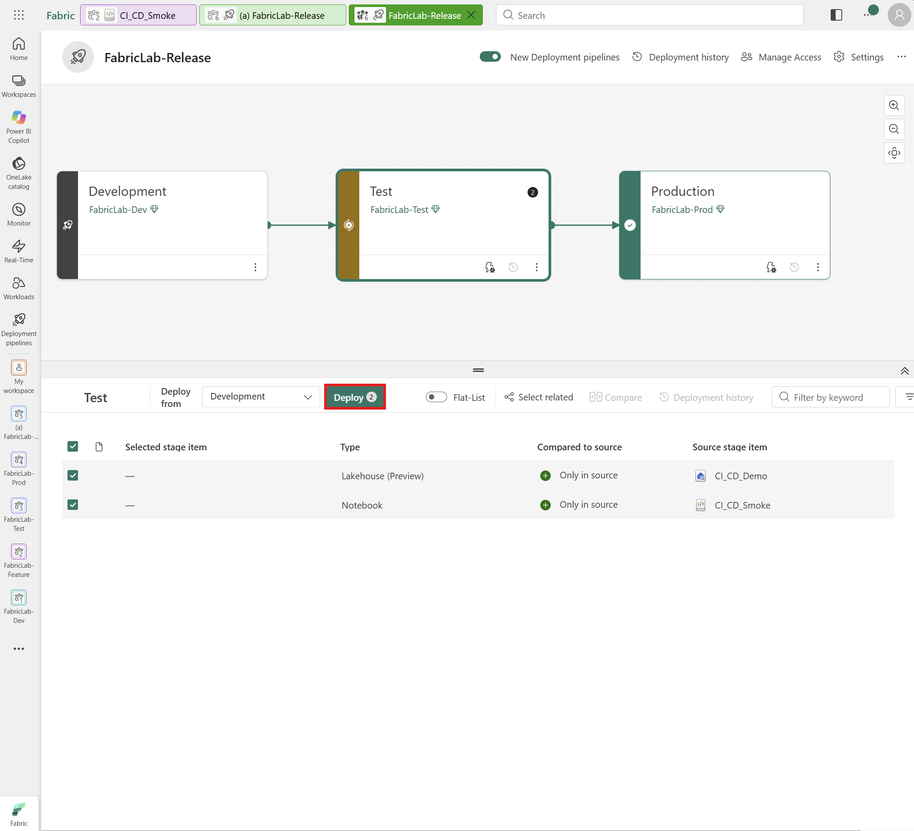

첫 배포에서 Notebook만 배포하고 Lakehouse가 생겼을 것이라고 가정하지 않습니다.
Lakehouse가 관리하는 SQL analytics endpoint를 별도 source item으로 선택하지 않습니다.

6. **Deploy**로 확인 창을 엽니다.
7. Development → Test, 두 아이템의 이름, New/Modified 범위를 확인합니다.
8. **Continue deployment in case 1 or more items fail**을 해제합니다.
9. **Add a note**에 v1, Development → Test 방향, Dev 검증 결과와 다음 Test 검증 계획을 적습니다.
   정확한 변경 이력을 남기려면 Commit SHA도 함께 기록할 수 있습니다.
10. 최종 **Deploy**를 선택하고 배포 완료를 기다립니다.

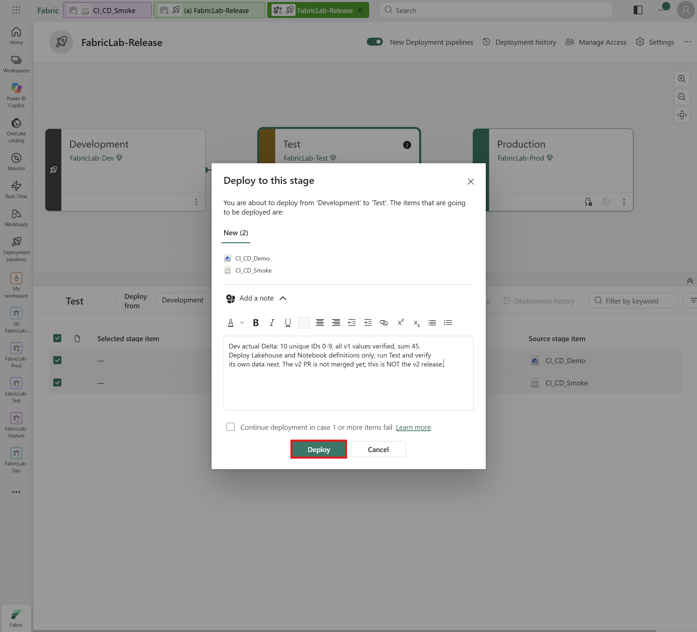

**기대 결과:** 배포가 **Succeeded**이고 두 아이템의 정의가 Test에 생성됩니다.
본인의 실제 배포 ID와 Development → Test 방향, 아이템 수, v1 note를 기록합니다.

## 4-4. 배포 직후: 정의와 바인딩, 데이터 부재 확인

1. Test Workspace에 `CI_CD_Demo`와 `CI_CD_Smoke`가 생성됐는지 확인합니다.
2. Notebook을 실행하지 말고 먼저 저장된 정의를 확인합니다.
3. 전체 코드가 v1과 같고 기본 Lakehouse의 ID와 Workspace ID가 **Test 자체**인지 대조합니다.
4. Test Lakehouse **Tables → dbo**를 펼칩니다.

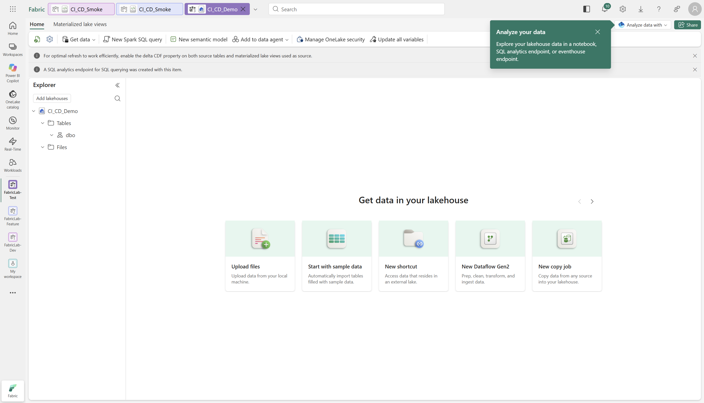

**기대 결과:** v1 코드와 Test 자체 Lakehouse 바인딩은 있지만,
새 환경의 첫 배포 직후에는 아직 `cicd_smoke` 테이블이 없습니다.
이미 테이블이 있다면 실행 이력과 내용을 확인하고 임의로 삭제하지 않습니다.

이것이 **정의 배포는 Lakehouse 데이터를 복사하지 않는다**는 점을 확인하는 체크포인트입니다.

## 4-5. Test에서 Notebook 실행·실제 데이터 검증

1. Test의 기본 Lakehouse를 다시 확인합니다.
2. 배포된 v1 Notebook을 열어 **Run all**로 실행합니다.
3. 현재 Workspace가 Test인지, 실제 Delta 경로가 Test Lakehouse인지 확인합니다.
4. 10행·고유 ID 0–9·모든 행의 `value=id`, `release=v1`·합계 45를 확인합니다.

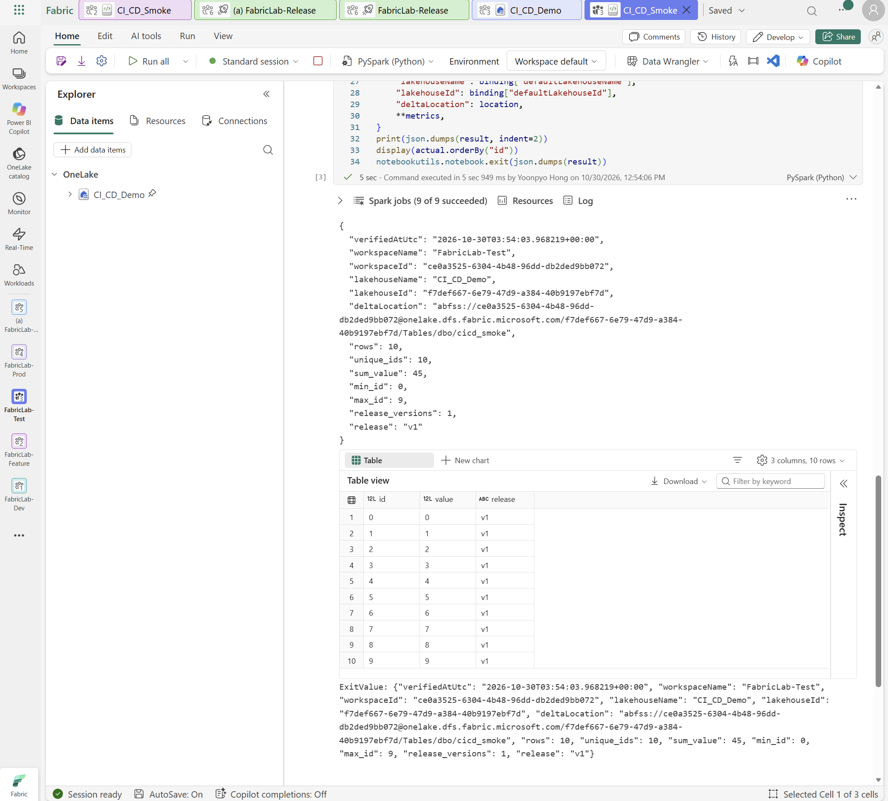

**기대 결과:** Test Notebook 실행 후 실제 Delta 테이블이 생성되고 10행·합계 45 검증이 통과합니다.
생성된 Delta commit이나 Completed 상태만으로 성공을 판단하지 않고, 셀 아래 JSON과 실제 테이블을 확인합니다.

## 4-6. 환경별 기본 Lakehouse 규칙

Git의 Feature 분기에는 [Git binding 설정](03-git-integration.md#3-2-git으로-분기할-때-lakehouse-바인딩-설정)을,
단계 간 배포에는 Pipeline의 의존성 auto-binding을 사용합니다. 두 기능을 같은 설정으로 혼동하지 않습니다.

이 절에서는 **Dev → Test 배포 시 Test Notebook이 Test 자체 Lakehouse를 사용하도록**
Test 단계에 규칙을 설정합니다. **From은 Dev, To는 Test**입니다.
Development 단계에 규칙을 만들거나 To에 Dev의 ID를 입력하지 않습니다.

**필수 권한:** 규칙을 만들 **대상 Notebook의 아이템 소유자**여야 합니다.
Workspace Admin이나 Pipeline Admin 역할만 확인하고 이 조건을 생략하지 않습니다.
Notebook의 About/Details에서 소유자를 확인하고, 소유자가 아닌 경우 실제 소유자에게
규칙 구성을 요청합니다. 소유권이나 권한을 승인 없이 자동으로 바꾸지 않습니다.
[Notebook 공식 사전 조건](https://learn.microsoft.com/en-us/fabric/data-engineering/notebook-source-control-deployment#before-you-start)과
[Deployment rules 제한사항](https://learn.microsoft.com/en-us/fabric/cicd/deployment-pipelines/create-rules#considerations-and-limitations)을
따릅니다.

**소유자 확인 경로:** 대상 Test Workspace에서 `CI_CD_Smoke`의 **More options → Settings →
About → Details**를 열고, **Owned by**의 소유자와 실습 계정을 대조합니다.
**Location이 FabricLab-Test**인지도 함께 확인합니다.

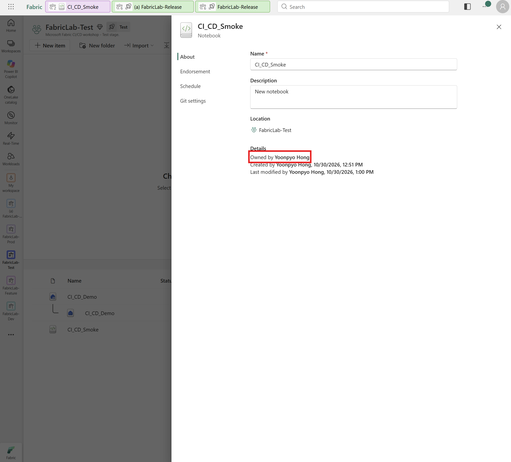

1. 첫 정의 배포로 Dev의 Lakehouse·Notebook과 Test의 대응 아이템이 연결되었는지(pairing) 확인합니다.
2. 4-5에서 실행한 **Test Notebook의 세 번째 셀 출력**을 엽니다.
   `workspaceName`이 **FabricLab-Test**, `lakehouseName`이 **CI_CD_Demo**인지 확인한 뒤,
   해당 출력의 `workspaceId`와 `lakehouseId`를 기록합니다. Dev나 Feature 실행 결과를 사용하지 않습니다.
3. **FabricLab-Release Pipeline**으로 돌아와 **Test 카드 하단의 Deployment rules 아이콘**을 선택합니다.
   번개·톱니바퀴 모양의 아이콘에 마우스를 올려 이름을 확인합니다.
   단계 카드 영역이 접혀 있다면 먼저 펼칩니다.
4. 오른쪽 아이템 목록에서 **CI_CD_Smoke**를 선택하고 **Default lakehouse → Add rule**을 엽니다.
5. **From**에서 **FabricLab-Dev의 `CI_CD_Demo`**를 선택합니다.
6. **To → Other**를 선택하고 다음과 같이 **FabricLab-Test의 정보**를 입력합니다.

    | 입력란 | 사용할 값 | 확인 위치 |
    |---|---|---|
    | **Lakehouse id** | Test Workspace 안에 생성된 `CI_CD_Demo`의 실제 ID | Test Notebook 출력의 `lakehouseId` |
    | **Lakehouse name** | `CI_CD_Demo` | Test Notebook 출력의 `lakehouseName` |
    | **Lakehouse workspace id** | `FabricLab-Test`의 Workspace ID | Test Notebook 출력의 `workspaceId` |

    Dev와 Test의 Lakehouse 이름은 같아도 ID는 다릅니다. 자동으로 표시된 값도 Test 정보인지 확인하며,
    캡처의 ID나 Git `.platform`의 logical ID를 복사하지 않습니다.
7. **From = Dev의 Lakehouse, To = Test의 Lakehouse**인지 다시 대조한 뒤 **Save**를 선택합니다.

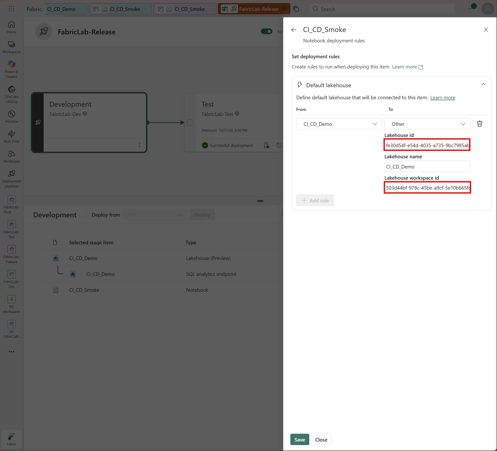

저장 후 규칙 패널을 다시 열어 **To에 Test의 Lakehouse ID·이름·Workspace ID가 저장되어 있는지** 확인합니다.

배포 규칙은 auto-binding보다 우선하며 **다음 Test 배포에 적용됩니다.**
실제 연결 대상과 데이터의 검증은 6장의 v2 배포 후 진행합니다.

**기대 결과:** Test에서 v1의 10행·합계 45를 확인했고, 다음 배포에 사용할 Test 기본 Lakehouse 규칙을 저장했습니다.
**PR은 아직 Open이며 main과 Dev는 v1입니다.**

---

## 다음으로 이동

이제 5장에서 PR을 검토·병합하고 Dev를 v2로 업데이트합니다.

| 이전 단계 | 전체 목차 | 다음 단계 |
|---|---|---|
| [← GitHub 연결·Feature v2 검증과 PR 생성](03-git-integration.md) | [실습 순서](README.md#workshop-order) | [PR 검토·병합과 Dev v2 반영 →](05-pr-merge-dev-update.md) |
