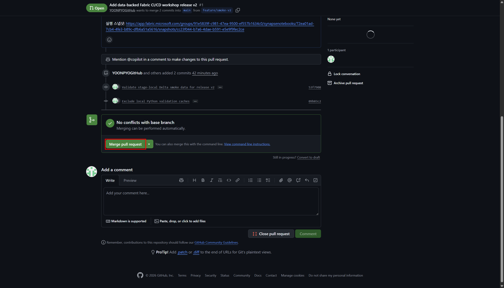
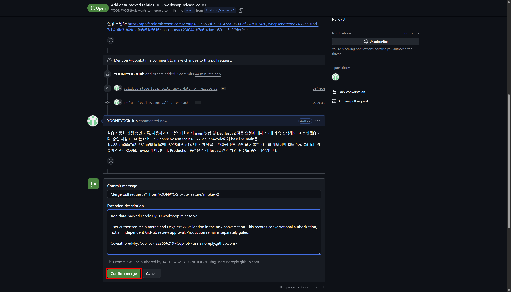
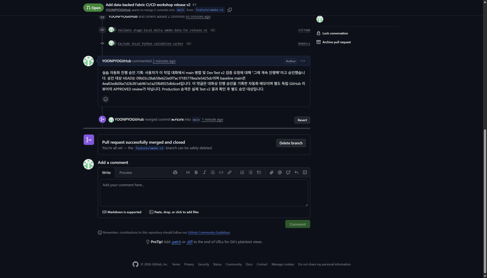
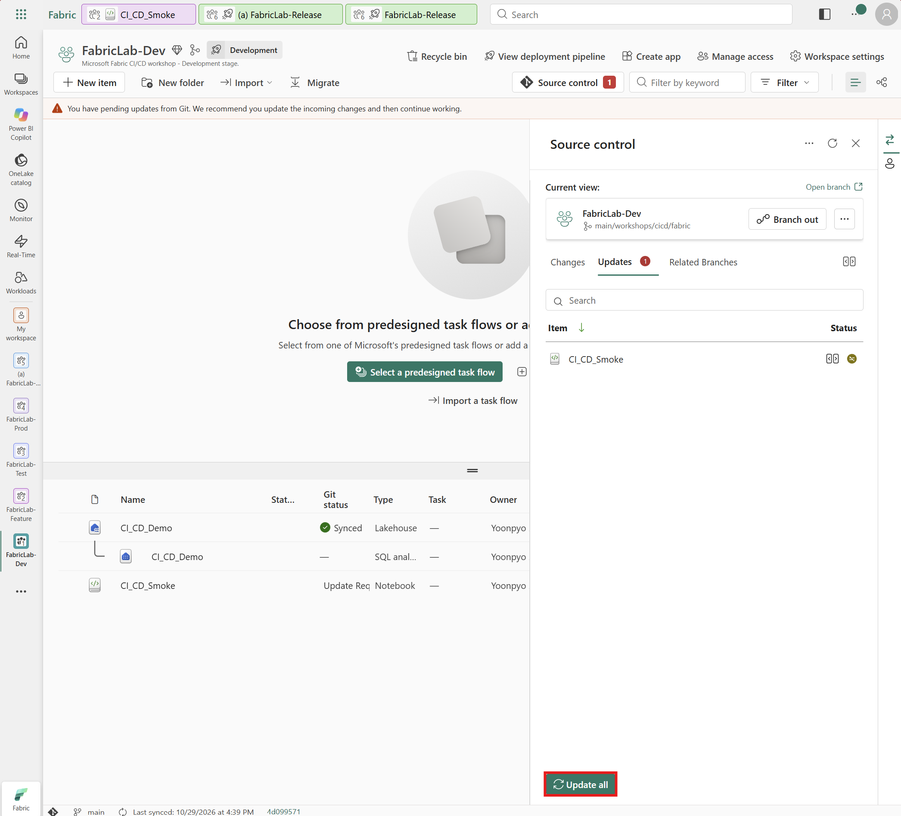
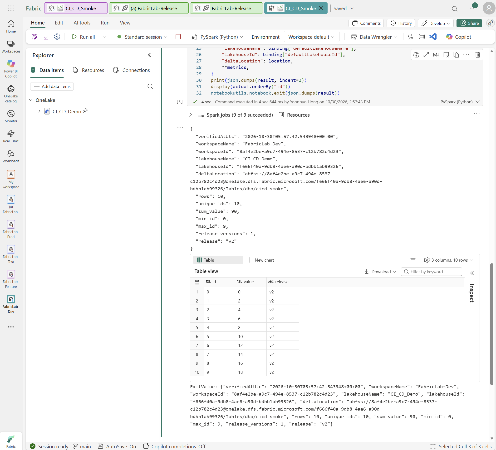

# 5. PR 검토·병합과 Dev v2 반영

[처음으로](README.md) · [이전: Test v1 초기 배포](04-deployment-pipelines.md) · [다음: Test v2와 Production](06-test-production-release.md)

**목표:** 검증한 Feature 변경을 main에 병합하고, Dev에서 v2의 실제 10행·합계 90을 확인합니다.

**시작 조건:** Test v1의 10행·합계 45를 확인했고, PR은 Open 상태입니다.
GitHub main과 Dev는 v1, Feature branch와 Feature Workspace는 v2여야 합니다.

## 5-1. PR 검토와 병합

**경로:** 본인 GitHub 실습 저장소 **Pull requests → 3장에서 만든 PR**.

1. base가 `main`, compare가 `feature/smoke-v2`인지 확인합니다.
2. **Files changed**에서 두 상수의 v1 → v2 변경과 테스트 파일, 의도하지 않은 metadata 변경 여부를
   확인합니다. PR 설명의 오프라인 테스트 9개 통과와 Feature 10행·합계 90, Test v1 합계 45 근거도 확인합니다.
3. 검토 후 Feature branch나 main에 새 Commit이 추가됐다면 PR의 변경 내용을 다시 검토합니다.
4. 검토 결과와 병합 결정을 PR 댓글 또는 조직에서 정한 승인 방식으로 남깁니다.
   혼자 하는 기본 실습은 본인이 검토할 수 있지만, 이를 독립 리뷰어 승인으로 기록하지 않습니다.
   조직에서 별도 리뷰어 승인을 요구하면 해당 승인을 받은 뒤 진행합니다. 승인이 없으면 병합하지 않습니다.
5. **Merge pull request**를 선택합니다.

6. 병합 대상과 Commit 메시지를 확인하고 **Confirm merge**를 선택합니다.

7. PR이 **Merged**인지 확인합니다. 정확한 병합 이력을 남기려면 merge Commit SHA를 기록할 수 있습니다.
   GitHub main의 Notebook 소스가 `RELEASE = "v2"`, `MULTIPLIER = 2`인지 확인합니다.
   Feature Workspace가 연결된 `feature/smoke-v2` branch는 유지합니다.

**기대 결과:** PR이 Merged이고 GitHub main은 v2입니다.
아직 Dev에서 Update하지 않았으므로 Dev와 Test는 v1입니다.

이 실습은 GitHub Actions나 필수 status check를 추가로 구성하지 않습니다.
로컬 테스트 통과와 GitHub Checks의 성공은 별개이며, 조직에 기존 병합 정책이 있다면 따릅니다.

## 5-2. Dev Update와 v2 실행

**경로:** `FabricLab-Dev → Source control → Updates`.

1. Dev의 Git 연결이 본인 실습 저장소의 `main /workshops/cicd/fabric`인지 확인합니다.
2. 병합된 Notebook 변경을 검토하고, 충돌·삭제·로컬 미커밋 변경이 없는지 확인합니다.
3. **Update all**을 선택합니다.

4. Git status가 **Synced**, 변경 목록이 0인지 확인하고,
   Dev의 Git 동기화 정보에 표시된 Commit SHA를 GitHub main의 최신 Commit과 대조합니다.
5. 저장된 Notebook 전체 코드가 병합한 v2 소스와 같고 세 코드 셀이 유지되는지 확인합니다.
   실제 기본 Lakehouse ID와 Workspace ID는 **Dev 자체의 `CI_CD_Demo`**를 가리켜야 합니다.
6. Dev Notebook을 열어 **Run all**로 실행합니다.
7. 셀 아래 결과에서 실제 Delta의 10행·고유 ID 0–9·모든 행의 `value=id*2`, `release=v2`,
   합계 90과 Dev 자체의 Delta 위치를 확인합니다.

**기대 결과:** main과 Dev가 v2이며, Dev의 실제 데이터는 10행·합계 90입니다.
Test는 아직 v1·합계 45이므로, 다음 장에서 v2로 업데이트합니다.

Feature HEAD와 merge Commit SHA는 다를 수 있습니다. Dev는 병합 후 main의 SHA와 비교합니다.

---

## 다음으로 이동

Dev v2 검증을 마쳤다면 6장에서 Test v2 배포를 진행합니다.

| 이전 단계 | 전체 목차 | 다음 단계 |
|---|---|---|
| [← Pipeline과 Test v1 초기 배포](04-deployment-pipelines.md) | [실습 순서](README.md#workshop-order) | [Test v2 배포·Production 승격 →](06-test-production-release.md) |
