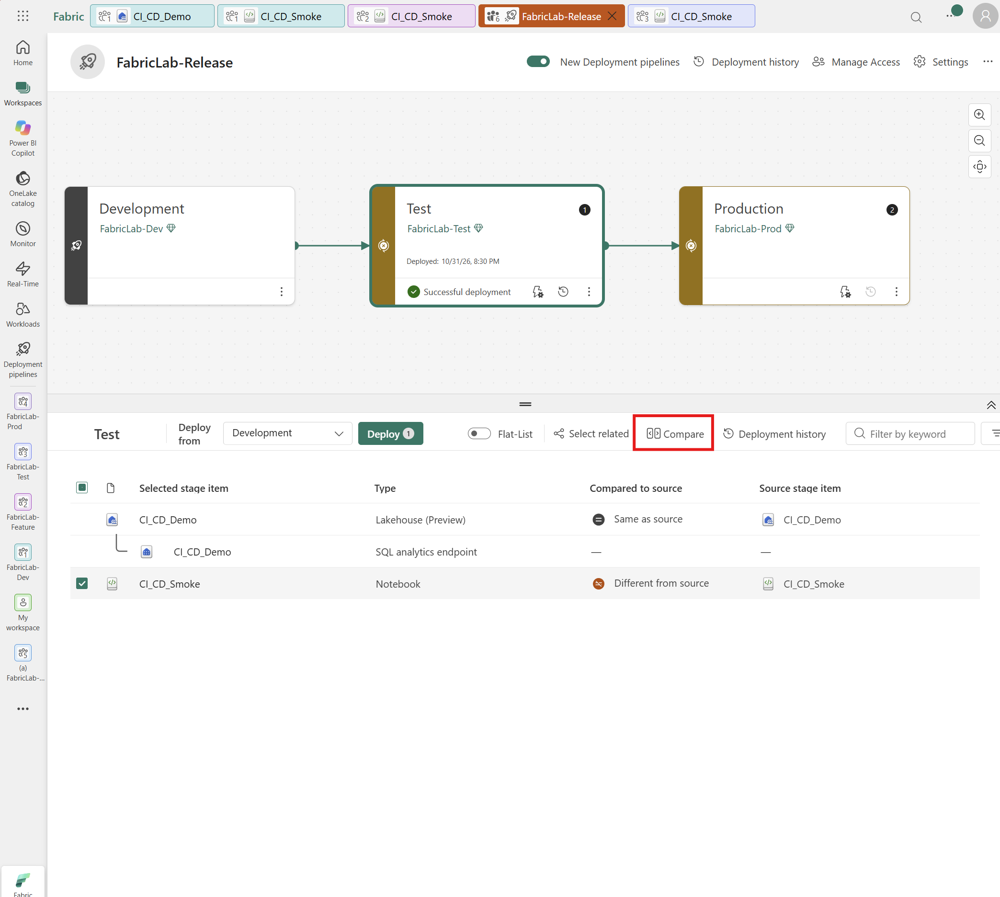
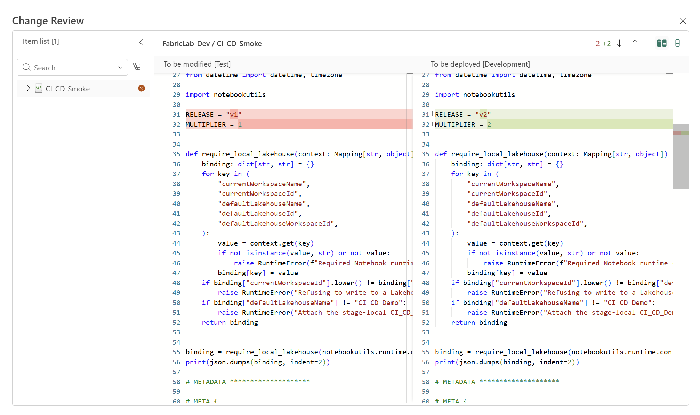
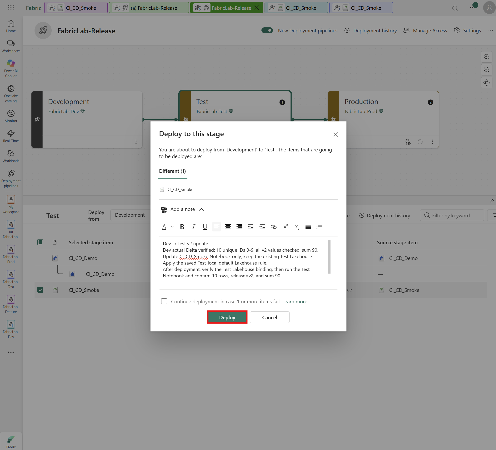
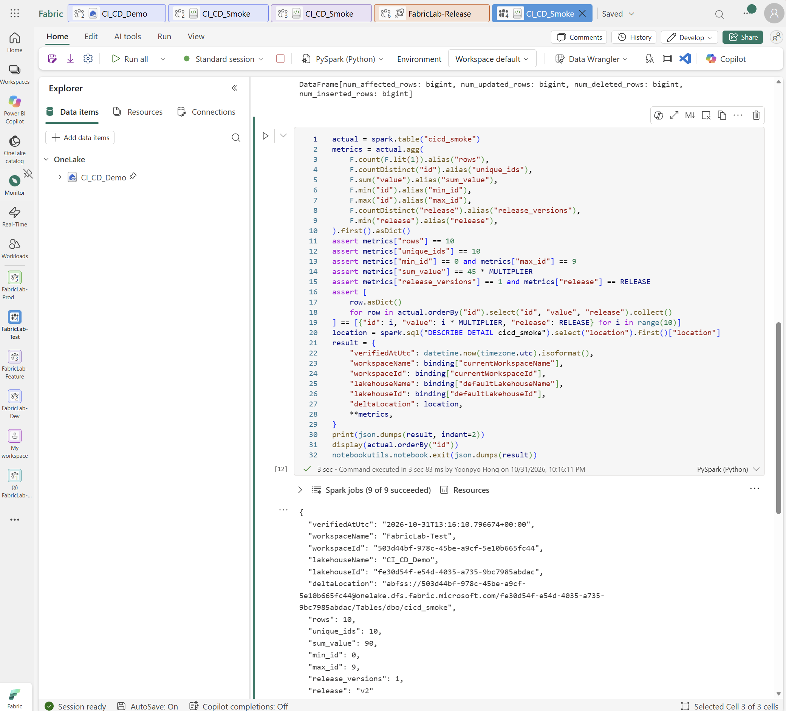
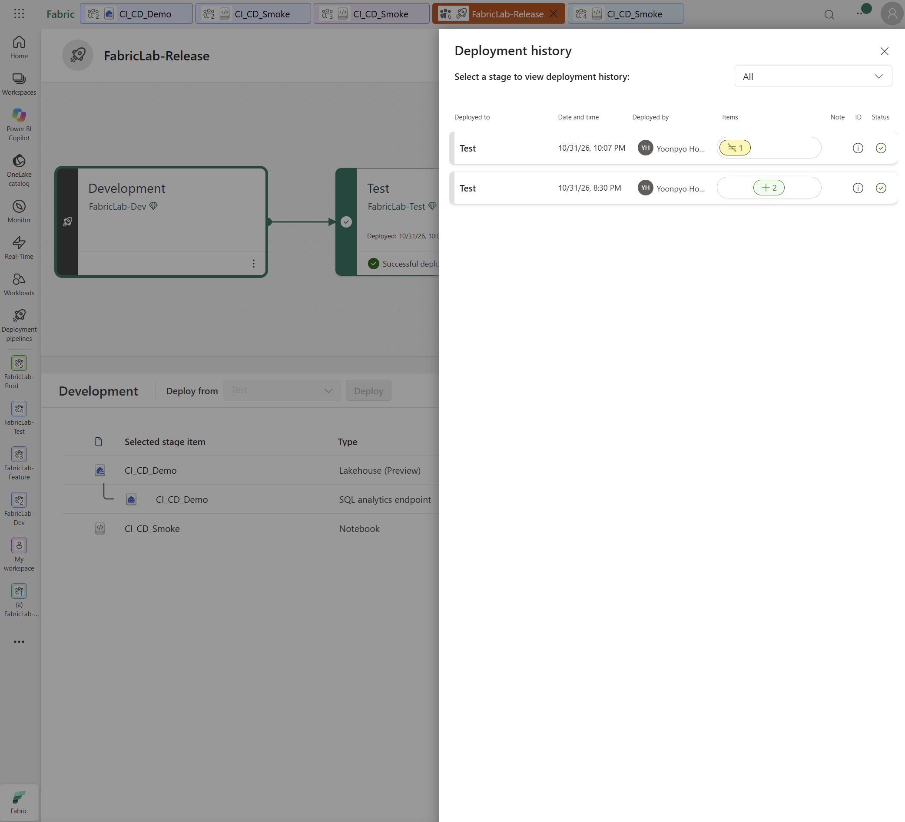
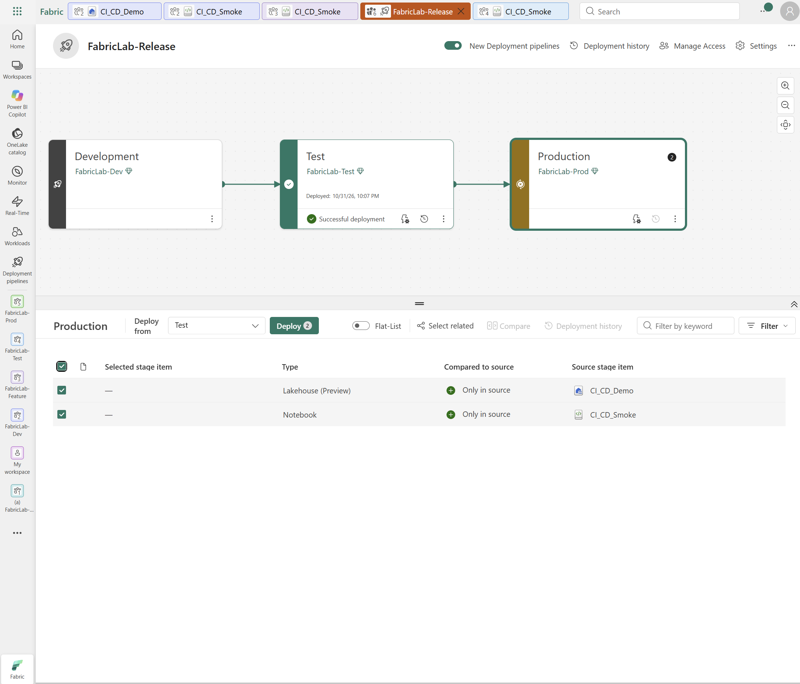
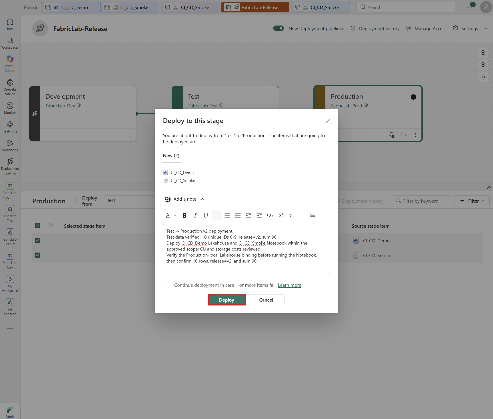
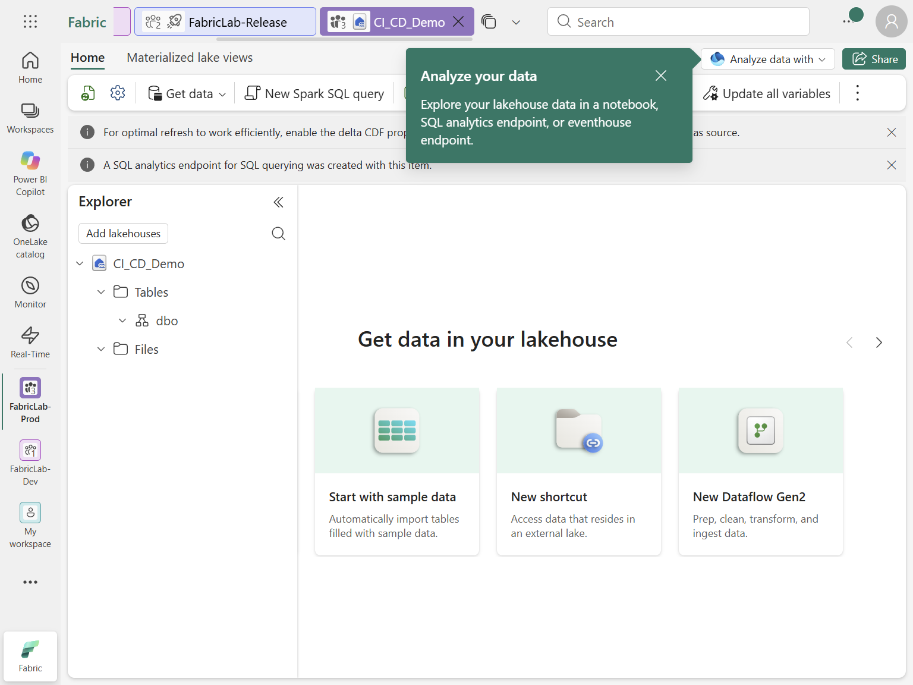
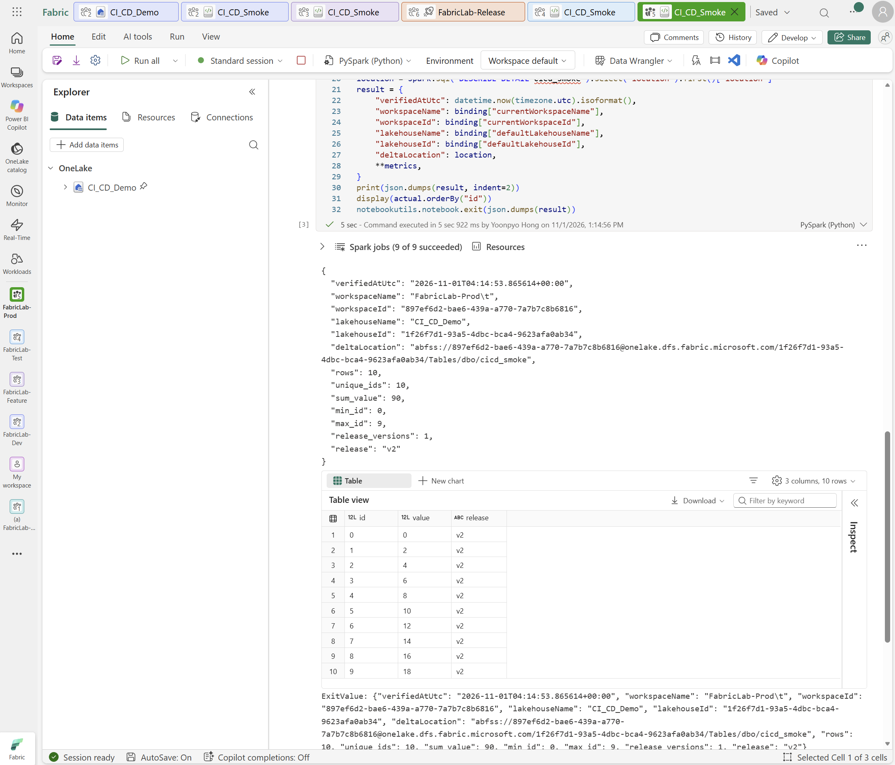
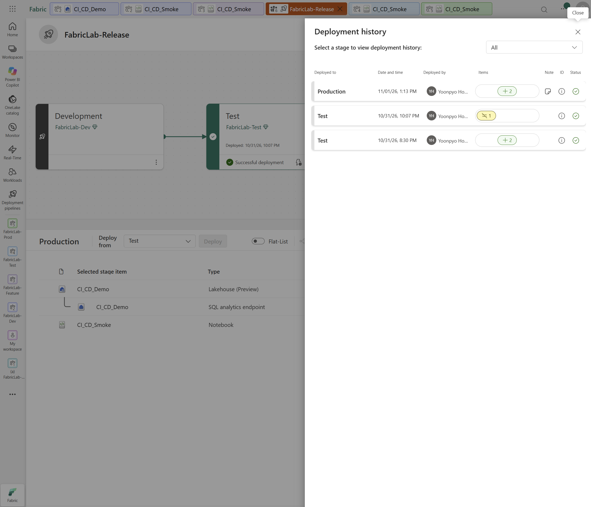

# 6. Test v2 배포와 Production 승격

[처음으로](README.md) · [이전: PR 병합과 Dev v2](05-pr-merge-dev-update.md) · [다음: 완료 확인과 정리](07-validation-and-recovery.md)

**목표:** Test를 v1에서 v2로 업데이트하고, 별도 릴리스 승인 후 Production에 배포해 실제 데이터를 검증합니다.

**시작 조건:** PR을 병합했고 Dev v2의 실제 10행·합계 90을 확인했습니다.
Test에는 4장에서 배포·검증한 v1이 있어야 합니다.

## 6-1. Dev v2 → Test v2 배포·검증

**경로:** `FabricLab-Release → Test 단계`.

Dev의 코드가 승인된 main과 같고 실제 v2 결과가 10행·합계 90인지 확인한 뒤 진행합니다.

1. **FabricLab-Release Pipeline**에서 **Test 카드**를 선택합니다.
   **Deploy from = Development**인지 확인하고 **CI_CD_Smoke Notebook만 체크**합니다.

Lakehouse는 **Same as source**, Notebook은 **Different from source**가 예상 상태입니다.
Notebook만 선택되어 버튼이 **Deploy 1**로 표시되는지 확인합니다.
Test가 비어 있거나 추가 차이가 있다면 배포 전에 원인을 확인합니다.

2. **Compare → CI_CD_Smoke**에서 `RELEASE`와 `MULTIPLIER`를 비교합니다.
   왼쪽 **Test**는 v1/1, 오른쪽 **Development**는 v2/2인지 확인하고 오른쪽 위 **X**로 창을 닫습니다.

3. Test 카드의 **Deployment rules**에서 To가 **Test 자체의 `CI_CD_Demo`**인지 확인하고 패널을 닫습니다.
4. **Deploy 1**을 눌러 확인 창을 엽니다.
   **Development → Test**, **Different (1): CI_CD_Smoke**인지 확인합니다.
5. **Continue deployment in case 1 or more items fail**을 해제하고,
   **Add a note**에 v2, Development → Test 방향과 Dev 검증 근거를 기록한 뒤 최종 **Deploy**를 선택합니다.
   완료 상태가 **Succeeded**인지 확인합니다. 예상은 새 아이템 0, 변경 Notebook 1개입니다.

6. **FabricLab-Test → CI_CD_Smoke Notebook**을 엽니다.
   전체 v2 코드·세 셀과 Test 자체 Lakehouse의 실제 ID·Workspace ID를 대조합니다.
7. **Run all**로 실행하고, 세 번째 셀 아래의 JSON과 테이블에서 실제 데이터 검증 결과를 확인합니다.

8. **FabricLab-Release Pipeline → Deployment history**에서 Test v1 초기 배포와 v2 업데이트를 구분합니다.
   배포 ID·방향·아이템 수·note와 실제 데이터 검증 결과를 함께 기록합니다.

**기대 결과:** Test 테이블의 ID 0–9인 10행이 모두 `value=id*2`, `release=v2`이며, 합계는 45에서 **90**으로 바뀝니다.
출력의 `workspaceName`은 **FabricLab-Test**, Workspace ID·Lakehouse ID·Delta 위치도 Test 환경이어야 합니다.
Git Commit이나 정의 배포만으로 데이터가 바뀌지는 않으므로, Notebook 실행 후 저장된 테이블을 검증합니다.

## 6-2. 릴리스 승인 후 Test → Production 배포

### 대상·변경·비용 확인과 승인

Test v2 검증 결과와 Production 배포·Notebook 실행에 따른 변경·비용을 확인하고,
운영 정책에 맞는 릴리스 승인을 기록합니다.
**PR 병합 승인과는 별개**이며, 승인이 없으면 Production 배포를 진행하지 않습니다.

수동 승인 기록을 남기는 실습이며, Fabric 네이티브 승인 Workflow나 독립 GitHub review를
자동으로 구성하는 단계는 아닙니다.

1. 검토한 v2 변경과 Test의 실제 검증 결과, Production 배포·실행·비용 승인 범위를 확인합니다.
2. **FabricLab-Release Pipeline**에서 **Production 카드**를 선택하고 **Deploy from = Test**인지 확인합니다.
3. 첫 배포이므로 `CI_CD_Demo` Lakehouse와 `CI_CD_Smoke` Notebook **두 아이템**을 선택합니다.

4. **Deploy 2**를 눌러 확인 창을 엽니다.
   **Test → Production**, **New (2): CI_CD_Demo·CI_CD_Smoke**인지 확인합니다.
5. **Continue deployment in case 1 or more items fail**을 해제하고,
   **Add a note**에 승인 범위·시각, Test 검증 결과, 비용 확인과 Production 연결 확인 후 실행할 계획을 적습니다.
6. 확인 창 아래의 최종 **Deploy**를 선택하고 배포 완료를 기다립니다.

7. 배포가 **Succeeded**인지 확인하고 실제 배포 ID와 Test → Production 방향, 새 정의 2개를 기록합니다.

### 실행 전 Production 바인딩과 데이터 확인

8. **FabricLab-Prod → CI_CD_Smoke Notebook**을 엽니다.
   전체 코드가 승인한 v2 소스와 같고 세 셀이 유지되는지, 실제 기본 Lakehouse ID·Workspace ID가
   **Production 자체의 `CI_CD_Demo`**를 가리키는지 확인합니다.
9. Production Lakehouse의 **Tables → dbo**를 펼쳐, 첫 실행 전 `cicd_smoke` 테이블이 없는지 확인합니다.
   이미 있다면 실행 이력과 내용을 확인하고 임의로 삭제하지 않습니다.

auto-binding으로 Production 자체 Lakehouse에 연결되었다면 별도 규칙은 필요하지 않습니다.
다른 환경을 가리키면 실행하지 말고 Production의 규칙·바인딩을 확인합니다. Test 규칙은 Production에 적용되지 않습니다.

### Production 실행과 데이터 검증

10. 연결 확인을 마친 **Production Notebook**에서 **Run all**을 선택합니다.
    쓰기 전 guard가 실패하면 원인을 해결하기 전 다음 셀을 실행하지 않습니다.
11. 세 번째 셀 아래의 JSON과 테이블에서 **10행·고유 ID 0–9·`value=id*2`·`release=v2`·합계 90**을 확인합니다.
    출력의 Workspace ID·Lakehouse ID·Delta 위치도 Production 정보와 대조합니다.

12. **FabricLab-Release Pipeline → Deployment history**에서 Test → Production 배포 이력을 확인하고,
    실행·데이터 검증 결과와 함께 기록합니다.
    Dev·Feature·Test·Production 네 Notebook의 공통 v2 코드와 환경별 물리 Lakehouse·Workspace ID도 대조합니다.
    Dev·Feature·Test 결과만으로 Production 검증을 대신하지 않습니다.

**기대 결과:** 별도 승인 범위 안에서 Production 배포와 실행을 마치고,
Test·Production 각각의 Lakehouse에서 v2의 실제 10행·합계 90을 확인합니다.

정확한 변경 이력을 남기려면 배포 note에 merge Commit SHA도 기록할 수 있습니다.
배포는 원본 Workspace의 현재 정의를 전달하므로, SHA 기록만으로 코드·바인딩·데이터 검증을 대신하지 않습니다.

캡처는 결과 예시이며, 본인의 실행 결과로 검증합니다.

---

## 다음으로 이동

| 이전 단계 | 전체 목차 | 다음 단계 |
|---|---|---|
| [← PR 검토·병합과 Dev v2 반영](05-pr-merge-dev-update.md) | [실습 순서](README.md#workshop-order) | [실습 완료 확인과 정리 →](07-validation-and-recovery.md) |
