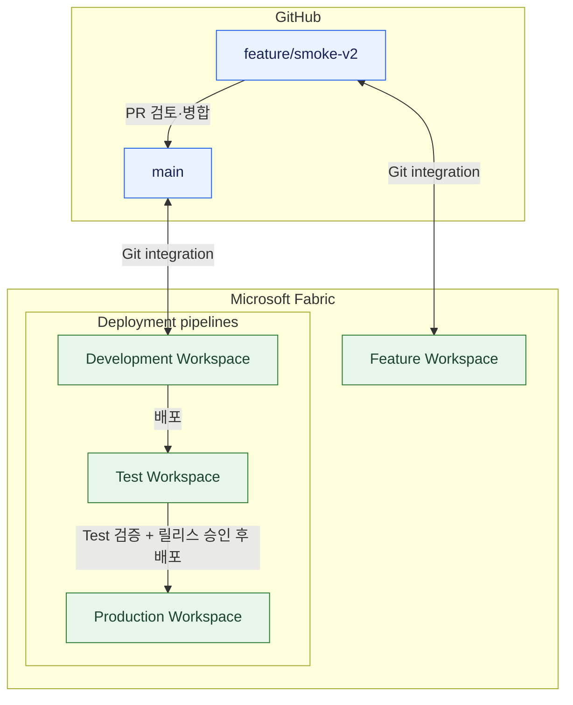
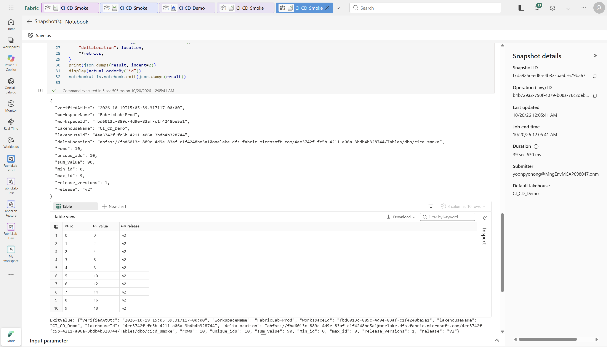
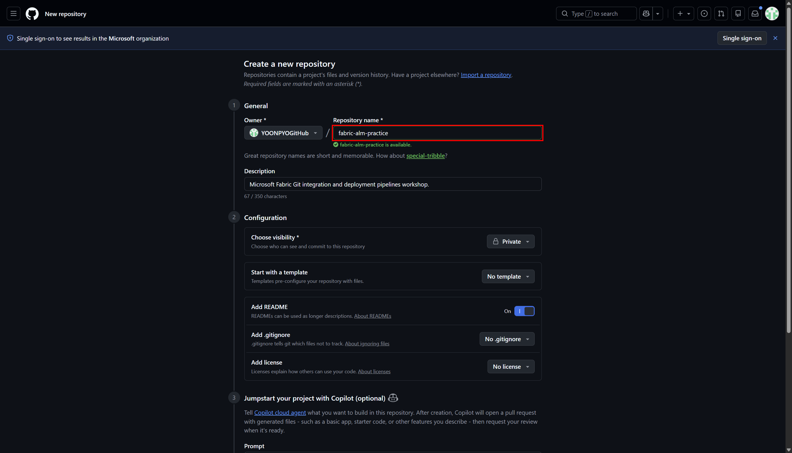
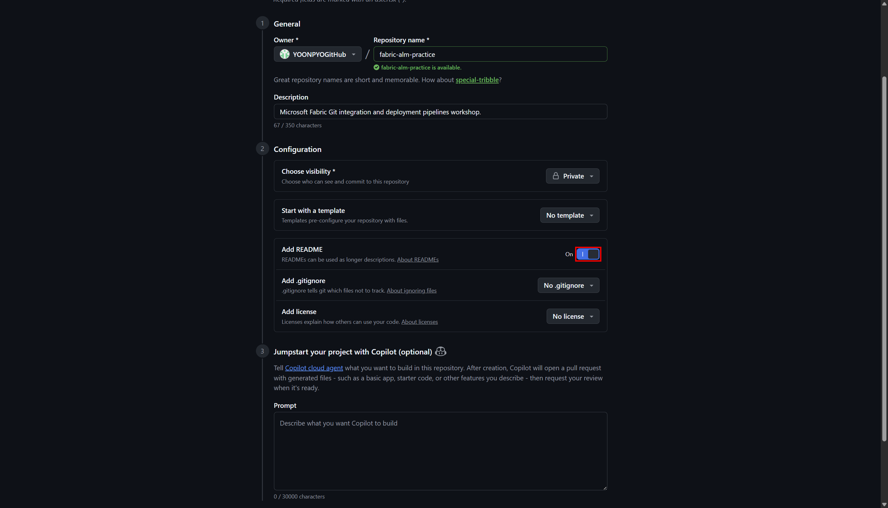
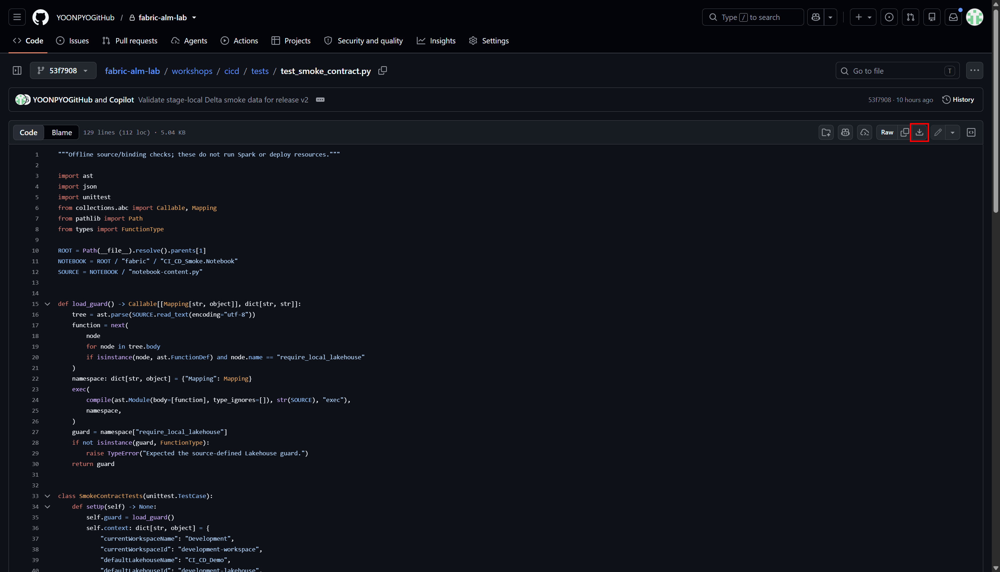

# Microsoft Fabric Git integration and deployment pipelines

**Lakehouse + Notebook + 실제 Delta 데이터**로 GitHub 버전 관리와 환경별 배포를 익히는 수동 실습입니다.
설명·캡처·[v1 Notebook 코드와 실습용 테스트](examples/README.md)를 이 저장소에서 제공합니다.

## 1. 무엇을 배우는가

### [Git integration](https://learn.microsoft.com/en-us/fabric/cicd/git-integration/git-integration-process) — GitHub branch ↔ Workspace

Workspace의 Lakehouse·Notebook 등 아이템 정의를 GitHub branch와 동기화하는 기능입니다.
Fabric Source control의 **Commit**으로 Workspace 변경을 GitHub에 기록하고,
**Update**로 GitHub의 변경을 Workspace에 반영합니다. Branch와 PR을 통해 변경 이력을 관리하고 검토합니다.

### [Deployment pipelines](https://learn.microsoft.com/en-us/fabric/cicd/deployment-pipelines/get-started-with-deployment-pipelines) — Development → Test → Production

환경별 Workspace를 Pipeline 단계에 할당하고, 아이템 정의를 다음 환경으로 배포하는 기능입니다.
이 실습에서는 Development의 변경을 Test에 배포·검증한 뒤, 별도 릴리스 승인을 거쳐 Production으로 배포합니다.
**GitHub의 PR 병합과 Workspace 간 배포는 별개의 작업**입니다.

**Git과 Deployment pipeline이 전달하는 것은 아이템 정의입니다.**
Lakehouse의 Delta 테이블 행은 Git에 저장되거나 단계 배포로 복사되지 않습니다.
각 Workspace의 Notebook을 실행해 그 환경의 데이터를 만들고 검증합니다.

## 2. 전체 구성과 Workspace 역할

| Workspace | 역할 | 연결 |
|---|---|---|
| Development (`FabricLab-Dev`) | 개발 기준 환경 | GitHub `main`, Pipeline의 Development 단계 |
| Feature (`FabricLab-Feature`) | 변경 개발·검증 | GitHub `feature/smoke-v2`; Pipeline에는 포함하지 않음 |
| Test (`FabricLab-Test`) | 배포 후 검증 | Pipeline의 Test 단계 |
| Production (`FabricLab-Prod`) | 승인된 변경의 최종 배포·검증 | Pipeline의 Production 단계 |



실습 구성: Pipeline `FabricLab-Release`, Lakehouse `CI_CD_Demo`, Notebook `CI_CD_Smoke`,
테이블 `dbo.cicd_smoke`, Git directory `/workshops/cicd/fabric`.

<a id="workshop-order"></a>

## 3. 실습 순서

| 순서 | 문서 | 완료 기준 |
|---|---|---|
| 1 | [사전 준비와 필수 설정](01-prerequisites.md) | 계정·Capacity·권한·관리자 설정·GitHub 인증 |
| 2 | [Lakehouse와 Notebook v1](02-lakehouse-notebook.md) | Dev v1: 10행·고유 ID 0–9·합계 45 |
| 3 | [GitHub 연결·Feature v2 검증과 PR 생성](03-git-integration.md) | Feature v2: 합계 90, PR Open; main·Dev는 v1 |
| 4 | [Pipeline 구성과 Test v1 초기 배포](04-deployment-pipelines.md) | Test v1: 10행·합계 45 |
| 5 | [PR 검토·병합과 Dev v2 반영](05-pr-merge-dev-update.md) | PR Merged, Dev v2: 10행·합계 90 |
| 6 | [Test v2 배포와 Production 승격](06-test-production-release.md) | Test v2 검증 → 별도 승인 → Production v2: 10행·합계 90 |
| 7 | [실습 완료 확인과 정리](07-validation-and-recovery.md) | 결과 확인·보관, 리소스·비용 정리 |

## 4. 시작 전에 알아둘 사항

- 이 저장소 `fabric-alm-guide`는 가이드·예제용입니다. Fabric에는 **본인 계정의 새 실습 저장소 `fabric-alm-lab`**를 연결합니다. 다른 새 저장소 이름도 일관되게 사용하면 됩니다.
- 파일은 각 장에서 안내할 때 준비합니다. 캡처의 계정·이름·환경 ID·Commit SHA는 예시이며 본인의 값과 실제 실행 결과로 확인합니다.
- 기존 환경은 상태를 확인한 뒤 재사용합니다. 이미 main·Dev가 v2라면 v1 출발점과 다르므로 확인 없이 진행하거나 임의로 되돌리지 않습니다.
- 승인된 Capacity와 기능 지원을 확인합니다. Spark는 CU를, Delta 데이터는 저장소를 사용합니다.
- **PR 병합 승인과 Production 릴리스 승인은 별개**입니다. 수동 승인은 자동 승인 통제나 독립 GitHub 리뷰를 구성하는 것이 아닙니다.
- 메뉴는 영문 UI, 로컬 명령은 Linux/WSL의 Bash와 `python3` 기준입니다. GitHub Actions/OIDC 자동화·Power BI 모델·보고서·RLS는 이 실습 범위가 아닙니다.

## 5. 참고 자료

### 공식 근거

- [GitHub Git integration 시작](https://learn.microsoft.com/en-us/fabric/cicd/git-integration/git-get-started?tabs=github%2CGitHub%2Ccommit-to-git)
- [Git integration 권한](https://learn.microsoft.com/en-us/fabric/cicd/git-integration/git-integration-process#permissions)
- [Deployment pipelines 시작 — new UI](https://learn.microsoft.com/en-us/fabric/cicd/deployment-pipelines/get-started-with-deployment-pipelines?tabs=from-fabric%2Cnew-ui)
- [Deployment pipelines 권한](https://learn.microsoft.com/en-us/fabric/cicd/deployment-pipelines/understand-the-deployment-process#permissions)
- [Notebook 소스 제어·auto-binding·배포 규칙](https://learn.microsoft.com/en-us/fabric/data-engineering/notebook-source-control-deployment)
- [Lakehouse 소스 제어·배포](https://learn.microsoft.com/en-us/fabric/data-engineering/lakehouse-git-deployment-pipelines)
- [Git integration 관리자 설정](https://learn.microsoft.com/en-us/fabric/admin/git-integration-admin-settings)

<details>
<summary>운영 적용 시 권한과 역할 분리</summary>

### 권한 구분과 운영 시 역할 분리

실습은 한 계정으로 진행합니다. 아래는 운영 참고이며 추가 계정 생성·Admin 권한 변경 단계가 아닙니다.
Tenant settings는 Fabric Administrator 또는 해당 설정을 위임받은 관리자가 변경합니다.

| 담당 / 작업 | 필요한 권한과 범위 |
|---|---|
| 환경 구성 | Git 연결: 해당 Workspace Admin / Pipeline 단계 할당: 해당 Workspace Admin + Pipeline Admin |
| 개발·Git Commit·Update | Dev·Feature Contributor 이상, 아이템 쓰기 권한, 작업에 맞는 GitHub 권한·인증 |
| 배포 | Pipeline Admin + 원본·대상 Workspace Contributor 이상 |
| Notebook 배포 규칙 | Pipeline Admin + 대상 Workspace Contributor 이상 + 대상 Notebook 소유자 |
| PR 검토·릴리스 승인 | 검토에 필요한 조회 권한·조직의 승인 자격. 독립 리뷰에는 PR 작성자와 별도인 적격 리뷰어 |

Workspace Admin, Pipeline Admin, 아이템 소유자, GitHub 권한은 서로 대체되지 않습니다.
Git 작업에는 소유자 제한·외부 의존성 권한 등 추가 조건이 적용될 수 있습니다.
운영에서는 필요한 환경만 허용하고 각자의 인증을 사용하며 관리자 PAT를 공유하지 않습니다.
이 권한 조합은 직접 아이템 수정이나 main Push를 막지 않습니다. 독립 리뷰 강제에는
GitHub branch protection/ruleset과 실제 리뷰어가 필요하며, 정책상 Commit 추적이 필요하면 승인·배포 기록에 SHA를 남깁니다.

</details>

<details>
<summary>가이드 유지보수·검증 기록·보관 캡처</summary>

<a id="7-캡처-재생성과-오프라인-검사"></a>

### 가이드 오프라인 검사

가이드 저장소 루트에서 Python 3.12 이상으로 실행합니다. 추가 패키지·Azure/Fabric 인증 없이 문서 링크·이미지 목록·실습 코드의 v1/v2와 오류 조건을 검사하며, Spark 실행이나 배포는 하지 않습니다.

```bash
python3 -m unittest discover -s tests -v
```

Windows PowerShell에서는 `py -3 -m unittest discover -s tests -v`로 실행합니다.
독자의 실습 저장소에서 실행할 9개 검사는 [Git 장의 테스트 준비](03-git-integration.md#prepare-smoke-tests)에 있습니다.

문서에 표시되는 최종 이미지는 [screenshots/](screenshots/)에서 직접 관리합니다.
경로는 장별 등장 순서이며 빨간 박스는 핵심 한 곳, 필요한 경우 최대 두 곳입니다. 실제 UI·값을 합성하거나 토큰·암호·MFA 화면을 캡처하지 않습니다.

[과거 검증 기록](evidence/workshop-verification.json)과 아래 캡처는 보관 자료이며 현재 실습의 결과·입력값을 대신하지 않습니다.
기록의 Private 저장소·Fabric 링크에는 별도 접근 권한이 필요합니다.






</details>

---

## 다음으로 이동

| 실습 시작 | 전체 목차 | 예제 자료 |
|---|---|---|
| [1단계: 사전 준비와 필수 설정 →](01-prerequisites.md) | [실습 순서로 이동](#workshop-order) | [실습용 코드와 테스트](examples/README.md) |
